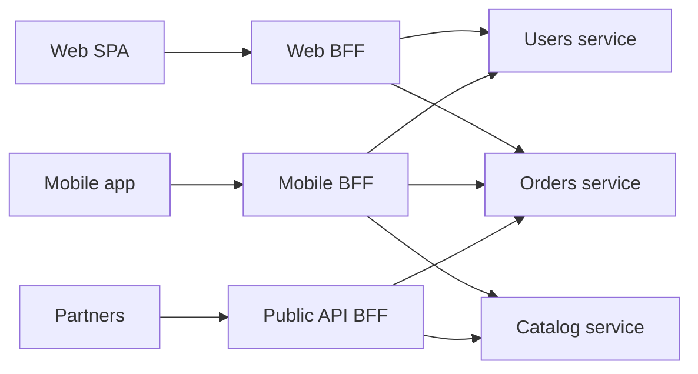

# BFF — Backend for Frontend

> [!summary] TL;DR
> BFF — это отдельный серверный слой под каждый тип клиента (web, mobile, партнёрский API). Он собирает данные из внутренних сервисов и отдаёт клиенту ровно то, что нужно, в удобной форме. **Один пользовательский опыт — один BFF.**

## Проблема

Есть микросервисы и несколько разных клиентов. Единый универсальный API начинает разваливаться:

- Мобильному приложению нужно мало полей и мало запросов (трафик, батарея, плохая сеть), вебу — богатые данные.
- Чтобы нарисовать один экран, клиент делает 5–8 запросов к разным сервисам и сам склеивает ответы (chattiness).
- Каждая команда клиента просит «добавь поле», и общий API превращается в компромисс, который неудобен всем.
- Внутренности (границы сервисов, форматы, схемы авторизации) утекают в клиент.

## Идея

Вместо одного API «для всех» — по одному бэкенду на каждый клиент. Его **владелец — команда, которая делает сам клиент**. Это важно: команда меняет и фронт, и его BFF, не согласуя каждую правку с чужим API.



## Что делает BFF

- **Агрегация** — один запрос клиента превращается в несколько внутренних вызовов (параллельно), ответ собирается в один.
- **Адаптация** — переименование полей, плоская структура вместо вложенной, усечение лишнего, форматы под конкретный экран.
- **Сессия и аутентификация** — проверка пользователя, обмен токенов, передача контекста во внутренние сервисы.
- **Устойчивость** — таймауты, ретраи, fallback при частичном отказе («рекомендации не загрузились — покажем остальное»).
- **Кэш и лимиты** — под профиль нагрузки конкретного клиента.

> [!warning] Чего BFF делать не должен
> Бизнес-логику домена (расчёт цены, правила скидок, статусы заказа). Она живёт в сервисах. BFF — это «клей» и адаптер, а не ещё один монолит.

## Пример

Эндпоинт главного экрана мобильного BFF (TypeScript, Express):

```ts
app.get("/api/home", async (req, res) => {
  const userId = req.session.userId;

  const [user, orders, recs] = await Promise.allSettled([
    usersApi.get(userId),
    ordersApi.latest(userId, { limit: 3 }),
    recsApi.forUser(userId, { limit: 5 }),
  ]);

  res.json({
    user: user.status === "fulfilled"
      ? { name: user.value.name, avatar: user.value.avatarUrl }
      : null,
    orders: orders.status === "fulfilled"
      ? orders.value.map(o => ({ id: o.id, title: o.title, status: o.status }))
      : [],
    // рекомендации — необязательный блок: при ошибке просто пустой список
    recommendations: recs.status === "fulfilled" ? recs.value : [],
  });
});
```

Один запрос вместо трёх, ответ уже в форме экрана, а падение рекомендаций не ломает страницу. Web BFF для того же экрана может отдавать больше полей и ещё пару блоков.

## BFF для безопасности SPA

Отдельный современный сценарий: **токены не должны жить в браузере**. Схема:

1. Браузер ходит только к BFF и держит сессию через `HttpOnly` + `Secure` + `SameSite` cookie.
2. BFF сам проходит OAuth 2.0 / OIDC, хранит access и refresh токены на сервере.
3. К внутренним API BFF ходит уже с токеном.

XSS не сможет украсть токен, потому что в JS его просто нет. Эту архитектуру рекомендует черновик IETF *OAuth 2.0 for Browser-Based Applications* как наиболее безопасную для SPA.

## BFF и API Gateway

| | API Gateway | BFF |
|---|---|---|
| Для кого | Все клиенты сразу | Один тип клиента |
| Задачи | Маршрутизация, rate limit, TLS, общая аутентификация | Агрегация, адаптация под экран |
| Кто владеет | Платформенная команда | Команда клиента |
| Знает о UI | Нет | Да |

Они не конкурируют: типичная схема — `Клиент → Gateway → BFF → сервисы`. Иногда BFF — это просто «умный» gateway для одного клиента.

## Когда использовать

- Несколько разных клиентов с разными потребностями (web, iOS, Android, партнёры).
- Экраны требуют данных из многих сервисов.
- Команды клиентов тормозят из-за зависимости от общего API.
- Нужна безопасная схема для SPA (токены на сервере).

## Когда не стоит

- Один клиент и простой бэкенд — BFF станет лишним слоем.
- Клиенты почти идентичны: проще один API (или [[GraphQL]], который даёт клиенту самому выбирать поля).
- Нет команды, готовой владеть и эксплуатировать ещё один сервис.

## Подводные камни

- **Дублирование кода** между BFF. Общие куски выносить аккуратно: общая библиотека легко превращается в связность и ломает независимость команд.
- **Дрейф бизнес-логики в BFF** — самый частый антипаттерн. Если появилось «правило», его место в сервисе.
- **Лишний хоп** — прибавляется латентность. Лечится параллельными вызовами и кэшем.
- **Операционные расходы** — каждый BFF это сервис: деплой, мониторинг, алерты.
- **Размножение** — не делайте BFF «на каждую страницу». Граница — тип клиента или целостный пользовательский опыт.
## Источники

- Sam Newman — [Pattern: Backend for Frontends](https://samnewman.io/patterns/architectural/bff/)
- Phil Calçado — [The Back-end for Front-end Pattern (BFF)](https://philcalcado.com/2015/09/18/the_back_end_for_front_end_pattern_bff.html) (опыт SoundCloud)
- IETF — OAuth 2.0 for Browser-Based Applications
