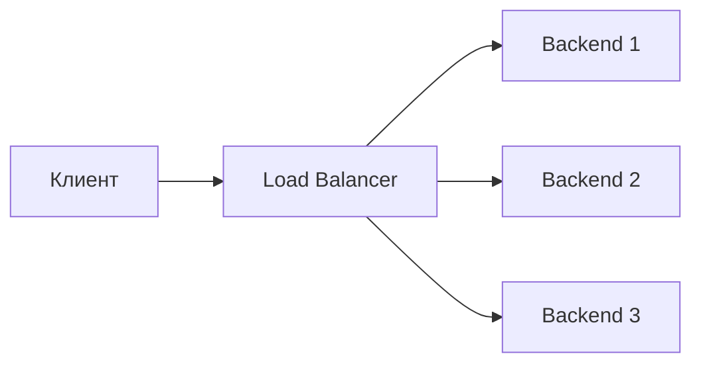
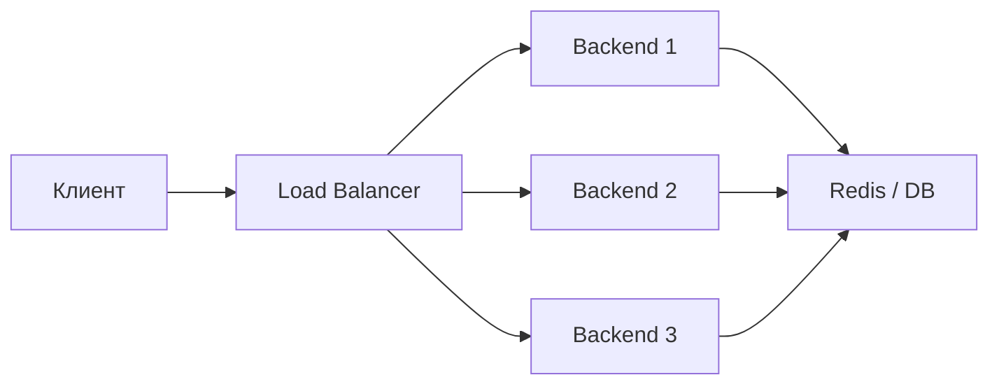
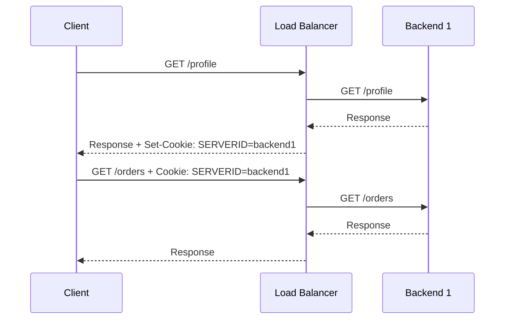

**Sticky session** — это механизм, при котором балансировщик нагрузки старается отправлять повторные запросы одного и того же клиента на один и тот же backend-сервер.

Другие названия:

- **session affinity**;
- **session persistence**;
- **sticky cookie**;
- **affinity routing**.

Простая идея:

```text
Пользователь A → Load Balancer → Backend 1
Пользователь A → Load Balancer → Backend 1
Пользователь A → Load Balancer → Backend 1
```

А не так:

```text
Пользователь A → Load Balancer → Backend 1
Пользователь A → Load Balancer → Backend 2
Пользователь A → Load Balancer → Backend 3
```

Sticky sessions нужны, когда приложение хранит состояние пользователя **локально на конкретном сервере**.

---

# 1. Проблема без sticky sessions

Представим, что есть 3 backend-сервера:



Клиент авторизовался, а его сессия сохранилась только на `Backend 1`.

```text
Backend 1:
session_id=abc123 → user_id=42

Backend 2:
нет такой сессии

Backend 3:
нет такой сессии
```

Если следующий запрос попадёт на `Backend 2`, приложение может не найти сессию.

Результат:

- пользователя может разлогинить;
- корзина может пропасть;
- состояние формы может потеряться;

Sticky session решает это так:

```text
если пользователь уже попал на Backend 1,
следующие запросы этого пользователя тоже отправлять на Backend 1
```

---

# 2. Stateful и stateless приложения

## Stateful-приложение

**Stateful** означает, что сервер хранит состояние клиента у себя.

Например:

```text
Backend 1 хранит:
session_id → user_data
```

Проблема: если клиент попадёт на другой backend, этот другой backend может не знать о его сессии.

### Sticky sessions часто нужны именно для stateful-приложений.

## Stateless-приложение

**Stateless** означает, что сервер не хранит состояние конкретного клиента локально.

Примеры:

- JWT-токен хранится у клиента;
- сессии лежат в Redis;
- состояние хранится в базе данных;
- любой backend может обработать любой запрос.

### В stateless-архитектуре sticky sessions обычно не нужны.


---

# 4. Как работает sticky session

| Способ                 | Идея                                                                 |
| ---------------------- | -------------------------------------------------------------------- |
| Cookie-based affinity  | балансировщик ставит cookie и по ней узнаёт клиента                  |
| IP-based affinity      | клиент определяется по IP-адресу                                     |
| Header-based affinity  | клиент определяется по HTTP-заголовку                                |
| URL/path-based routing | маршрутизация по пути, но это не классическая sticky session         |
| Consistent hashing     | backend выбирается через хеш от IP, cookie, header или другого ключа |

---

# 5. Cookie-based sticky session

Это самый популярный и обычно самый нормальный вариант для HTTP.

## Как работает

1. Клиент делает первый запрос.
2. Load Balancer выбирает backend.
3. Load Balancer добавляет клиенту cookie.
4. В следующих запросах клиент отправляет эту cookie.
5. Load Balancer по cookie понимает, на какой backend отправлять клиента.



## Пример cookie

```http
Set-Cookie: SERVERID=backend1; Path=/; HttpOnly; Secure; SameSite=Lax
```

В следующих запросах клиент отправляет:

```http
Cookie: SERVERID=backend1
```

## Плюсы

- точнее, чем IP-based;
- хорошо работает за NAT;
- подходит для браузерных приложений;
- можно контролировать время жизни affinity;
- можно сделать cookie безопасной.

## Минусы

- работает только там, где клиент поддерживает cookie;
- нужно аккуратно настраивать безопасность cookie;
- при падении backend-сервера cookie может указывать на недоступный backend;
- может мешать равномерному распределению нагрузки.

---

# 6. IP-based sticky session

При IP-based affinity балансировщик привязывает клиента к backend-серверу по IP-адресу.

Пример:

```text
hash(192.168.1.25) → Backend 2
```

## Плюсы

- просто;
- не нужны cookie;
- работает не только для HTTP;
- может применяться на L4-балансировке.

## Минусы

- плохо работает, если много пользователей сидят за одним NAT;
- мобильные клиенты могут менять IP;
- корпоративные прокси могут скрывать реальных пользователей;
- нагрузка может распределяться неровно.

Плохой сценарий:

```text
1000 пользователей из одного офиса → один внешний IP → один backend
```

В результате один backend перегружен, остальные простаивают.

---

# 7. Header-based sticky session

Иногда backend выбирается по HTTP-заголовку.

Например:

```http
X-User-ID: 42
```

или:

```http
Authorization: Bearer ...
```

Идея:

```text
hash(header_value) → backend
```

Такой подход может быть удобен в микросервисах, API Gateway или service mesh.

## Плюсы

- можно привязывать не к IP, а к пользователю;
- подходит для API;
- можно использовать tenant id, user id, organization id.

## Минусы

- нужно доверять источнику заголовка;
- нельзя принимать важные routing-заголовки напрямую от клиента без проверки;
- сложнее настраивать;
- не всегда поддерживается стандартными балансировщиками.

---
# 9. Sticky session и load balancing algorithms

Sticky sessions работают поверх или рядом с алгоритмами балансировки.

Обычные алгоритмы:

| Алгоритм | Что делает |
|---|---|
| Round Robin | по очереди отправляет запросы на backend-серверы |
| Least Connections | выбирает сервер с наименьшим числом соединений |
| Weighted Round Robin | распределяет по весам |
| Random | выбирает случайный backend |
| Hash-based | выбирает backend по хешу ключа |

Без sticky session:

```text
Request 1 → Backend 1
Request 2 → Backend 2
Request 3 → Backend 3
```

Со sticky session:

```text
Первый запрос → выбираем backend обычным алгоритмом
Следующие запросы → отправляем на тот же backend по cookie/IP/header
```
