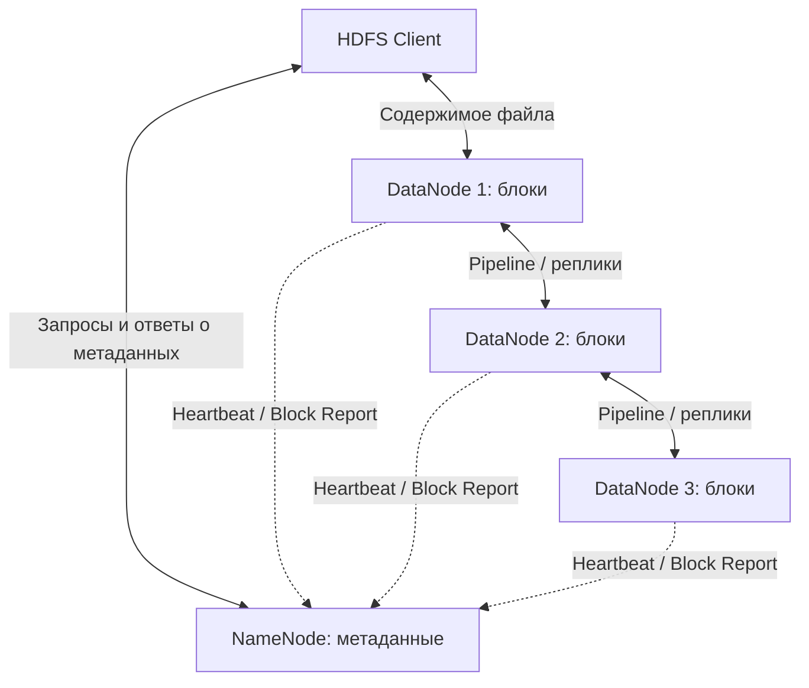

---
tags:
  - hadoop
  - hdfs
  - distributed-systems
aliases:
  - Архитектура HDFS
---
> [!abstract] Суть
> **HDFS (Hadoop Distributed File System)** — распределённая файловая система для хранения больших файлов на кластере серверов. Файлы делятся на **блоки**, блоки размещаются на **DataNode** и могут иметь несколько **реплик**. **NameNode** управляет метаданными и размещением блоков, но не передаёт содержимое файлов.

![[Pasted image 20261018163714.png|700]]
## 1. Место HDFS в Hadoop

- **HDFS** — хранение данных.
- **YARN** — управление вычислительными ресурсами кластера.
- **MapReduce, Spark, Tez** — обработка данных.
- **Hive** — SQL-доступ к данным через вычислительный движок.
- **HBase** — NoSQL-база данных, использующая распределённое хранилище HDFS.

HDFS не выполняет SQL-запросы и не распределяет CPU/RAM между заданиями.

## 2. Архитектура: Master–Worker

| Компонент | Назначение |
|---|---|
| **NameNode (NN)** | Управляет пространством имён, метаданными, правами, размещением и состоянием блоков. |
| **DataNode (DN)** | Хранит блоки на локальных дисках, читает/записывает данные, передаёт реплики. |
| **HDFS Client** | Создаёт файлы, запрашивает у NN блоки и расположение реплик, передаёт данные DN, закрывает файлы. |
| **Secondary NameNode** | Создаёт контрольные точки метаданных (*checkpoint*). **Не является резервным NameNode.** |



**Основное разделение:**

- **Client ↔ NameNode:** создание/закрытие файла, выделение блоков, получение адресов DataNode.
- **Client ↔ DataNode:** передача содержимого файла.
- **DataNode ↔ DataNode:** передача реплик блоков.
- **DataNode → NameNode:** информация о состоянии и наличии блоков.

**Содержимое файлов через NameNode не проходит.**

### Что именно хранит NameNode

- Иерархию каталогов и файлов (*namespace*).
- Владельцев, разрешения, атрибуты и параметры репликации.
- Соответствие «файл → список блоков».
- Текущие сведения «блок → DataNode», полученные от DataNode.

| Место | Что хранится |
|---|---|
| **RAM NameNode** | Рабочее представление пространства имён и карты блоков. |
| **FsImage на диске** | Сохранённый образ пространства имён и метаданных файлов. |
| **EditLog на диске** | Журнал изменений метаданных после сохранённого образа. |

**Checkpoint:** изменения из `EditLog` объединяются с образом `FsImage`, чтобы ограничить объём журнала и упростить восстановление. Расположение физических копий блоков восстанавливается, в частности, по отчётам DataNode.

**DataNode** хранит каждый блок как локальный файл (с сопутствующими метаданными) в файловой системе сервера, например ext4/XFS. DataNode не оперирует исходным именем файла так, как это делает NameNode.

## 3. Какие файлы хранит HDFS

**Любые последовательности байтов, независимо от расширения и формата:** `.csv`, `.json`, `.parquet`, `.orc`, `.txt`, `.pdf`, `.zip`, `.jpg`, `.mp4`, `.bin` и другие.

- HDFS **не понимает содержимое** Parquet/CSV/JSON: это делают Hive, Spark и другие инструменты.
- Формат влияет на **обработку**, но не на возможность **хранения**.
- HDFS рассчитан на **большие файлы и потоковый доступ**, а не на частые точечные изменения.
- Большое число мелких файлов создаёт нагрузку на память NameNode из-за метаданных.
- Модель записи: **write once, read many**. Поддерживаются добавление в конец (*append*) и усечение (*truncate*); произвольная перезапись байтов в середине файла не поддерживается.

> [!note] gzip и блоки
> Сжатый `.gz`-файл **тоже разбивается на блоки HDFS**. Свойство *non-splittable* относится к параллельной обработке его содержимого, а не к хранению в HDFS.

## 4. Блоки и репликация
![[Pasted image 20261018163754.png|500]]

**Блок HDFS** — логическая единица распределения файла между DataNode. Типовой размер блока — **128 МиБ**, он настраивается. Последний блок может быть меньше.

**Replication Factor (RF)** — желаемое количество копий **каждого блока**. При `RF = 3` каждый блок хранится на трёх разных DataNode. Две копии одного блока на одной DataNode не размещаются. При выборе узлов NN учитывает доступность и топологию стоек (*rack awareness*).

### Сквозной пример

Параметры:

- Файл `/data/example.bin`: **640 МиБ**.
- Размер блока: **128 МиБ**.
- Блоков: **5** (`B1`–`B5`).
- Кластер: **4 DataNode** (`DN1`–`DN4`).
- Фактор репликации: **3**.
- После достижения RF = 3: **15 физических реплик**; суммарный объём данных реплик — **1920 МиБ** без учёта служебных накладных расходов.

Пример выбора DataNode для каждого блока:

| Блок | Pipeline | Где останутся реплики |
|---|---|---|
| B1 | DN1 → DN2 → DN3 | DN1, DN2, DN3 |
| B2 | DN2 → DN3 → DN4 | DN2, DN3, DN4 |
| B3 | DN3 → DN4 → DN1 | DN3, DN4, DN1 |
| B4 | DN4 → DN1 → DN2 | DN4, DN1, DN2 |
| B5 | DN1 → DN2 → DN4 | DN1, DN2, DN4 |

Это **условный** вариант выбора узлов: NameNode определяет размещение динамически.

**Имя файла и порядок блоков** знает NameNode. DataNode хранят конкретные блоки, а не весь файл как единый объект.

## 5. Кто делит файл на блоки

**HDFS Client**, то есть библиотека HDFS на стороне приложения.

- Приложение передаёт поток байтов HDFS-клиенту.
- Клиент формирует границы логических блоков по мере записи.
- Клиенту **не требуется** сначала создавать отдельные файлы-блоки на своём диске.
- NameNode **не нужно заранее знать количество блоков** и полный размер будущего файла.
- Для нового блока клиент отдельно запрашивает у NameNode его выделение через `addBlock()`.

Таким образом, при создании файла **NameNode ещё не обязан выделять все пять блоков**.

## 6. Создание и запись файла

### 6.1. Создание записи в namespace

1. **Приложение → HDFS Client:** `create("/data/example.bin")`.
2. **Client → NameNode:** RPC создания файла с параметрами, включая `RF = 3`.
3. **NameNode → Client:** успешный ответ. Файл существует в состоянии **under construction**, клиент получает право записи (*lease*). Блоки пока могут отсутствовать.

### 6.2. Подробно: первый блок B1

Здесь каждый запрос, ответ и ACK приведён отдельно. Передача рассматривается для **одного пакета**; реальный блок состоит из множества пакетов.

**Выделение блока**

1. **Client → NameNode:** `addBlock(file, previous=null)`.
2. **NameNode → Client:** `B1`, список `[DN1, DN2, DN3]`.

**Создание цепочки записи (pipeline)**

3. **Client → DN1:** `WRITE_BLOCK B1`, последующие узлы `[DN2, DN3]`.
4. **DN1 → DN2:** `WRITE_BLOCK B1`, следующий узел `DN3`.
5. **DN2 → DN3:** `WRITE_BLOCK B1`, последний узел цепочки.
6. **DN3 → DN2:** успешный ответ об установке цепочки.
7. **DN2 → DN1:** успешный ответ об установке цепочки.
8. **DN1 → Client:** успешный ответ об установке цепочки.

**Передача и подтверждение пакета**

9. **Client → DN1:** `DATA B1, Packet #1`.
10. **DN1 → DN2:** `DATA B1, Packet #1`.
11. **DN2 → DN3:** `DATA B1, Packet #1`.
12. **DN3 → DN2:** `ACK Packet #1`.
13. **DN2 → DN1:** `ACK Packet #1`.
14. **DN1 → Client:** `ACK Packet #1`.
15. **Повтор шагов 9–14** для остальных пакетов B1, включая завершающий пакет.

```mermaid
sequenceDiagram
    participant C as Client
    participant N as NameNode
    participant D1 as DN1
    participant D2 as DN2
    participant D3 as DN3
    C->>N: addBlock()
    N-->>C: B1; DN1, DN2, DN3
    C->>D1: WRITE_BLOCK B1
    D1->>D2: WRITE_BLOCK B1
    D2->>D3: WRITE_BLOCK B1
    D3-->>D2: setup OK
    D2-->>D1: setup OK
    D1-->>C: setup OK
    loop Каждый пакет блока
        C->>D1: Packet
        D1->>D2: Packet
        D2->>D3: Packet
        D3-->>D2: ACK
        D2-->>D1: ACK
        D1-->>C: ACK
    end
```

**Пояснения:**

- **Клиент отправляет блок только первой DataNode**, а не всем трём самостоятельно.
- Репликация **начинается во время записи**: DN1 пересылает пакеты DN2, DN2 — DN3.
- У каждой DataNode сохраняется собственная копия блока.
- ACK возвращается **для каждого пакета**, а не одним ответом на целый блок.
- Пакеты передаются конвейерно: разные пакеты одного блока могут одновременно находиться на разных участках цепочки.

### 6.3. Остальные четыре блока

- Для **B2** клиент вызывает `addBlock(file, previous=B1)` и получает `[DN2, DN3, DN4]`.
- Для **B3** вызывает `addBlock(file, previous=B2)` и получает `[DN3, DN4, DN1]`.
- Для **B4** вызывает `addBlock(file, previous=B3)` и получает `[DN4, DN1, DN2]`.
- Для **B5** вызывает `addBlock(file, previous=B4)` и получает `[DN1, DN2, DN4]`.
- **Каждый** блок записывается через свой pipeline по той же схеме, что B1.

### 6.4. Закрытие файла

1. **Приложение → Client:** `close()`.
2. Клиент завершает отправку данных и получает необходимые ACK.
3. **Client → NameNode:** `complete(file, last=B5)` с данными последнего блока.
4. **NameNode → Client:** успешное завершение (`true`), если соблюдены условия закрытия файла. Если блоки ещё не удовлетворяют требованиям, возвращается `false`, и клиент повторяет запрос.
5. **Client → Приложение:** успешное завершение `close()`.

**Важно:** NameNode проверяет минимально необходимое количество реплик для завершения записи. Наличие всех трёх копий к моменту `complete()` не является безусловным требованием: недостающие реплики затем восстанавливаются.

## 7. Как NameNode узнаёт о записанных блоках

Три **разных вида подтверждений и сообщений**:

| Сообщение | Направление | Значение |
|---|---|---|
| **ACK** | DataNode → … → Client | Пакет данных прошёл pipeline. |
| **`complete()`** | Client → NameNode | Клиент закончил писать файл и просит закрыть его. |
| **IBR / Block Report** | DataNode → NameNode | На DataNode присутствуют определённые блоки, известны их состояния. |

- DataNode отправляют **Heartbeat** для подтверждения своей доступности.
- **Block Report** перечисляет блоки DataNode; **Incremental Block Report (IBR)** сообщает об изменениях, в том числе о принятых блоках.
- Такие уведомления **асинхронны** относительно клиентской записи. Их нельзя вставить в один обязательный фиксированный порядок вместе с запросами клиента.
- NameNode не получает сами байты записанного файла.

## 8. Чтение файла

1. **Client → NameNode:** запрос расположения блоков файла.
2. **NameNode → Client:** список блоков и DataNode, содержащих их реплики.
3. **Client → выбранные DataNode:** запросы на чтение блоков, предпочтение близким и доступным репликам.
4. **DataNode → Client:** содержимое блоков.
5. **Client:** собирает единый поток байтов в нужном порядке.

NameNode участвует в **поиске блоков**, но не пересылает содержимое файла.

## 9. Отказы и восстановление

### Если клиент создал файл, но не отправил данные

- **Вызвал `close()` без записи:** будет создан пустой файл (0 байт).
- **Не записал данные и не вызвал `close()`:** запись остаётся незавершённой (`under construction`); клиент удерживает lease до её истечения или восстановления.
- **Клиент аварийно завершился во время записи:** HDFS выполняет *lease/block recovery*; сохранность неподтверждённых данных не гарантируется.

### Если отказала DataNode

1. NameNode обнаруживает недоступность узла по отсутствию Heartbeat.
2. Определяет блоки, для которых стало меньше доступных реплик.
3. Назначает создание недостающих реплик на оставшихся DataNode.
4. DataNode пересылают блоки между собой, восстанавливая требуемый RF при наличии ресурсов.

**Два режима репликации:**

- **Во время новой записи:** pipeline создаёт копии сразу.
- **После потери копий:** NameNode управляет фоновой повторной репликацией (*re-replication*).

### Если отказал NameNode

- Без высокой доступности работа с namespace и новыми операциями HDFS прекращается до восстановления NN.
- **Secondary NameNode не заменяет вышедший из строя NameNode:** он отвечает за checkpoints.
- Для **High Availability (HA)** применяются **Active NameNode**, **Standby NameNode**, общий журнал изменений (часто **JournalNode**) и механизмы переключения (например, ZooKeeper/ZKFC).

## 10. Ключевые ответы в одной таблице

| Вопрос | Ответ |
|---|---|
| Какие расширения поддерживаются? | Любые: HDFS хранит байты. |
| Кто делит файл на блоки? | HDFS-клиент при потоковой записи. |
| Нужно ли NN знать размер файла заранее? | Нет. Новый блок выделяется по мере необходимости. |
| Кто выбирает DataNode для блока? | NameNode. |
| Клиент отправляет один блок сразу трём DataNode? | Нет, первой DataNode из pipeline. |
| Когда появляются копии? | При передаче пакетов по pipeline. |
| Кто подтверждает получение пакета? | DataNode через цепочку ACK до клиента. |
| Кто подтверждает создание файла? | NameNode при `complete()` после проверки условий завершения. |
| Как NN узнаёт о копиях? | По сообщениям и отчётам DataNode. |
| Если DN потеряна? | NameNode инициирует восстановление недостающих реплик. |
| Если приложение не закрывает файл? | Файл остаётся незавершённым до восстановления lease. |

> [!summary] Запомнить
> **NameNode отвечает на вопрос «где находятся блоки?»; DataNode хранят байты; HDFS-клиент управляет записью и чтением.** Блоки выделяются последовательно. Для каждого блока создаётся pipeline, через который одновременно передаются данные и создаются реплики. Успешная передача пакетов и успешное закрытие файла — разные события.

## Источники

- [Arenadata: Архитектура HDFS](https://docs.arenadata.io/ru/ADH/current/concept/hdfs-core.html)
- [Apache Hadoop: HDFS Architecture](https://hadoop.apache.org/docs/stable/hadoop-project-dist/hadoop-hdfs/HdfsDesign.html)
- [Apache Hadoop: HDFS Users Guide](https://hadoop.apache.org/docs/current/hadoop-project-dist/hadoop-hdfs/HdfsUserGuide.html)
