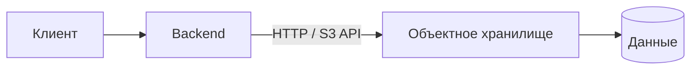
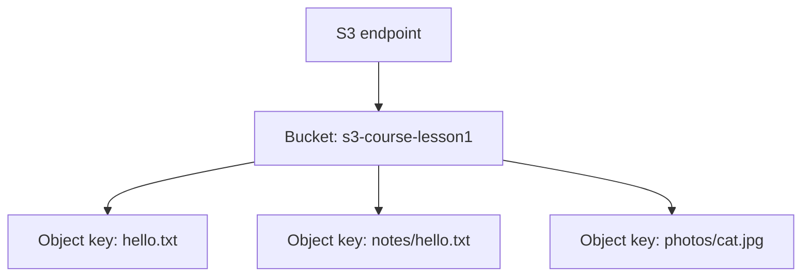
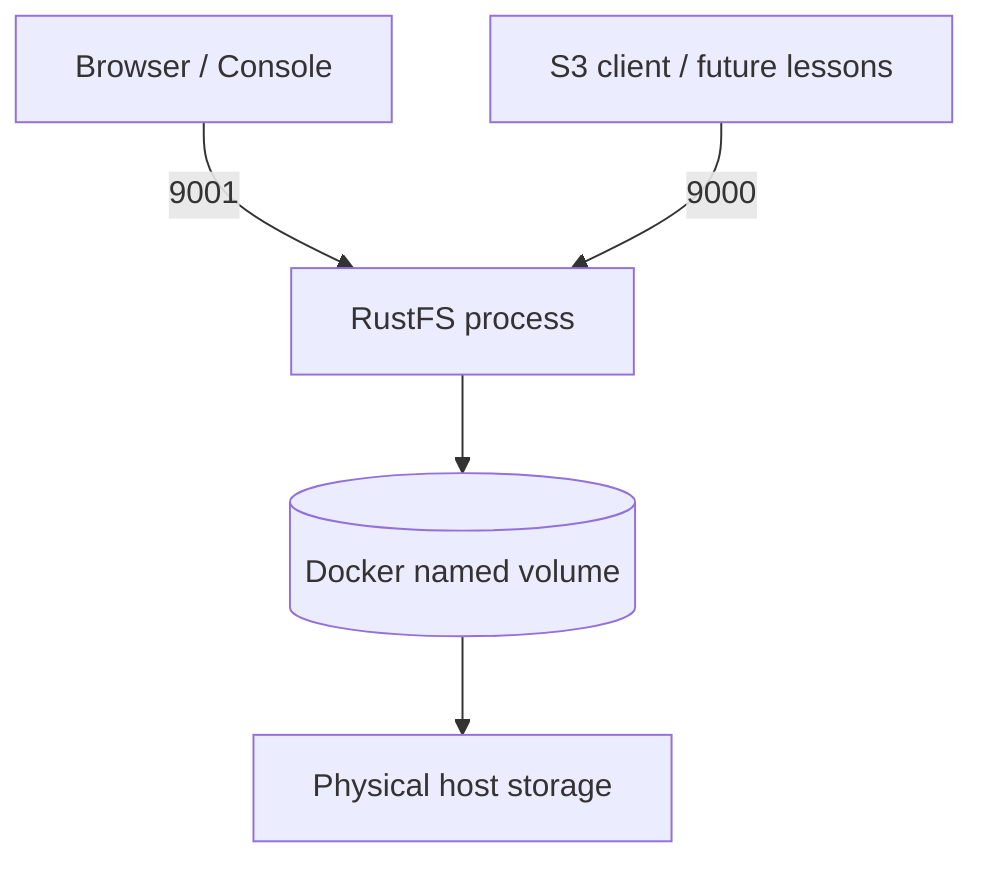

# Урок 01. Что такое S3 и как запустить RustFS локально

> [!abstract] Цель урока
> Понять принцип объектного хранения, различать *bucket*, *object* и *key*, запустить локальный RustFS и сохранить первый объект. Не нужно заранее знать S3 или AWS.

**Предварительные знания:** файлы и каталоги Linux, базовое представление о HTTP и Docker.  
**Практическая среда:** Linux, Docker Engine, Docker Compose, терминал `fish`, браузер.  
**Критерий завершения:** локальный RustFS работает, создан бакет, загружен и скачан первый объект, его содержимое совпадает с исходным файлом.

---

## 1. Зачем вообще нужен S3

Рассмотрим backend, который принимает фотографии пользователей. Простейшее решение — сохранять загруженные файлы на локальный диск:

```text
POST /upload
      |
      v
   Backend
      |
      v
/var/app/uploads/photo.jpg
```

Проблемы возникают при переходе от одного сервера к нескольким:

1. Один backend сохраняет файл на свой диск, другой backend не видит этот файл.
2. При замене сервера необходимо переносить файлы отдельно от приложения.
3. Хочется независимо масштабировать код приложения и его хранилище.
4. Нужны единые правила доступа, управления версиями и жизненным циклом данных.

Объектное хранилище решает задачу через сетевой интерфейс. Приложение обращается не к локальному пути, а к API сервиса хранения:



**Amazon S3 (Simple Storage Service)** — сервис объектного хранения от AWS. Через его API приложение может создавать бакеты, загружать объекты, читать их и удалять. **RustFS** — отдельная система объектного хранения, реализующая S3-совместимый API; её можно запустить на своём компьютере.

> [!important] Не путай
> **AWS S3** — конкретный облачный сервис Amazon. **S3 API** — интерфейс взаимодействия с объектным хранилищем. **RustFS** — самостоятельная реализация S3-совместимого сервиса. Совместимость не означает идентичность всех функций и внутренних алгоритмов.

### Три модели хранения

| Модель | Как обращаемся к данным | Примеры задач |
|---|---|---|
| **Файловая** | Путь: `/home/user/report.pdf`; операции файловой системы | Домашний каталог, совместный сетевой диск |
| **Блочная** | Чтение и запись блоков устройства; файловую систему создаёт ОС | Диски виртуальных машин, базы данных |
| **Объектная** | Идентификатор объекта через API: `bucket + key` | Фотографии, резервные копии, видео, архивы, datasets |

S3 **не является обычной POSIX-файловой системой**. В нём нет стандартного системного вызова «открыть файл и заменить байты по смещению» с теми же гарантиями, что у локального файла. Приложение записывает объект через операции API; для изменения содержимого используется запись нового содержимого объекта или новый объект. Частичное **чтение** по диапазону байтов существует — его изучим в уроке 8.

---

## 2. Минимальная модель данных S3

### 2.1. Bucket (бакет)

**Bucket** — логический контейнер, в котором хранятся объекты. У бакета есть имя, настройки доступа и другие параметры.

В AWS S3 у обычного бакета (general purpose bucket) есть регион размещения. Не следует воспринимать бакет как физическую папку на конкретном диске.

### 2.2. Object (объект)

**Object** — единица хранения в S3. Состоит из **данных** (последовательности байтов) и **метаданных**. К объекту привязаны ключ и, при включённом versioning, идентификатор версии.

### 2.3. Key (ключ)

**Key** — строковый идентификатор объекта внутри одного бакета.

```text
Bucket: s3-course-lesson1
Key:    notes/hello.txt
```

Комбинация `bucket + key` определяет текущий объект; при включённом версионировании для обращения к конкретной версии используется также `versionId`.



> [!warning] Папки в S3 — не каталоги Linux
> Для обычных бакетов AWS S3 структура ключей плоская. `notes/hello.txt` — **одна строка ключа**, символ `/` внутри неё служит удобным разделителем. Интерфейсы отображают общие префиксы ключей как папки. Подробно разберём это в уроке 5.

---

## 3. Что делает клиент при загрузке файла

Модель запроса:

```text
Локальный файл         HTTP API                  Хранилище
  hello.txt      -- PUT Object / bucket/key -->  Object
    bytes                                          bytes + metadata
```

Последовательность действий:

1. Клиент выбирает **бакет** и **ключ**.
2. Клиент отправляет HTTP-запрос с содержимым файла и служебными заголовками.
3. Сервер проверяет запрос и права доступа.
4. Сервер сохраняет объект согласно своей реализации.
5. Сервер возвращает результат операции.

**Файл** — исходная сущность на компьютере клиента. **Объект** — сохранённая сущность в S3. Имя локального файла и S3 key **не обязаны совпадать**.

В AWS S3 и RustFS основные действия выражаются одними и теми же понятиями API: `CreateBucket`, `PutObject`, `GetObject`, `ListObjectsV2`, `DeleteObject`. В этом уроке выполним их часть через веб-консоль, в следующих — напрямую через HTTP и AWS CLI.

---

## 4. Лаборатория: запускаем RustFS

### 4.1. Проверяем Docker

Выполни:

```fish
 docker --version
 docker compose version
 docker info
```

Если команды не выполняются, сначала установи/запусти Docker Engine и Compose Plugin. На Arch Linux можно использовать пакетный менеджер и systemd; пакетные названия и состояние установки проверь в своей системе. Все дальнейшие команды запускай из терминала, в котором доступен Docker.

### 4.2. Создаём каталог лаборатории

```fish
mkdir -p ~/s3-course/lesson-01
cd ~/s3-course/lesson-01
```

В результате файлы настройки будут находиться в одном каталоге. Само содержимое объектов сохраним в **Docker named volume** — оно переживёт удаление контейнера.

### 4.3. Создаём файл `.env`

Для лаборатории используем уникальные случайные реквизиты. Команда ниже рассчитана на **fish** и требует `openssl`:

```fish
printf 'RUSTFS_ACCESS_KEY=lab%s\nRUSTFS_SECRET_KEY=%s\n' \
    (openssl rand -hex 8) \
    (openssl rand -hex 24) > .env
chmod 600 .env
```

В `.env` появятся две строки с учётными данными. Они понадобятся для входа в веб-консоль. **Не добавляй `.env` в Git и не публикуй его содержимое.**

### 4.4. Создаём `compose.yaml`

Скопируй в файл `~/s3-course/lesson-01/compose.yaml`:

```yaml
services:
  rustfs:
    image: rustfs/rustfs:latest
    environment:
      RUSTFS_ACCESS_KEY: ${RUSTFS_ACCESS_KEY:?set in .env}
      RUSTFS_SECRET_KEY: ${RUSTFS_SECRET_KEY:?set in .env}
      RUSTFS_VOLUMES: /data
      RUSTFS_ADDRESS: ":9000"
      RUSTFS_CONSOLE_ADDRESS: ":9001"
      RUSTFS_CONSOLE_ENABLE: "true"
    ports:
      - "127.0.0.1:9000:9000"
      - "127.0.0.1:9001:9001"
    volumes:
      - rustfs-data:/data

volumes:
  rustfs-data:
```

**Что здесь важно:**

| Поле | Назначение |
|---|---|
| `image` | Официальный контейнер RustFS |
| `RUSTFS_ACCESS_KEY` | Идентификатор доступа для лаборатории |
| `RUSTFS_SECRET_KEY` | Секрет для аутентификации |
| `RUSTFS_VOLUMES=/data` | Путь к данным внутри контейнера |
| `9000` | S3 API (для приложений и клиентов) |
| `9001` | Веб-консоль RustFS |
| `127.0.0.1:` | Публикация портов только на локальном интерфейсе компьютера |
| `rustfs-data:/data` | Постоянный Docker-том с данными |

> [!note] Почему named volume
> Официальный контейнер работает под непривилегированным пользователем с UID `10001`. Для обычного bind mount каталога с хоста требуются корректные права. Named volume убирает необходимость вручную менять владельца директории на первом уроке.

`latest` фиксирует не версию, а канал образа: при последующей загрузке можно получить другую сборку. Для воспроизводимости будущих опытов запишем идентификатор образа; позднее закрепим конкретный тег или digest.

### 4.5. Запуск и проверка

```fish
docker compose config -q
docker compose up -d
docker compose ps
docker compose logs --tail=50 rustfs
```

Проверь API:

```fish
curl -i http://127.0.0.1:9000/health
```

**Ожидаемый результат:** HTTP `200 OK` — процесс отвечает на health-запрос. Это проверка доступности, а **не** проверка успешной авторизации или сохранения объекта.

Для дополнительной проверки готовности:

```fish
curl -i http://127.0.0.1:9000/health/ready
```

При успешной готовности вернётся HTTP 200; при проблемах со storage/IAM/peer-зависимостями возможен HTTP 503.

Открой в браузере:

- **Console:** <http://127.0.0.1:9001>
- **S3 API:** <http://127.0.0.1:9000>

Для входа в Console используй значения `RUSTFS_ACCESS_KEY` и `RUSTFS_SECRET_KEY` из `.env`. Порт `9000` не является адресом веб-консоли.

Уточнение: названия кнопок Console могут меняться с версиями RustFS; действия с бакетами и объектами остаются теми же.

---

## 5. Первая операция: создаём бакет

В веб-консоли RustFS:

1. Найди раздел **Buckets**.
2. Нажми **Create Bucket**.
3. Введи `s3-course-lesson1`.
4. Создай бакет.
5. Открой созданный бакет — он должен быть пустым.

**Что произошло с точки зрения S3:** выполнена логическая операция создания контейнера объектов. Данные файла пока не загружены.

**Что важно понять:** имя бакета и ключ объекта — разные идентификаторы. Позднее у одного бакета будет много объектов.

---

## 6. Вторая операция: загружаем объект

### 6.1. Подготовь файл на своём компьютере

```fish
printf 'Hello, object storage!\n' > hello.txt
cat hello.txt
```

Открой в RustFS бакет `s3-course-lesson1`, выбери **Upload**, затем загрузи `hello.txt`.

После загрузки изучи карточку объекта:

- Имя (ключ) объекта — `hello.txt`.
- Размер содержимого — **23 байта** для указанного текста с завершающим `\n`.
- Метаданные содержат служебную информацию (точный набор отображаемых полей зависит от версии Console).

Пояснение по размеру: `Hello, object storage!` содержит 22 ASCII-символа, плюс один байт перевода строки.

### 6.2. Скачать и проверить

1. Через Console скачай объект обратно.
2. Сохрани его под именем `downloaded-hello.txt` в каталоге лаборатории.
3. Сравни содержимое или вычисли хеши:

```fish
sha256sum hello.txt downloaded-hello.txt
cmp hello.txt downloaded-hello.txt
```

**Критерий успеха:** обе контрольные суммы равны, а `cmp` завершается без сообщения о различиях.

> [!important] Что доказывает эксперимент
> RustFS принял объект, сохранил его и вернул те же байты. Но опыт **не доказывает** наличие реплик, erasure coding или защиту от потери диска.

---

## 7. Третья операция: ключ объекта не равен пути файла

Загрузи тот же `hello.txt` повторно, но укажи в интерфейсе путь или ключ `notes/hello.txt`, если твоя версия Console поддерживает такой ввод. Если прямого ввода ключа нет, создай в бакете папку `notes` через интерфейс и загрузи в неё файл.

Итоговая логическая структура:

```text
Bucket: s3-course-lesson1
|
|-- hello.txt
`-- notes/hello.txt
```

Теперь внутри одного бакета два объекта с разными ключами. Даже если их содержимое совпадает, это **два разных объекта**, а не одна ссылка на локальный файл.

Заметь: отображаемая папка `notes` в обычной модели S3 — логическая группировка по префиксу ключа. UI может также создать нулевой объект `notes/`; это деталь реализации интерфейса, а не появление POSIX-каталога.

---

## 8. Что находится внутри RustFS — пока без деталей

Наша текущая конфигурация использует режим **Single Node Single Disk (SNSD)**:



- **Node** — экземпляр сервиса RustFS; в нашей конфигурации он один.
- **Volume** — место для данных, подключённое к контейнеру.
- **SNSD** — один узел и один диск с данными; **избыточности нет**.
- **Физическое размещение** — детали внутреннего формата RustFS пока не рассматриваем. **Не редактируй содержимое Docker-тома вручную**: это не пользовательская директория для изменения файлов.

Позднее мы исследуем метаданные, erasure coding, репликацию и многонодовые топологии. Нельзя считать, что AWS S3 устроен физически точно так же, как локальный RustFS: S3 API определяет операции, но не универсальную структуру кластеров всех реализаций.

---

## 9. Как безопасно остановить лабораторию

Остановить контейнеры, **сохранив том и объекты**:

```fish
docker compose down
```

Запустить снова:

```fish
docker compose up -d
```

**Не выполняй `docker compose down -v`, если хочешь сохранить данные.** Ключ `-v` удаляет именованные тома, объявленные в Compose-проекте, вместе с содержимым лабораторного хранилища.

Для понимания того, какой контейнер и образ запущены:

```fish
docker compose ps
docker image inspect rustfs/rustfs:latest --format '{{.Id}}'
```

---

## 10. Самостоятельные задания

Выполняй по порядку. Ответы пока не смотри в документации.

### Задание 1 — определения

Дай **одним предложением** определение каждому термину:

1. Object storage
2. Bucket
3. Object
4. Key
5. S3 API
6. Endpoint

### Задание 2 — мысленный эксперимент

В бакете `documents` хранятся объекты:

```text
report.pdf
2026/report.pdf
2026/october/report.pdf
```

Ответь:

1. Сколько здесь объектов?
2. Сколько физических папок обязано существовать по модели обычного S3-бакета?
3. Почему все три объекта могут иметь одинаковое содержимое?
4. Каков идентификатор второго объекта в формате `bucket + key`?

### Задание 3 — эксперимент

В своей лаборатории:

1. Создай второй бакет `s3-course-backup`.
2. Загрузи туда тот же `hello.txt`.
3. Удали объект **только из первого** бакета.
4. Проверь, что объект во втором бакете доступен.
5. Верни удалённый объект в первый бакет.

**Вопрос:** удаление объекта в одном бакете привело к удалению объекта в другом? Объясни, почему.

### Задание 4 — проверка сохранности

1. Убедись, что бакет и объекты доступны.
2. Выполни `docker compose down`.
3. Выполни `docker compose up -d`.
4. Проверь наличие объектов через Console.

**Вопрос:** что именно обеспечило сохранение данных после пересоздания контейнера?

### Задание 5 — архитектурное мышление

Есть три backend-инстанса за балансировщиком. Все они должны сохранять аватары пользователей. Объясни в 3–5 предложениях, почему выделенный S3-совместимый сервис лучше, чем папка `uploads` на диске каждого backend-инстанса.

---

## Источники

1. [Amazon S3 User Guide — What is Amazon S3?](https://docs.aws.amazon.com/AmazonS3/latest/userguide/Welcome.html)
2. [Amazon S3 — Naming Amazon S3 objects](https://docs.aws.amazon.com/AmazonS3/latest/userguide/object-keys.html)
3. [Amazon S3 — Object overview](https://docs.aws.amazon.com/AmazonS3/latest/userguide/UsingObjects.html)
4. [RustFS — Docker installation](https://docs.rustfs.com/en/installation/container/docker)
5. [RustFS — Status checks](https://docs.rustfs.com/en/operations/status-check)
6. [RustFS — Installation modes](https://docs.rustfs.com/en/installation/linux)
