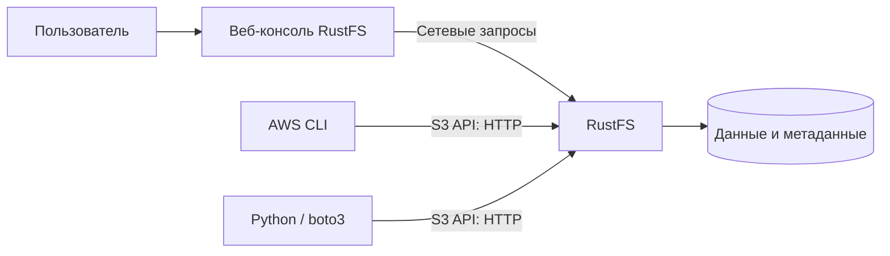
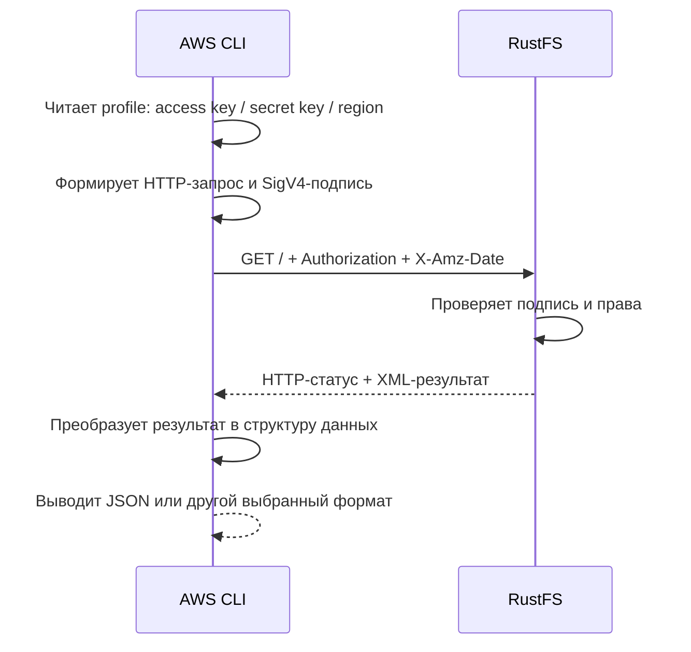
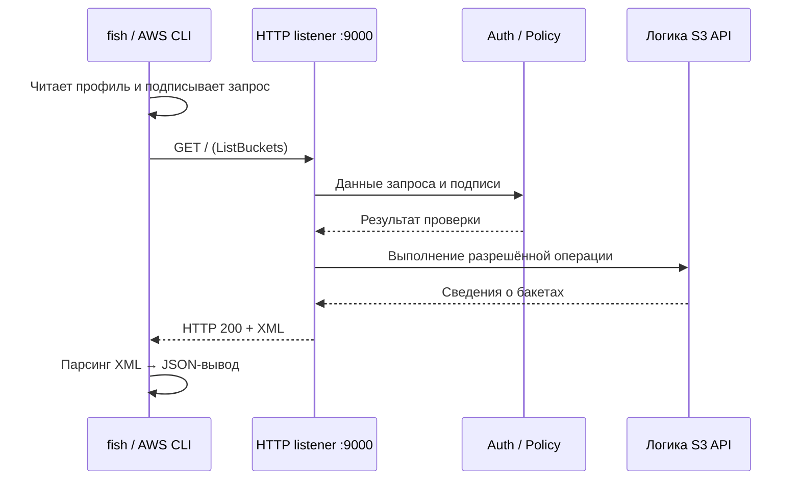

# Урок 02. Как устроен S3 API: HTTP, endpoint, region и AWS CLI

> [!abstract] Цель урока
> Понять, как операция S3 превращается в HTTP-запрос и HTTP-ответ, различать *endpoint*, *region*, методы, заголовки, тело и статус-коды. Подключить AWS CLI к локальному RustFS и выполнить первый подписанный запрос без веб-консоли.

**Предварительные знания:** материал урока 1, методы HTTP `GET` и `PUT` на уровне названий, работа в терминале Linux.  
**Практическая среда:** Arch Linux, Docker Compose, терминал `fish`, RustFS из урока 1, AWS CLI v2, `curl`.  
**Критерий завершения:** `aws s3api list-buckets` возвращает бакеты локального RustFS, `aws s3 ls` показывает те же бакеты, а ты можешь назвать метод, адрес, параметры и HTTP-статус первого запроса, а также объяснить отличие XML-ответа S3 от JSON, выводимого AWS CLI.

---

## 1. Зачем изучать S3 API, если есть Console

В уроке 1 мы создали бакет и загрузили объект через веб-интерфейс RustFS. Но веб-консоль — **клиентское приложение**, а не само хранилище.



Операции хранения должны выполняться **без обязательного участия браузера**. Для этого сервис предоставляет программный интерфейс.

**API (Application Programming Interface)** — контракт взаимодействия между программами: набор операций, правила их вызова, форматы входных данных и ответов.

**S3 API** — набор операций над ресурсами объектного хранилища, передаваемых по HTTP. Примеры: `ListBuckets`, `CreateBucket`, `PutObject`, `GetObject`.

Для одной операции доступны разные инструменты:

| Инструмент       | Что делает                                                             |
| ---------------- | ---------------------------------------------------------------------- |
| RustFS Console   | Отображает интерфейс; выполняет запросы к серверу через свои механизмы |
| `aws s3api`      | Вызывает операции S3 API по их именам                                  |
| `aws s3`         | Упрощает распространённые действия над бакетами и объектами            |
| Python + `boto3` | Выполняет S3-операции из программного кода                             |

---

## 2. REST, ресурсы и адресация S3

**REST (Representational State Transfer)** — архитектурный стиль построения сетевых интерфейсов, в котором ресурсы адресуются URI, а действия выражаются стандартной семантикой HTTP.

S3 предоставляет **REST API поверх HTTP**. Не нужно считать, что каждая S3-операция соответствует отдельному пути вида `/api/list-buckets`.

### 2.1. URI и URL

**URI** — идентификатор ресурса. **URL** — URI, указывающий способ и расположение доступа к нему.

Разберём URL:

```text
http://127.0.0.1:9000/s3-course-lesson1/notes/hello.txt
|___|  |_______| |__| |________________| |_____________|
 scheme   host   port       bucket           key
```

- `http` — схема соединения; для текущей локальной лаборатории без TLS.
- `127.0.0.1` — адрес компьютера, с которого выполняется запрос.
- `9000` — порт HTTP-сервера S3 API.
- `s3-course-lesson1` — имя бакета.
- `notes/hello.txt` — ключ объекта, содержащий символ `/`.

Такое представление адреса называется **path-style addressing**: имя бакета находится в пути URL.

### 2.2. Два способа адресации бакета

| Стиль | Пример |
|---|---|
| **Path-style** | `http://127.0.0.1:9000/my-bucket/hello.txt` |
| **Virtual-hosted-style** | `https://my-bucket.s3.us-east-1.amazonaws.com/hello.txt` |

В virtual-hosted-style имя бакета — часть имени хоста. В path-style — часть URL-пути.

**В нашей лаборатории используем path-style.** Для него не нужно создавать DNS-записи на каждый бакет. В RustFS virtual-hosted-style требует отдельной настройки доменов (`RUSTFS_SERVER_DOMAINS`).

### 2.3. Query-параметры

**Query string** — часть URL после `?`, содержащая параметры запроса.

```http
GET /my-bucket?list-type=2&prefix=notes%2F HTTP/1.1
Host: 127.0.0.1:9000
```

Здесь:

- `/my-bucket` — адрес бакета;
- `list-type=2` — выбор API `ListObjectsV2`;
- `prefix=notes%2F` — фильтр по префиксу `notes/` (`%2F` — URL-кодировка `/`).

Этот запрос **не равен** `GetObject`: в нём нет ключа конкретного объекта, а query-параметр выбирает операцию перечисления. Подробности префиксов и пагинации — в уроке 5.

> [!warning] Адрес S3 — не путь к файлу на серверном диске
> `GET /my-bucket/hello.txt` не требует существования физического файла `/my-bucket/hello.txt` в корневой файловой системе контейнера. Сервер сопоставляет URL с логическим ресурсом S3 и сам определяет способ доступа к сохранённым данным.

---

## 3. Endpoint и Region — разные настройки

### 3.1. Endpoint

**Endpoint** — сетевой адрес, по которому клиент обращается к API конкретного сервиса.

В текущей лаборатории:

```text
S3 API endpoint:  http://127.0.0.1:9000
RustFS Console:   http://127.0.0.1:9001
```

`9000` принимает операции S3 API. `9001` предоставляет веб-консоль. **Нельзя подменять один порт другим** при настройке клиента S3.

Параметр AWS CLI:

```text
--endpoint-url http://127.0.0.1:9000
```

указывает клиенту использовать локальный RustFS вместо стандартного AWS endpoint.

### 3.2. Region

**AWS Region** — географическая область инфраструктуры AWS, в которой размещаются региональные ресурсы. Примеры идентификаторов: `us-east-1`, `eu-central-1`.

В AWS S3 регион влияет на размещение обычного бакета, региональный endpoint и область действия подписи запроса.

В RustFS параметр `RUSTFS_REGION` используется для совместимости с S3-клиентами и подписи запросов. **Регион RustFS в локальной конфигурации не переносит данные в инфраструктуру AWS.** Документированное значение по умолчанию — `us-east-1`.

Для нашего клиента зададим:

```text
Region: us-east-1
```

| Параметр | AWS S3 | Наша лаборатория RustFS |
|---|---|---|
| `endpoint` | Адрес API AWS S3 | `http://127.0.0.1:9000` |
| `region` | География размещения и регион запроса | `us-east-1` для совместимости и подписи |
| `credentials` | AWS-идентичность с правами доступа | Ключи RustFS из `.env` |
| `addressing_style` | Зависит от адресации ресурса и клиента | `path` |

---

## 4. Что происходит с аутентификацией

S3 API требует не только указания ресурса, но и проверки доступа. Для нашего первого запроса AWS CLI использует два реквизита:

- **Access Key ID** — идентификатор учётных данных.
- **Secret Access Key** — секретный ключ, используемый для вычисления подписи.

**AWS Signature Version 4 (SigV4)** — алгоритм аутентификации AWS-запросов с криптографической подписью. Клиент формирует подпись на основе содержимого запроса, даты, региона, имени сервиса и секретного ключа. Сервер проверяет её и отдельно проверяет разрешение на операцию.



**Secret Access Key не должен отправляться в заголовке как открытое значение.** Он нужен клиенту для вычисления подписи.

> [!note] Граница темы
> В уроке 2 достаточно понимать, **где в цепочке появляется подпись и зачем она нужна**. Строгое построение canonical request, вычисление HMAC, временные ключи и `SessionToken` изучим в уроке 13.

Без подписи некоторые ресурсы S3 могут быть публично доступны по соответствующей политике; **`ListBuckets` требует авторизованного доступа** и не является публичной операцией нашего учебного сервера.

---

## 5. AWS CLI: `aws s3` и `aws s3api`

**AWS CLI (Command Line Interface)** — утилита для обращения к API AWS из терминала. Она также работает с S3-совместимыми хранилищами при явной настройке endpoint и учётных данных.

У AWS CLI два уровня S3-команд.

### 5.1. `aws s3` — высокоуровневые команды

Они ориентированы на пользовательские действия:

```fish
aws s3 ls
aws s3 cp local.txt s3://my-bucket/local.txt
aws s3 sync ./data s3://my-bucket/data/
```

- `ls` — показать бакеты либо содержимое указанного бакета;
- `cp` — скопировать файл или объект;
- `sync` — синхронизировать набор файлов и объектов.

Одна высокоуровневая команда может выполнить **несколько S3 API-вызовов**. Например, передача больших файлов может потребовать multipart upload.

### 5.2. `aws s3api` — операции уровня API

Команды ближе к именам операций S3:

```fish
aws s3api list-buckets
aws s3api head-bucket --bucket my-bucket
aws s3api put-object --bucket my-bucket --key file.txt --body file.txt
```

| Задача | `aws s3` | `aws s3api` |
|---|---|---|
| Список бакетов | `ls` без S3-пути | `list-buckets` |
| Создать бакет | `mb s3://my-bucket` | `create-bucket --bucket my-bucket` |
| Загрузить файл | `cp file.txt s3://my-bucket/file.txt` | `put-object --bucket my-bucket --key file.txt --body file.txt` |
| Получить метаданные объекта | Нет отдельной команды `head-object` | `head-object` |
| Сложные настройки API | Ограниченный набор | Именованные операции и аргументы API |

---

## 6. Лаборатория: подключаем AWS CLI к RustFS

**Не создаём новый RustFS-контейнер.** Продолжаем использовать том и бакеты из урока 1.

### 6.1. Проверяем, что RustFS запущен

```fish
cd ~/s3-course/lesson-01
docker compose up -d
docker compose ps
curl -i http://127.0.0.1:9000/health
```

**Критерий успеха:** контейнер RustFS запущен, проверка `/health` возвращает HTTP `200`.

Если бакет `s3-course-lesson1` из урока 1 уже создан, **не создавай его заново**. Первый запрос этого урока только читает перечень бакетов.

### 6.2. Устанавливаем AWS CLI v2 на Arch Linux

Проверка наличия:

```fish
aws --version
```

Если команды нет, установи пакет `aws-cli-v2` из официального репозитория Arch:

```fish
sudo pacman -Syu aws-cli-v2
aws --version
```

**Ожидаемый признак:** вывод содержит `aws-cli/2.`. Полная версия зависит от установленного пакета.

> [!note] Версии пакетов
> В Arch существуют пакеты `aws-cli` (ветка v1) и `aws-cli-v2` (ветка v2). Для лаборатории используем именно v2.

### 6.3. Создаём отдельный профиль AWS CLI

**Profile** — именованный набор параметров AWS CLI. Профиль позволяет не смешивать учебные реквизиты RustFS с другими учётными данными.

Выполни:

```fish
aws configure --profile rustfs-lab
```

На запросы введи значения:

```text
AWS Access Key ID:      значение RUSTFS_ACCESS_KEY из .env урока 1
AWS Secret Access Key:  значение RUSTFS_SECRET_KEY из .env урока 1
Default region name:   us-east-1
Default output format: json
```

Это пояснение полей, **не текст для вставки целиком в терминал**. Первые два значения берутся из `~/s3-course/lesson-01/.env`.

AWS CLI сохраняет настройки профиля в файлах:

```text
~/.aws/credentials
~/.aws/config
```

Для стандартного файлового хранилища credentials ключ хранится **в виде читаемого текста**, а не зашифрованного секрета. Проверяй права доступа к этим файлам и не добавляй их в Git.

Выбери path-style для нашего профиля:

```fish
aws configure set s3.addressing_style path --profile rustfs-lab
```

Проверь профиль без вывода полного секрета:

```fish
aws configure list --profile rustfs-lab
```

### 6.4. Задаём endpoint в текущем fish-сеансе

```fish
set -gx RUSTFS_ENDPOINT http://127.0.0.1:9000
```

`set -gx` создаёт экспортируемую переменную окружения для текущего процесса `fish` и запускаемых им программ. **После открытия нового терминала команду надо выполнить повторно**, если не сохранил переменную в настройках shell.

Проверь:

```fish
echo $RUSTFS_ENDPOINT
```

Ожидаемая строка:

```text
http://127.0.0.1:9000
```

**Не сохраняй локальный endpoint как универсальное значение для всех AWS-команд.** В курсе указываем его явно для запросов к RustFS.

---

## 7. Первый подписанный S3-запрос: `ListBuckets`

### 7.1. Выполняем команду

```fish
aws --profile rustfs-lab \
    --endpoint-url $RUSTFS_ENDPOINT \
    s3api list-buckets \
    --output json \
    --no-cli-pager
```

**Ожидаемый результат:** команда завершается с кодом `0` и выводит JSON, в котором перечислены доступные бакеты. Среди них находится `s3-course-lesson1`, если ты сохранил бакет после урока 1.

Пример **структуры**, не фактический ответ твоего хранилища:

```json
{
  "Buckets": [
    {
      "Name": "s3-course-lesson1",
      "CreationDate": "2026-10-19T10:00:00+00:00"
    }
  ],
  "Owner": {
    "ID": "EXAMPLE_OWNER_ID"
  }
}
```

Состав необязательных полей зависит от операции, сервера и версии клиента. Обрати внимание: вывод в терминал — **JSON, но стандартный успешный HTTP-ответ `ListBuckets` имеет тело XML**. AWS CLI разобрал XML и представил его в выбранном формате вывода.

### 7.2. Разбираем команду посимвольно

| Фрагмент | Назначение |
|---|---|
| `aws` | Запуск AWS CLI |
| `--profile rustfs-lab` | Использовать реквизиты и регион нашего профиля |
| `--endpoint-url $RUSTFS_ENDPOINT` | Отправлять запрос на локальный RustFS |
| `s3api` | Использовать API-level команды |
| `list-buckets` | Вызвать операцию `ListBuckets` |
| `--output json` | Вывести разобранный результат в JSON |
| `--no-cli-pager` | Не открывать постраничный терминальный просмотрщик |

### 7.3. Какой HTTP-запрос стоит за этой командой

Суть операции:

```http
GET / HTTP/1.1
Host: 127.0.0.1:9000
Authorization: <SIGV4_AUTHORIZATION>
X-Amz-Date: <UTC_TIMESTAMP>
```

В зависимости от версии CLI и параметров пагинации в URL могут добавляться query-параметры, а набор заголовков будет шире. **Фактические поля запроса можно посмотреть в диагностическом выводе AWS CLI с параметром `--debug`.**

Алгоритм:

1. AWS CLI читает профиль `rustfs-lab`.
2. Формирует запрос `ListBuckets` для endpoint `http://127.0.0.1:9000`.
3. Подписывает запрос с помощью SigV4.
4. Отправляет HTTP-запрос на порт `9000`.
5. RustFS проверяет аутентификацию и права.
6. RustFS получает перечень бакетов из своего состояния и формирует S3-ответ.
7. AWS CLI читает ответ, преобразует данные и печатает JSON.

**Что доказывает эксперимент:** AWS CLI может авторизованно обращаться к S3 API RustFS и получать состояние хранилища без Console. Этот опыт **не проверяет устройство внутреннего размещения данных, репликацию или отказоустойчивость**.

### 7.4. Получаем только имена бакетов

```fish
aws --profile rustfs-lab \
    --endpoint-url $RUSTFS_ENDPOINT \
    s3api list-buckets \
    --query 'Buckets[].Name' \
    --output text
```

`--query` применяет выражение **JMESPath к ответу, разобранному AWS CLI**. Это не S3 query-параметр `prefix` и не серверная фильтрация в RustFS.

**Критерий успеха:** видишь имя `s3-course-lesson1` и остальные созданные бакеты. Новые данные в хранилище не создаются.

---

## 8. Сравниваем `aws s3api`, `aws s3` и `curl`

### 8.1. Та же задача через `aws s3`

```fish
aws --profile rustfs-lab \
    --endpoint-url $RUSTFS_ENDPOINT \
    s3 ls
```

Пример формата вывода:

```text
2026-10-19 10:00:00 s3-course-lesson1
```

Дата — **учебное значение**. Сравни фактические имена бакетов из `s3 ls` и `s3api list-buckets`.

**Вывод:** задача та же, но интерфейс клиента и формат результата другие. `s3 ls` — команда для человека; `s3api list-buckets` — прямой интерфейс операции.

### 8.2. Отправляем запрос без подписи через `curl`

```fish
curl -i http://127.0.0.1:9000/
```

`-i` выводит HTTP-заголовки ответа вместе с телом.

**Ожидаемый смысл результата:** RustFS отказывает в перечислении бакетов без необходимой авторизации. Изучи фактические HTTP-код и S3-код ошибки своей версии RustFS. Не воспринимай отказ как признак того, что S3 API не работает.

Сопоставление:

| Клиент | Что отправляет | Результат при текущих правилах доступа |
|---|---|---|
| AWS CLI с профилем | Подписанный S3-запрос | Список бакетов |
| `curl` без заголовка `Authorization` | Неподписанный HTTP-запрос | Отказ в доступе к `ListBuckets` |

> [!important] Почему `curl` не эквивалентен готовому AWS CLI
> В обычном виде `curl` знает HTTP, но не вычисляет за тебя S3-подпись. AWS CLI выполняет подготовку SigV4 автоматически. В дальнейшем научимся формировать подписанные запросы вручную.

## 9. Что произошло внутри RustFS

Разделяем **наблюдаемое поведение API** и **внутреннюю реализацию сервера**.



**Что устанавливается из работы клиента и API:**

1. Клиент сформировал запрос с выбранными endpoint и region.
2. Сервер принял запрос через HTTP-интерфейс S3.
3. Сервер выполнил предусмотренные протоколом проверки доступа.
4. Сервер вернул результат операции `ListBuckets`.
5. Клиент отобразил результат в JSON.

**Что этот опыт не позволяет установить:**

- какой внутренний файл, таблица или структура памяти хранят список бакетов;
- как данные распределяются по дискам;
- какие потоки и функции RustFS обработали запрос;
- как устроены erasure coding, репликация и quorum.

Это темы архитектурного модуля курса. Сейчас мы изучаем **внешний контракт API**.

### AWS S3 и RustFS: что совпадает, что различается

| Аспект | AWS S3 | RustFS в нашей лаборатории |
|---|---|---|
| Сетевой контракт | Официальный Amazon S3 REST API | S3-совместимый REST API |
| Базовые операции | `ListBuckets`, `PutObject`, `GetObject` и другие | Совместимые базовые операции |
| Аутентификация | SigV4, механизмы идентичности AWS | SigV4 и механизмы доступа RustFS |
| Endpoint | AWS S3 endpoint | `http://127.0.0.1:9000` |
| Region | Физическое размещение обычного бакета AWS | Логическая настройка совместимости и подписи |
| Физическое хранение | Управляется инфраструктурой AWS | Локальный Docker-том RustFS |
| Полная идентичность всех API | Не применяется | **Не гарантируется**: совместимость проверяем по операциям |

---

## 10. Самостоятельные задания

Выполняй по порядку. Не удаляй бакеты и объекты из урока 1.

### Задание 1 — определения

Дай **одним предложением** строгое определение каждому термину:

1. Endpoint
2. Region
3. S3 error code
4. AWS CLI profile
5. SigV4

### Задание 2 — эксперимент с двумя интерфейсами

В текущем RustFS:

1. Выполни `aws s3api list-buckets` с учебным профилем и endpoint.
2. Выполни `aws s3 ls` с теми же настройками.
3. Сверь имена бакетов.
4. Выполни `aws s3api list-buckets --query 'Buckets[].Name' --output text` с теми же глобальными аргументами.
5. Объясни, почему три вывода различаются по формату, но описывают один набор бакетов.

### Задание 3 — архитектурное мышление

Есть backend, который подключается к объектному хранилищу через AWS SDK. Объясни в 4–6 предложениях, какие параметры требуется изменить при переносе **с AWS S3 на локальный RustFS**, и почему смена endpoint **не требует переписывать каждую операцию `PutObject`/`GetObject`**, если обе реализации поддерживают требуемое подмножество S3 API.

---

## 11. Контрольные вопросы для перехода к уроку 3

- [ ] Я отличаю S3 API от веб-консоли и AWS CLI.
- [ ] Я могу назвать четыре основные части HTTP-запроса.
- [ ] Я различаю HTTP method, path, query string и headers.
- [ ] Я понимаю разницу между endpoint и region.
- [ ] Я знаю разницу между path-style и virtual-hosted-style.
- [ ] Я понимаю, почему для RustFS в лаборатории используется `us-east-1`.
- [ ] Я различаю `aws s3` и `aws s3api`.
- [ ] Я создал отдельный профиль `rustfs-lab`.
- [ ] Я выполнил подписанный `ListBuckets` против `127.0.0.1:9000`.
- [ ] Я понимаю, почему простой `curl GET /` не может заменить авторизованный запрос.
- [ ] Я могу найти реальный HTTP-запрос и HTTP-ответ в журнале `--debug`.
- [ ] Я различаю HTTP status code и S3 error code.
- [ ] Я понимаю, что JSON-вывод AWS CLI не означает JSON в HTTP-ответе S3 API.

> [!success] Результат урока
> S3 — это **контракт сетевых операций**. Клиент выбирает endpoint и region, адресует ресурс, формирует HTTP-запрос, подписывает его и получает HTTP-ответ. AWS CLI скрывает низкоуровневую подготовку запроса, но `--debug` позволяет проследить обмен. Наш первый запрос к RustFS выполнен **напрямую через S3 API, без Console**.

**Следующий урок:** **№3 — «Buckets: CreateBucket, ListBuckets, HeadBucket, DeleteBucket»**. Изучим жизненный цикл бакета, ограничения имён и ошибки операций, а затем создадим и удалим учебный бакет через API.

---

## Источники

1. [Amazon S3 API Reference — ListBuckets](https://docs.aws.amazon.com/AmazonS3/latest/API/API_ListBuckets.html)
2. [Amazon S3 — Error responses](https://docs.aws.amazon.com/AmazonS3/latest/developerguide/ErrorResponses.html)
3. [AWS CLI — Using Amazon S3 in the AWS CLI](https://docs.aws.amazon.com/cli/latest/userguide/cli-services-s3.html)
4. [AWS CLI — Using API-level (`s3api`) commands](https://docs.aws.amazon.com/cli/latest/userguide/cli-services-s3-apicommands.html)
5. [AWS CLI — S3 configuration (`addressing_style`)](https://docs.aws.amazon.com/cli/latest/topic/s3-config.html)
6. [AWS CLI — ListBuckets command reference](https://docs.aws.amazon.com/cli/latest/reference/s3api/list-buckets.html)
7. [RustFS — S3 protocol, AWS CLI, region and path-style](https://docs.rustfs.com/en/administration/protocols/s3)
8. [RustFS — Virtual Host Style](https://docs.rustfs.com/en/integration/virtual)
9. [Arch Linux — `aws-cli-v2` package](https://archlinux.org/packages/extra/any/aws-cli-v2/)
