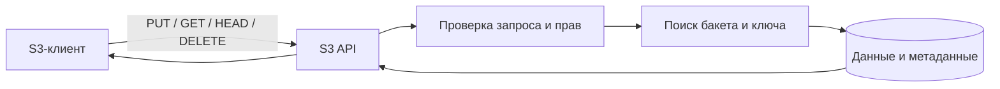

# Урок 04. Объекты S3: PUT, GET, HEAD, DELETE

> [!abstract] Цель урока
> Разобрать устройство объекта, его идентификацию и четыре базовые операции S3 API. Понять, какие действия выполняет объектное хранилище при записи, чтении и удалении данных.

**Предварительные знания:** уроки 1–3; понятия bucket, key, endpoint; базовая работа с AWS CLI.  
**Практическая среда:** локальный RustFS, AWS CLI, терминал `fish`.  
**Критерий завершения:** объект загружен, прочитан, проверен через HEAD и удалён; понятны последствия каждой операции.

---

## 1. Объект как единица хранения

**Object (объект)** — данные в виде последовательности байтов и связанные с ними метаданные, хранящиеся в бакете под определённым ключом.

У объекта различают:

- **Body** — содержимое: текст, изображение, архив или произвольные байты.
- **Key** — идентификатор внутри бакета.
- **Size** — размер содержимого в байтах, не включая метаданные.
- **Metadata** — сведения об объекте: тип содержимого, дата изменения и другие атрибуты.

S3 не интерпретирует содержимое как документ, фотографию или архив. Для хранилища это последовательность байтов; смысл данных определяет приложение.

> [!important] Главное отличие от файла
> Объект — единица операций S3 API, а не файл, который приложение открывает на диске сервера. Физическое размещение объекта скрыто за интерфейсом хранилища.

---

## 2. Идентификация объекта

Для обращения к объекту клиент указывает **bucket + key** и направляет запрос на соответствующий S3 endpoint.

```text
Endpoint: http://127.0.0.1:9000
Bucket:   s3-course-lesson1
Key:      docs/lesson04.txt
```

- Внутри бакета два текущих объекта не могут иметь один и тот же ключ.
- Одинаковый ключ в разных бакетах обозначает разные объекты.
- Символ `/` в ключе не создаёт файловый каталог.
- При включённом версионировании к идентификации отдельной версии добавляется `versionId` (урок 11).

**Имя локального файла не определяет ключ:** клиент сам выбирает, по какому ключу сохранить передаваемые байты.

---

## 3. Четыре операции S3 API

- **`PutObject` (PUT)** — записать содержимое и метаданные по заданному ключу; при существующем ключе изменить его текущую версию.
- **`GetObject` (GET)** — получить содержимое объекта и связанные заголовки ответа.
- **`HeadObject` (HEAD)** — получить сведения об объекте **без передачи его содержимого**.
- **`DeleteObject` (DELETE)** — удалить объект или сделать его недоступным как текущую версию; результат зависит от состояния версионирования.

Эти операции адресуют **конкретный объект**. Перечисление объектов — отдельная операция `ListObjectsV2`, которую разберём в уроке 5.

---

## 4. Что происходит внутри хранилища



На логическом уровне обработка операций различается:

1. **PUT:** проверить запрос → принять байты → сохранить данные и метаданные → подтвердить результат.
2. **GET:** проверить доступ → найти объект → передать его байты и заголовки клиенту.
3. **HEAD:** проверить доступ → найти сведения об объекте → вернуть заголовки без тела объекта.
4. **DELETE:** проверить доступ → применить удаление согласно настройкам бакета → вернуть результат.

**Граница абстракции:** S3 API задаёт наблюдаемое поведение операций, но не фиксирует формат хранения, число дисков, способ распределения данных или устройство индекса метаданных. AWS S3 и RustFS реализуют эти механизмы самостоятельно.

---

## 5. Перезапись и удаление: важные ограничения

**Повторный PUT с тем же `bucket + key`** не создаёт второй объект с другим ключом. В бакете без версионирования новое содержимое заменяет прежнее. При включённом версионировании AWS S3 сохраняет предыдущую версию и создаёт новую.

**DELETE в бакете без версионирования** удаляет объект. При включённом версионировании AWS S3 обычный DELETE создаёт *delete marker*, а прежние версии сохраняются.

Успешный ответ DELETE не является доказательством физического стирания байтов с каждого носителя. Физическое освобождение места относится к внутренней реализации и политике хранения.

---

## 6. Практика: полный жизненный цикл объекта

Используй бакет `s3-course-lesson1` из первой лаборатории и учётные данные RustFS из `.env`. AWS CLI должен быть установлен (урок 2).

```fish
cd ~/s3-course/lesson-01
set -gx AWS_ACCESS_KEY_ID (sed -n 's/^RUSTFS_ACCESS_KEY=//p' .env)
set -gx AWS_SECRET_ACCESS_KEY (sed -n 's/^RUSTFS_SECRET_KEY=//p' .env)
set -gx AWS_DEFAULT_REGION us-east-1

printf 'Object storage lesson 04\n' > lesson04.txt
```

**1. Запись (`PUT`):**

```fish
aws --endpoint-url http://127.0.0.1:9000 s3api put-object \
  --bucket s3-course-lesson1 --key docs/lesson04.txt \
  --body lesson04.txt --content-type text/plain
```

**2. Проверка сведений (`HEAD`):**

```fish
aws --endpoint-url http://127.0.0.1:9000 s3api head-object \
  --bucket s3-course-lesson1 --key docs/lesson04.txt
```

Изучи `ContentLength`, `ContentType` и `LastModified`. HEAD возвращает метаданные, но не содержимое файла.

**3. Чтение (`GET`) и проверка байтов:**

```fish
aws --endpoint-url http://127.0.0.1:9000 s3api get-object \
  --bucket s3-course-lesson1 --key docs/lesson04.txt downloaded04.txt
cmp lesson04.txt downloaded04.txt
```

**4. Удаление (`DELETE`):**

```fish
aws --endpoint-url http://127.0.0.1:9000 s3api delete-object \
  --bucket s3-course-lesson1 --key docs/lesson04.txt
```

**Критерий успеха:** `cmp` не обнаружил различий. После удаления GET без `versionId` больше не возвращает содержимое объекта.

---

## 7. Самостоятельные задания

1. Загрузи новый текст в `docs/lesson04.txt` и сравни `ContentLength` до и после записи. Почему изменился размер?
2. Объясни, для какой задачи backend использует HEAD вместо GET при проверке уже загруженного объекта.
3. Два клиента выполняют PUT одного ключа с разными данными. Какие архитектурные проблемы возникают, если приложение не контролирует конкурентные изменения?

---

## 8. Контрольные вопросы и итог

- [ ] Я различаю данные объекта, ключ и метаданные.
- [ ] Я понимаю, почему размер объекта измеряется в байтах содержимого.
- [ ] Я объясняю различие между PUT, GET, HEAD и DELETE.
- [ ] Я знаю, что один ключ не означает один и тот же объект во всех бакетах.
- [ ] Я отличаю удаление через API от физического стирания данных.

> [!success] Результат урока
> Объект доступен приложению через операции S3 API. Клиент задаёт бакет, ключ и действие; хранилище отвечает за проверку доступа, управление данными и метаданными. Физическая архитектура не раскрывается контрактом API.

**Следующий урок:** №5 — «Keys, Prefixes, Listing: логическая организация объектов и `ListObjectsV2`».

**Источники:** [Amazon S3 — Uploading objects](https://docs.aws.amazon.com/AmazonS3/latest/userguide/upload-objects.html), [HeadObject API](https://docs.aws.amazon.com/AmazonS3/latest/API/API_HeadObject.html), [DeleteObject API](https://docs.aws.amazon.com/AmazonS3/latest/API/API_DeleteObject.html).
