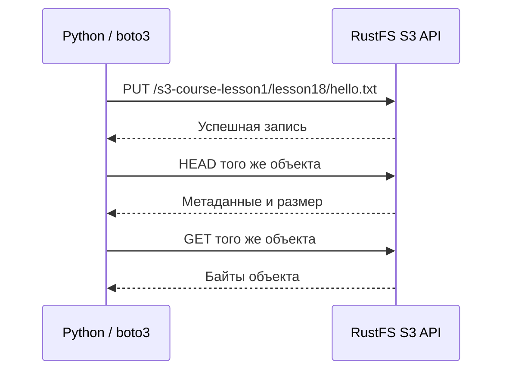

# Урок 18. AWS SDK и boto3: первый Python-клиент RustFS

> [!abstract] Цель урока
> Научиться вызывать S3 API из Python через `boto3`, понимать назначение `endpoint`, `region` и `credentials`, а также различать Client и Resource API.

**Предварительные знания:** уроки 1–17, HTTP, AWS CLI, основы Python.  
**Практическая среда:** запущенный RustFS (`http://127.0.0.1:9000`), Python, терминал `fish`, настроенные AWS credentials.  
**Критерий завершения:** Python создаёт объект в RustFS, читает его метаданные и скачивает те же байты.

---

## 1. Что такое SDK и boto3

**SDK (Software Development Kit)** — библиотека для вызова API из программного кода. **boto3** — официальный AWS SDK для Python, а **botocore** — его низкоуровневая основа: формирование запросов, подписание SigV4, HTTP, обработка ошибок и повторы.

Вместо ручного составления HTTP-запроса и заголовка `Authorization` вызываем метод:

```python
s3.put_object(Bucket="s3-course-lesson1", Key="a.txt", Body=b"hello")
```

SDK сам формирует и подписывает S3 `PUT`-запрос. **boto3 не является сервером**: объект хранит AWS S3 или RustFS.

## 2. Client и Resource API

| API | Что представляет | Когда использовать |
|---|---|---|
| `boto3.client("s3")` | Низкоуровневые методы, близкие к S3 API: `put_object`, `head_object`, `list_objects_v2` | Основной выбор для обучения и backend |
| `boto3.resource("s3")` | Объектные обёртки: `Bucket`, `Object` | Когда удобнее работать с Python-объектами |

Оба интерфейса используют S3 API. Например, `client.put_object(...)` и `resource.Object(bucket, key).put(...)` решают одну задачу записи.

> [!important] Не путай
> **Client / Resource** — интерфейсы программирования Python. **Bucket / Object** — сущности самого S3. `client` не соответствует отдельному сервису внутри RustFS.

## 3. Конфигурация подключения

| Параметр | Значение в лаборатории | Назначение |
|---|---|---|
| `endpoint_url` | `http://127.0.0.1:9000` | Адрес S3 API RustFS, не Console (`9001`) |
| `region_name` | `us-east-1` | Регион для конфигурации клиента и подписи запроса |
| `credentials` | Access Key + Secret Key | Идентификация и подпись SigV4 |
| `signature_version` | `s3v4` | Версия алгоритма подписи |
| `addressing_style` | `path` | Адрес вида `http://127.0.0.1:9000/bucket/key` |

`boto3` ищет credentials, в частности, в переменных `AWS_ACCESS_KEY_ID` / `AWS_SECRET_ACCESS_KEY` и в профилях AWS CLI. **Не сохраняй секреты в исходном коде и Git.**

Для RustFS явно задаём `path`-style: это рекомендованная конфигурация его официальной документации. В AWS S3 тип обращения к бакету и его регион зависят от конкретной конфигурации сервиса.

## 4. Лаборатория: подключение из Python

Создай каталог урока, виртуальное окружение и установи библиотеку (команды для `fish`):

```fish
mkdir -p ~/s3-course/lesson-18
cd ~/s3-course/lesson-18
python -m venv .venv
source .venv/bin/activate.fish
python -m pip install boto3
aws configure list
```

Проверь, что текущие AWS credentials относятся к локальной лаборатории. Бакет `s3-course-lesson1` уже создан на предыдущих уроках.

Создай `lesson18.py`:

```python
from pathlib import Path
import boto3
from botocore.config import Config

BUCKET = "s3-course-lesson1"
KEY = "lesson18/hello.txt"

s3 = boto3.client(
    "s3",
    endpoint_url="http://127.0.0.1:9000",
    region_name="us-east-1",
    config=Config(
        signature_version="s3v4",
        s3={"addressing_style": "path"},
    ),
)

Path("hello.txt").write_bytes(b"hello from boto3\n")
s3.upload_file("hello.txt", BUCKET, KEY)

info = s3.head_object(Bucket=BUCKET, Key=KEY)
print("Size:", info["ContentLength"])

s3.download_file(BUCKET, KEY, "downloaded.txt")
assert Path("hello.txt").read_bytes() == Path("downloaded.txt").read_bytes()
print("OK: downloaded bytes match")
```

Запусти:

```fish
python lesson18.py
```

**Ожидаемый результат:** размер **17 байт**, затем `OK: downloaded bytes match`. В RustFS появится объект `lesson18/hello.txt`.

## 5. Какие операции произошли внутри



- `upload_file` — **высокоуровневый менеджер передачи**; для маленького файла использует обычную загрузку, для большого может автоматически перейти к multipart.
- `head_object` — запрос только метаданных, без скачивания содержимого.
- `download_file` — управляемое скачивание в локальный файл.

Внутреннее размещение байтов в RustFS и AWS S3 различается; SDK этого не определяет.

## 6. Что одинаково у AWS S3 и RustFS

**Общее:** S3-операции, структура бакетов/ключей, подпись запросов и интерфейс `boto3`. **Отличие:** AWS SDK по умолчанию обращается к AWS endpoint; для RustFS мы явно подставляем локальный адрес и path-style. Поддержку конкретной дополнительной операции необходимо проверять на версии RustFS.

## 7. Самостоятельные задания

1. Измени `KEY` на `lesson18/second.txt` и проверь наличие обоих объектов.
2. Добавь `list_objects_v2(Bucket=BUCKET, Prefix="lesson18/")` и выведи `Key` каждого объекта.
3. Ошибочно укажи порт `9001` и объясни, почему это не S3 API.

## 8. Контрольные вопросы

- [ ] Чем SDK отличается от самого объектного хранилища?
- [ ] Где boto3 берёт ключи доступа и зачем требуется SigV4?
- [ ] Чем `client` отличается от `resource`?
- [ ] Что делает `endpoint_url` и почему регион — не то же самое, что адрес сервера?
- [ ] Каким HTTP-операциям соответствуют `upload_file`, `head_object`, `download_file`?

> [!success] Результат урока
> Один и тот же Python-код для основных S3-операций работает с разными S3-совместимыми хранилищами после настройки клиента. **Мы управляем объектами через API, а не через файловые пути RustFS.**

**Следующий урок:** №19 — «Потоковая передача, multipart и параллельные загрузки».

---

## Источники

1. [RustFS — boto3 (Python)](https://docs.rustfs.com/en/developer/examples/boto3)
2. [RustFS — Python SDK Guide](https://docs.rustfs.com/en/developer/sdk/python)
3. [Boto3 — Session](https://docs.aws.amazon.com/boto3/latest/guide/session.html)
4. [Boto3 — S3 upload_fileobj](https://docs.aws.amazon.com/boto3/latest/reference/services/s3/client/upload_fileobj.html)

**Дата сверки с документацией:** 2026-10-28. Возможности RustFS проверяй на установленной сборке.
