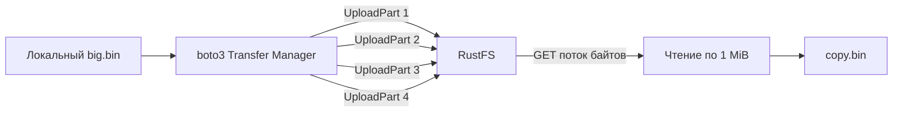

# Урок 19. Потоковая передача: Streaming, Multipart и память

> [!abstract] Цель урока
> Передавать большие объекты из Python без загрузки целого файла в RAM и понимать, как boto3 использует multipart и параллельные запросы.

**Предварительные знания:** уроки 9 и 18; методы `PutObject`, `GetObject`, `CreateMultipartUpload`.  
**Практическая среда:** Python + boto3, запущенный RustFS, бакет `s3-course-lesson1`.  
**Критерий завершения:** файл размером 32 MiB загружен с multipart, скачан порциями и побайтно совпадает с исходным.

---

## 1. Зачем нужен Streaming

**Streaming** — обработка последовательных порций данных вместо чтения всего содержимого в память.

- `data = open("big.bin", "rb").read()` — помещает весь файл в RAM.
- Чтение файла порциями по 1 MiB — удерживает в памяти текущие порции, а не все 32 MiB.

Для backend это важно: одновременная передача нескольких больших файлов не должна требовать RAM, равной сумме их размеров. **Ограниченный размер порции не означает нулевого использования памяти:** буферы SDK и параллельных операций тоже занимают RAM.

## 2. Streaming и Multipart — разные понятия

| Механизм | За что отвечает |
|---|---|
| **Streaming** | Как программа читает/пишет байты и расходует RAM |
| **Multipart Upload** | Как большой объект загружается частями через набор S3 API операций |
| **Parallel transfer** | Сколько частей передаётся одновременно |

**Streaming не требует multipart.** Один HTTP-запрос может отправлять тело потоком. И **multipart не гарантирует минимальное потребление RAM**: всё зависит от того, как реализован клиент.

## 3. Менеджер передач boto3

В boto3 методы `upload_file`, `upload_fileobj`, `download_file` управляют передачами. Через `TransferConfig` задаются:

- `multipart_threshold` — размер, начиная с которого менеджер выбирает multipart;
- `multipart_chunksize` — размер одной части multipart;
- `max_concurrency` — число одновременно выполняемых операций передачи;
- `use_threads` — разрешение многопоточности.

При multipart SDK выполняет последовательность `CreateMultipartUpload` → `UploadPart` (несколько вызовов) → `CompleteMultipartUpload`. Это тот же API, который мы вызывали вручную в уроке 9.

## 4. Лаборатория: загружаем 32 MiB

Используй виртуальное окружение урока 18 либо установи `boto3`. Создай тестовый файл без формирования 32 MiB в Python-памяти:

```fish
mkdir -p ~/s3-course/lesson-19
cd ~/s3-course/lesson-19
truncate -s 32M big.bin
```

Создай `lesson19.py`:

```python
from contextlib import closing
from pathlib import Path
import boto3
from boto3.s3.transfer import TransferConfig
from botocore.config import Config

BUCKET = "s3-course-lesson1"
KEY = "lesson19/big.bin"
MIB = 1024 * 1024

s3 = boto3.client(
    "s3",
    endpoint_url="http://127.0.0.1:9000",
    region_name="us-east-1",
    config=Config(
        signature_version="s3v4",
        s3={"addressing_style": "path"},
    ),
)

transfer = TransferConfig(
    multipart_threshold=8 * MIB,
    multipart_chunksize=8 * MIB,
    max_concurrency=2,
)

s3.upload_file("big.bin", BUCKET, KEY, Config=transfer)
print("Uploaded:", s3.head_object(Bucket=BUCKET, Key=KEY)["ContentLength"])

response = s3.get_object(Bucket=BUCKET, Key=KEY)
with closing(response["Body"]) as source, open("copy.bin", "wb") as target:
    while chunk := source.read(MIB):
        target.write(chunk)

print("Downloaded:", Path("copy.bin").stat().st_size)
```

Запуск и проверка:

```fish
python lesson19.py
sha256sum big.bin copy.bin
cmp big.bin copy.bin
```

**Ожидаемый результат:** `Uploaded: 33554432`, `Downloaded: 33554432`, совпадающие SHA-256 и успешный `cmp`.

## 5. Как это выполняется внутри



При размере 32 MiB и части 8 MiB менеджер формирует **4 части**. `max_concurrency=2` разрешает одновременно передавать до двух частей; это **не** два объекта или два экземпляра RustFS.

`get_object` возвращает `StreamingBody` в поле `Body`. Вызов `read(MIB)` читает до 1 MiB за итерацию, `close()` освобождает сетевой поток. `get_object` сам по себе не скачивает файл полностью в RAM; полный `Body.read()` без размера — другой сценарий.

## 6. AWS S3 и RustFS: границы ответственности

**boto3** управляет разбиением, параллелизмом и локальными буферами. **S3-сервер** принимает части, собирает объект и хранит его по своим внутренним правилам. Multipart совместим на уровне API; физические диски и внутренние фрагменты RustFS не равны multipart-частям.

> [!warning] Важно
> Если multipart не завершён через `CompleteMultipartUpload`, загруженные части не становятся обычным доступным объектом. Их следует очищать через `AbortMultipartUpload` или соответствующими правилами жизненного цикла, когда они поддерживаются.

## 7. Самостоятельные задания

1. Установи `max_concurrency=1`, затем `4`; сравни время передачи на своей машине.
2. Установи `multipart_threshold=64 * MIB` и выясни, почему для 32 MiB multipart не выбирается.
3. Замени `source.read(MIB)` на `source.read(256 * 1024)` и объясни, что изменилось в потреблении RAM, а что — нет.

## 8. Контрольные вопросы

- [ ] Могу отличить потоковое чтение от multipart upload.
- [ ] Знаю назначение `multipart_threshold` и `multipart_chunksize`.
- [ ] Понимаю, что контролирует `max_concurrency`.
- [ ] Знаю, почему `get_object(...)["Body"]` — поток, а не готовый `bytes`.
- [ ] Не путаю multipart-части S3 с физическими shard-фрагментами erasure coding.

> [!success] Результат урока
> Большие файлы можно передавать через boto3 с ограниченным расходом RAM; multipart и параллелизм настраиваются независимо от логики приложения.

**Следующий урок:** №20 — «Ошибки, повторы, тайм-ауты и конкурентная запись».

---

## Источники

1. [Boto3 — File transfer configuration](https://docs.aws.amazon.com/boto3/latest/guide/s3.html)
2. [Boto3 — upload_fileobj](https://docs.aws.amazon.com/boto3/latest/reference/services/s3/client/upload_fileobj.html)
3. [Boto3 — get_object и StreamingBody](https://docs.aws.amazon.com/boto3/latest/reference/services/s3/client/get_object.html)
4. [RustFS — Python SDK Guide](https://docs.rustfs.com/en/developer/sdk/python)

**Дата сверки с документацией:** 2026-10-28. Реальные расходы RAM и скорость зависят от настроек менеджера передач и окружения.
