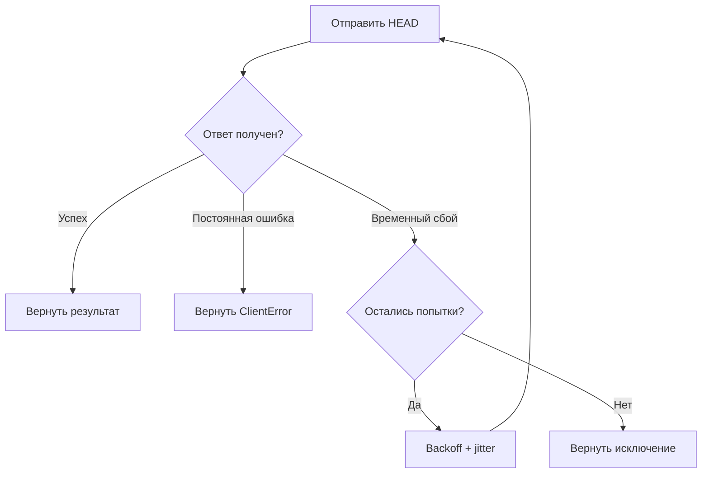

# Урок 20. Ошибки S3, Retry, Timeout и конкурентная запись

> [!abstract] Цель урока
> Научиться отличать постоянные ошибки от временных, настраивать тайм-ауты и автоматические повторы boto3, понимать ограничения идемпотентности и безопасной перезаписи.

**Предварительные знания:** уроки 11, 13, 18–19; HTTP-статусы и S3 API.  
**Практическая среда:** Python + boto3, RustFS в Docker, бакет `s3-course-lesson1`.  
**Критерий завершения:** клиент корректно сообщает о недоступности RustFS, не повторяет запросы бесконечно и возобновляет работу после запуска сервера.

---

## 1. Какие ошибки возникают при работе с S3

| Ситуация | Проявление | Что делать |
|---|---|---|
| Неверные права | `403 AccessDenied` | Исправить права или credentials; не повторять тот же запрос вслепую |
| Объект отсутствует | `404 NoSuchKey` | Проверить bucket/key или обработать отсутствие как штатный результат |
| Нарушено условие записи | `412 PreconditionFailed` | Перечитать состояние и разрешить конфликт |
| Временная перегрузка | `503 SlowDown` | Ограниченные повторы с backoff |
| Сервер не отвечает | `EndpointConnectionError`, timeout | Проверить соединение; повторы только в заданных пределах |

Ошибки S3 обычно приходят через `botocore.exceptions.ClientError`; сетевые ошибки представлены другими исключениями botocore. Код ошибки доступен в `error.response["Error"]["Code"]`.

## 2. Retry, Timeout и Backoff

- **Retry** — повтор запроса после сбоя.
- **Timeout** — предел ожидания соединения (`connect_timeout`) или чтения (`read_timeout`).
- **Backoff** — пауза между повторными запросами с увеличением интервала; **jitter** добавляет случайный разброс.

В `botocore` режим `standard` классифицирует сбои и автоматически повторяет часть сетевых ошибок, HTTP 5xx и throttling. Для постоянных ошибок типа `AccessDenied` он не должен запускать бессмысленные повторы.

Параметр `total_max_attempts=3` означает **один исходный запрос + не более двух повторов**. Он отличается от `max_attempts` внутри `botocore.config.Config`, где значение задаёт именно число *повторов*.

## 3. Почему повтор записи требует осторожности

**Идемпотентная операция** — повтор которой приводит к тому же логическому результату, что и однократное выполнение.

При сетевом сбое возможен сценарий: `PUT` уже сохранён сервером, но ответ потерялся. Повтор с тем же содержимым и ключом приведёт к той же текущей версии данных без versioning, **но с включённым versioning может создать дополнительную версию**. Повтор небезопасен, если после сбоя приложение меняет ключ, данные или рассчитывает, что объект создастся строго один раз.

Для операций «создать только один раз» полезны **уникальные ключи** и условные записи; для сложных процессов нужна прикладная логика идемпотентности.

## 4. Конкурентная запись и условия

Два клиента могут одновременно записать один `bucket + key`. Без защиты итоговое содержимое определяется порядком успешных записей; оба клиента не обязательно узнают, что перезаписали друг друга.

В **AWS S3** условные заголовки для `PutObject` решают эту задачу:

- `IfNoneMatch="*"` — создать объект только при отсутствии текущего объекта с таким ключом;
- `IfMatch=etag` — обновить только если текущий ETag совпадает с прочитанным ранее.

При нарушении условия AWS S3 возвращает `412 Precondition Failed`; при гонке отдельных операций возможен `409 Conflict`. **Поддержку и поведение этих условий в твоей версии RustFS нужно проверить отдельно.** `ETag` не следует считать универсальным MD5-суммой содержимого.

## 5. Лаборатория: отключаем RustFS и наблюдаем Retry

Создай `lesson20.py` (используй `boto3` из урока 18):

```python
import logging
import boto3
from botocore.config import Config
from botocore.exceptions import BotoCoreError, ClientError

boto3.set_stream_logger("botocore.retries", logging.DEBUG)

s3 = boto3.client(
    "s3",
    endpoint_url="http://127.0.0.1:9000",
    region_name="us-east-1",
    config=Config(
        signature_version="s3v4",
        s3={"addressing_style": "path"},
        connect_timeout=2,
        read_timeout=3,
        retries={"mode": "standard", "total_max_attempts": 3},
    ),
)

try:
    s3.head_bucket(Bucket="s3-course-lesson1")
    print("RustFS доступен")
except ClientError as error:
    print("Ошибка S3:", error.response["Error"]["Code"])
except BotoCoreError as error:
    print("Сбой подключения после повторов:", type(error).__name__)
```

1. При запущенном RustFS выполни `python lesson20.py` — получи `RustFS доступен`.
2. В каталоге своего `compose.yaml` выполни `docker compose stop rustfs`.
3. Повтори `python lesson20.py` — увидишь попытки SDK в логах и завершение с ошибкой подключения.
4. Выполни `docker compose start rustfs` и снова запусти Python — запрос должен пройти.

**Не останавливай другие контейнеры лаборатории**, если они нужны для работы RustFS (например, отдельный KMS). В ходе практики мы проверяем сетевую недоступность, а не свойства данных на диске.

## 6. Что происходит внутри клиента



`boto3` не «чинит» хранилище: он лишь повторяет запросы, которые его политика считает допустимыми. Приложение должно фиксировать итоговый отказ и решать, что делать с задачей дальше.

## 7. Самостоятельные задания

1. Измени `total_max_attempts` с `3` на `1`: сравни число попыток при остановленном RustFS.
2. Укажи несуществующий `Bucket`: поймай `ClientError`, выведи `HTTPStatusCode` и `Error.Code`.
3. Если твоя сборка RustFS поддерживает условные записи, дважды вызови `s3.put_object(Bucket="s3-course-lesson1", Key="lesson20/once.txt", Body=b"once", IfNoneMatch="*")` и объясни ответ второго вызова.

## 8. Контрольные вопросы

- [ ] Могу отличить `ClientError` от сетевой ошибки.
- [ ] Понимаю различие `connect_timeout` и `read_timeout`.
- [ ] Знаю, зачем ограничивать retry и использовать backoff.
- [ ] Могу объяснить проблему «сервер сохранил PUT, но ответ потерялся».
- [ ] Понимаю, как versioning и `If-Match` / `If-None-Match` влияют на повторные и конкурентные записи.

> [!success] Результат урока
> Надёжный S3-клиент **не повторяет все ошибки подряд**: он ограничивает ожидание и число попыток, различает сетевые сбои и ошибки API, а конфликтующие записи обрабатывает явно.

**Следующий урок:** №21 — «Архитектура объектного хранилища: API layer, storage layer, metadata».

---

## Источники

1. [Botocore — Config](https://docs.aws.amazon.com/botocore/latest/reference/config.html)
2. [Boto3 — Error handling](https://docs.aws.amazon.com/boto3/latest/guide/error-handling.html)
3. [Boto3 — Retries](https://docs.aws.amazon.com/boto3/latest/guide/retries.html)
4. [AWS S3 — Conditional writes](https://docs.aws.amazon.com/AmazonS3/latest/userguide/conditional-writes.html)
5. [RustFS — Python SDK Guide](https://docs.rustfs.com/en/developer/sdk/python)

**Дата сверки с документацией:** 2026-10-28. Режимы retry и детали совместимости RustFS проверяй на установленной версии SDK и сервера.
