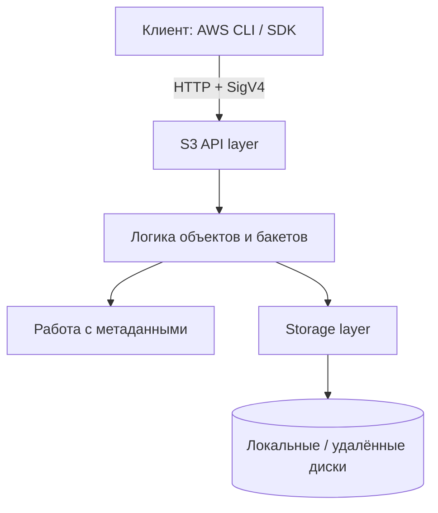
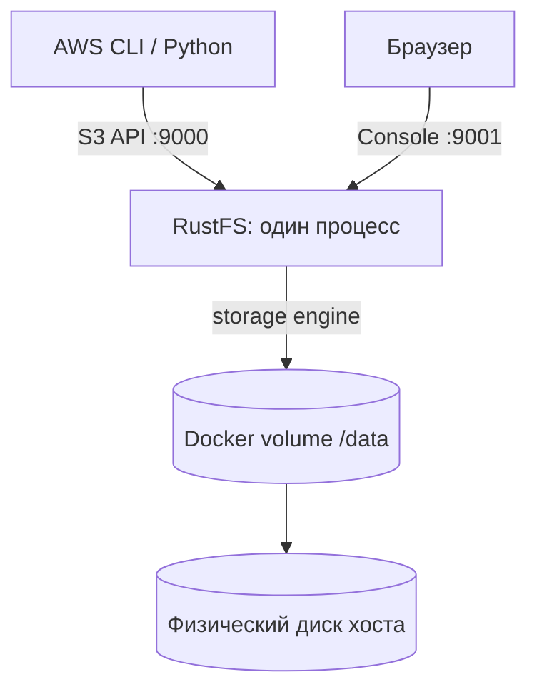

# Урок 21. Архитектура объектного хранилища

> [!abstract] Цель урока
> Понять, какие слои участвуют в работе S3-совместимого хранилища, чем различаются **API**, **метаданные**, **данные**, **data plane** и **control plane**, а затем построить схему собственной лаборатории RustFS.

**Предварительные знания:** S3 API, bucket, object, key, SigV4, базовые команды Docker.  
**Практическая среда:** действующий RustFS на `127.0.0.1:9000`, Console на `:9001`, AWS CLI, Docker Compose.  
**Критерий завершения:** построена схема действующего экземпляра RustFS; каждому слою и порту назначена понятная роль; отделены факты о своей лаборатории от предположений об AWS S3.

---

## 1. Зачем делить хранилище на слои

Клиент видит простую операцию `PUT bucket/key`, но серверу необходимо проверить запрос, решить, где сохранить объект, записать байты и метаданные, а затем сформировать ответ.



**Слой** — логическая область ответственности. На схеме блоки не означают обязательные отдельные процессы, контейнеры или базы данных.

## 2. Четыре ключевые области

| Область | Что делает | Пример |
|---|---|---|
| **API layer** | Принимает HTTP, проверяет подпись и права, разбирает S3-операцию | `PutObject`, `GetObject` |
| **Object/storage logic** | Управляет бакетами, версиями, условиями операции, размещением | Выбор erasure set |
| **Metadata** | Хранит сведения об объекте и его версиях | Размер, ETag, VersionId, части |
| **Data storage** | Сохраняет фактические байты объекта или его фрагменты | Локальный диск / shards |

**Метаданные** описывают объект; **данные** составляют его содержимое. Это логическое различие: маленькое содержимое может быть физически встроено в файл метаданных, а метаданные и фрагменты могут располагаться на одних дисках.

> [!important] API не задаёт внутренний формат
> Клиенту не нужно знать имена файлов на диске, количество фрагментов или способ хранения метаданных. Он работает через `bucket + key` и при необходимости `versionId`.

## 3. Data plane и control plane

- **Data plane** — путь пользовательских данных: `PUT`, `GET`, `HEAD` и действия чтения/записи внутри storage engine.
- **Control plane** — управление системой: конфигурация, IAM, настройки бакетов, состояние кластера, политики и административные операции.
- **Фоновые процессы** — lifecycle, scanner, healing, replication; они могут читать и менять данные, хотя управляются административными настройками.

В RustFS эти области существуют как логические подсистемы одного сервера. Не следует делать вывод, что для них обязательно запущены отдельные микросервисы.

## 4. AWS S3 и RustFS: что можно утверждать

| Вопрос | AWS S3 | RustFS |
|---|---|---|
| Внешний интерфейс | Управляемый облачный S3 API | S3-совместимый API собственной установки |
| Управление инфраструктурой | Скрыто от клиента AWS | Ноды, диски и конфигурация доступны оператору |
| Физический формат | Внутренний формат AWS не раскрыт через S3 API | Реализация и формат изучаются по документации и коду RustFS |
| Отказоустойчивость | Определяется характеристиками сервиса и класса хранения | Зависит от фактической топологии и erasure coding |

**Не утверждай**, что AWS S3 использует точно такой же `xl.meta`, erasure set или схему RPC, что и RustFS: S3 API этого не гарантирует.

## 5. Как устроена наша текущая лаборатория

В базовом варианте курса используется **SNSD — Single Node Single Disk**.



- **Node** — экземпляр RustFS.
- **Docker volume** — монтирование хранилища в контейнер, не отдельный физический диск.
- **SNSD** — один storage endpoint без избыточных shards: отказ единственного диска приводит к потере данных, если нет резервной копии.

## 6. Практика: зафиксировать реальную схему

В каталоге, где находится `compose.yaml` запущенной лаборатории:

```fish
docker compose ps
docker compose logs --tail=25 rustfs
docker inspect (docker compose ps -q rustfs) \
    --format '{{range .Mounts}}{{println .Destination .Type .Name}}{{end}}'
```

Далее проверь S3 API (учётные данные AWS CLI настроены ранее):

```fish
aws --endpoint-url http://127.0.0.1:9000 --region us-east-1 \
    s3api head-bucket --bucket s3-course-lesson1
curl -i http://127.0.0.1:9000/health
```

1. Укажи на собственной схеме клиент, S3 endpoint, Console, RustFS и том.
2. Отметь, где проверяются права, где выполняется логика объектов, а где лежат байты.
3. Подпиши **один узел, один диск, нулевая избыточность**. Не рисуй несуществующие реплики.

> [!note] Что показывает эксперимент
> Команды подтверждают запущенные контейнеры, монтирования и доступность S3 API. Они **не** доказывают устройство всех внутренних алгоритмов; для этого нужны логи, документация или исходный код.

## 7. Самостоятельные задания

1. Объясни, почему `HEAD` относится к пользовательскому API, хотя не возвращает тело объекта.
2. Отнеси к data/control plane: загрузку файла, изменение bucket policy, выдачу списка объектов, настройку lifecycle.
3. Объясни, почему PostgreSQL не является обязательной отдельной базой метаданных RustFS.
4. Нарисуй вторую схему: четыре RustFS-узла с общим S3 endpoint через балансировщик. Пока **не** назначай конкретный алгоритм распределения.

## 8. Контрольные вопросы и итог

- [ ] Я различаю API layer, metadata и storage layer.
- [ ] Я понимаю data plane и control plane как области ответственности.
- [ ] Я знаю, что Console `:9001` и S3 API `:9000` выполняют разные задачи.
- [ ] Я не переношу детали реализации RustFS на AWS S3.
- [ ] Я могу нарисовать свою **фактическую**, а не воображаемую топологию.

> [!success] Результат урока
> S3 API скрывает реализацию хранения. RustFS предоставляет этот API и самостоятельно управляет метаданными, размещением байтов и дисками. Теперь можно проследить операцию **PUT** от входящего HTTP до подтверждения клиенту.

**Следующий урок:** №22 — «Путь записи объекта: от PUT до диска».

---

## Источники

1. [RustFS — Architecture](https://github.com/rustfs/rustfs/blob/main/ARCHITECTURE.md)
2. [RustFS — Storage, Control Plane, and Background Controllers](https://github.com/rustfs/rustfs/blob/main/docs/architecture/storage-control-data-plane.md)
3. [RustFS — варианты установки](https://docs.rustfs.com/en/installation/linux)
4. [Amazon S3 User Guide](https://docs.aws.amazon.com/AmazonS3/latest/userguide/Welcome.html)

**Дата сверки с документацией:** 2026-10-28. Названия внутренних модулей и формат хранения относятся к указанной версии документации RustFS; детали могут меняться между релизами.
