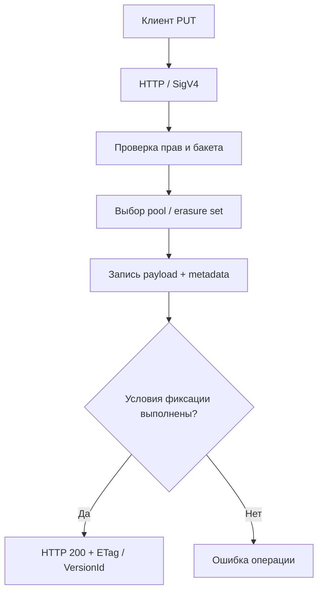

# Урок 22. Путь записи объекта: от PUT до диска

> [!abstract] Цель урока
> Разобрать путь `PutObject`: проверка запроса и прав, выбор места хранения, запись содержимого и метаданных, фиксация операции и ответ клиенту. Проследить запрос в AWS CLI и логах RustFS.

**Предварительные знания:** SigV4, `PutObject`, `HeadObject`, архитектура из урока 21.  
**Практическая среда:** текущий RustFS и AWS CLI; каталог с `compose.yaml`.  
**Критерий завершения:** объект успешно загружен, его размер и содержимое проверены; последовательность серверных этапов объяснена без смешения поведения SNSD и erasure coding.

---

## 1. Что отправляет клиент

```text
PUT /s3-course-lesson1/arch/lesson22.txt HTTP/1.1
Host: 127.0.0.1:9000
Authorization: AWS4-HMAC-SHA256 ...
Content-Length: ...

<байты файла>
```

Клиент передаёт **bucket**, **key**, байты и HTTP-заголовки. SigV4 доказывает владение ключом подписи; затем сервер проверяет разрешение на операцию. Наличие корректной подписи **не заменяет** проверку IAM/bucket policy.

## 2. Логический путь PUT



**Порядок смысловых этапов:**

1. Принять HTTP-запрос и установить S3-операцию.
2. Проверить подлинность, политику и доступность бакета.
3. Определить параметры объекта: ключ, версию, метаданные, шифрование, класс хранения.
4. Выбрать внутреннее размещение согласно конфигурации.
5. Сохранить данные и метаданные и зафиксировать запись согласно требованиям storage engine.
6. Вернуть результат клиенту.

> [!important] Что означает `200 OK`
> Сервер подтвердил завершение S3-операции по правилам своей конфигурации. Это **не означает**, что объект сохранён в трёх копиях: в SNSD второго диска нет. Устойчивость к внезапной потере питания также зависит от режима синхронизации данных с носителем.

## 3. Куда именно записываются данные

| Режим | Внутренняя запись |
|---|---|
| **SNSD** | Один локальный storage endpoint; parity `0`, отсутствует избыточность |
| **Многодисковый RustFS** | Выбор erasure set, разбиение на data/parity shards, запись на диски, контроль quorum |
| **AWS S3** | Внутренняя физическая схема скрыта от S3-клиента |

В текущей реализации RustFS метаданные версий представлены форматом `xl.meta`; небольшое содержимое может храниться **inline** вместе с метаданными. Поэтому «отдельный файл метаданных и отдельный файл содержимого» — не универсальное правило.

## 4. Версия, ETag, атомарность

- **ETag** — значение в ответе, которое можно использовать для условных запросов; **не** считай его неизменно равным MD5 всего файла.
- **VersionId** возвращается при соответствующем режиме версионирования; новая запись того же `key` создаёт новую версию, если versioning включён.
- **Quorum** в erasure-coded RustFS — достаточное число согласованных успешных операций с дисками для принятия решения. Для SNSD quorum нескольких дисков не возникает.
- При недостижении write quorum сервер не должен подтверждать успешный PUT; остаточные временные данные при сбоях требуют внутренней очистки/healing.

## 5. Практика: PUT и проверка результата

В терминале `fish`:

```fish
printf 'PUT path in RustFS\n' > lesson22.txt

aws --endpoint-url http://127.0.0.1:9000 --region us-east-1 \
    s3api put-object \
    --bucket s3-course-lesson1 \
    --key arch/lesson22.txt \
    --body lesson22.txt \
    --content-type text/plain

aws --endpoint-url http://127.0.0.1:9000 --region us-east-1 \
    s3api head-object \
    --bucket s3-course-lesson1 \
    --key arch/lesson22.txt
```

Проверь `ContentLength`, `ETag` и наличие `VersionId` в ответах, **если он возвращён**. Набор полей зависит от параметров операции и режима бакета.

## 6. Практика: логи клиента и сервера

В первом терминале из каталога Compose:

```fish
docker compose logs -f --tail=20 rustfs
```

Во втором повтори PUT с новым ключом:

```fish
aws --endpoint-url http://127.0.0.1:9000 --region us-east-1 \
    s3api put-object \
    --bucket s3-course-lesson1 \
    --key arch/lesson22-second.txt \
    --body lesson22.txt
```

Если в логах не видно детального пути запроса, это **не означает**, что PUT не выполнялся: уровень `info` не обязан выводить каждый внутренний шаг. Для расширенной диагностики RustFS поддерживает `RUSTFS_OBS_LOGGER_LEVEL=debug` и экспорт трассировок через OpenTelemetry (`RUSTFS_OBS_ENDPOINT`). Изменяй эти настройки только для своей тестовой среды.

Дополнительно клиентскую отладку можно включить через `aws --debug ...`; **не публикуй** необработанный вывод — в нём могут присутствовать чувствительные данные подписи и заголовков.

## 7. Самостоятельные задания

1. Объясни разницу между `AccessDenied` и ошибкой storage engine при записи на диск.
2. Повтори PUT в тот же ключ при включённом versioning. Посмотри `list-object-versions` и объясни результат.
3. Нарисуй, на каком этапе могла возникнуть ошибка «недостаточно доступных дисков».
4. Ответь: почему по одному `200 OK` нельзя определить количество физических копий?

## 8. Контрольные вопросы и итог

- [ ] Я последовательно объясняю путь PUT от HTTP до подтверждения.
- [ ] Я различаю авторизацию запроса и фактическую запись данных.
- [ ] Я не считаю `ETag` универсальной MD5-суммой.
- [ ] Я понимаю различие SNSD и multi-drive записи.
- [ ] Я могу найти серверные логи, не путая их с логами AWS CLI.

> [!success] Результат урока
> `PutObject` — это не простое копирование файла в каталог. Это проверяемая S3-операция, за которой стоят политика доступа, выбор размещения, сохранение метаданных и фиксация результата.

**Следующий урок:** №23 — «Путь чтения объекта: GET, HEAD и Range».

---

## Источники

1. [RustFS — Architecture: PUT data flow](https://github.com/rustfs/rustfs/blob/main/ARCHITECTURE.md)
2. [RustFS — Erasure Coding: write path, quorum, on-disk format](https://github.com/rustfs/rustfs/blob/main/docs/architecture/erasure-coding.md)
3. [RustFS — Observability](https://docs.rustfs.com/en/operations/observability)
4. [AWS S3 API — PutObject](https://docs.aws.amazon.com/AmazonS3/latest/API/API_PutObject.html)

**Дата сверки с документацией:** 2026-10-28. Точный перечень внутренних событий в логах зависит от сборки и конфигурации RustFS.
