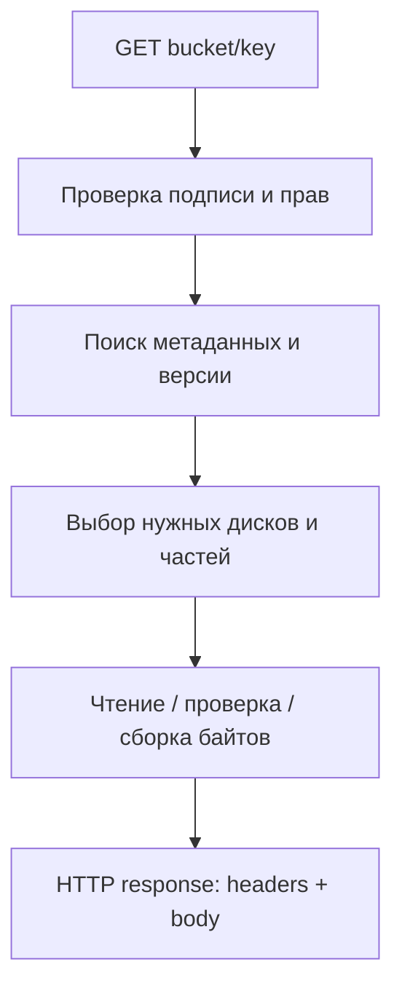

# Урок 23. Путь чтения объекта: GET, HEAD и Range

> [!abstract] Цель урока
> Проследить путь чтения объекта: поиск по `bucket + key`, выбор версии, проверка метаданных и прав, получение байтов, формирование ответа. Сравнить `GET`, `HEAD` и частичное чтение `Range`.

**Предварительные знания:** `GetObject`, `HeadObject`, `Range`, `VersionId`, урок 22.  
**Практическая среда:** RustFS `http://127.0.0.1:9000`, AWS CLI, терминал `fish`.  
**Критерий завершения:** полный GET совпадает с исходным файлом, HEAD возвращает сведения без тела, Range возвращает выбранную часть объекта.

---

## 1. От ключа к физическим байтам

Снаружи объект идентифицируется `bucket + key` и, при запросе старой версии, `versionId`. Клиент **не** передаёт путь вида `/data/disk0/part.1`: такой путь относится к внутренней реализации RustFS.



В многодисковом RustFS перед выдачей данных могут потребоваться чтение нескольких shards, проверка целостности и восстановление недостающих частей. В SNSD таких резервных фрагментов нет.

## 2. Что хранится в метаданных для чтения

- **Size** — сколько байтов содержится в объекте.
- **ETag** и проверки целостности — сведения, используемые в ответах и при условных запросах.
- **VersionId / delete marker** — какая версия считается текущей и существует ли доступное содержимое.
- **Parts / data directory / erasure layout** — информация внутреннего формата RustFS, по которой storage engine находит данные.
- **Content-Type**, пользовательские метаданные — заголовки ответа.

> [!important] Метаданные не обязаны быть в отдельной базе
> В RustFS данные версий и схема размещения могут храниться внутри `xl.meta` на storage-дисках. Для небольших объектов возможен формат inline, когда фрагменты содержимого размещены вместе с метаданными.

## 3. GET, HEAD, Range: различия

| Операция | Что возвращает | Зачем нужна |
|---|---|---|
| **GET** | Заголовки и тело объекта | Скачать содержимое |
| **HEAD** | Заголовки без тела | Узнать размер, ETag, Content-Type, метаданные |
| **GET с Range** | Заголовки и выбранные байты | Прочитать часть большого объекта |

Для корректного диапазона `bytes=0-9` сервер возвращает **10 байтов** (позиции включительно); HTTP-ответ для частичного содержимого — `206 Partial Content`. Для полноценного GET используется `200 OK`.

**Важно:** HEAD **не** означает «хранилище вообще не читает диск». Оно может читать или проверять метаданные, но **не отправляет клиенту тело объекта**.

## 4. Что происходит при отсутствии версии или фрагментов

1. Бакета или ключа нет / объект скрыт текущим delete marker → операция чтения не возвращает содержимое (HTTP-статус зависит от условий и прав запроса).
2. Указан `versionId` → RustFS ищет эту конкретную версию, а не автоматически текущую.
3. Один shard недоступен в erasure-coded конфигурации → чтение возможно, если хватает согласованных метаданных и фрагментов для read quorum.
4. Доступных фрагментов меньше порога восстановления → операция завершается ошибкой; неполный набор байтов не должен выдаваться как корректный объект.

В RustFS для схемы `K+M` восстановление содержимого требует не менее `K` доступных shards; при этом проверка согласованности версий и метаданных — отдельное необходимое условие.

## 5. Практика: полный цикл чтения

Подготовь новый объект в тестовом бакете:

```fish
printf '0123456789ABCDEFGHIJ\n' > lesson23.txt

aws --endpoint-url http://127.0.0.1:9000 --region us-east-1 \
    s3api put-object \
    --bucket s3-course-lesson1 \
    --key arch/lesson23.txt \
    --body lesson23.txt \
    --content-type text/plain
```

Получение метаданных и полного содержимого:

```fish
aws --endpoint-url http://127.0.0.1:9000 --region us-east-1 \
    s3api head-object \
    --bucket s3-course-lesson1 --key arch/lesson23.txt

aws --endpoint-url http://127.0.0.1:9000 --region us-east-1 \
    s3api get-object \
    --bucket s3-course-lesson1 --key arch/lesson23.txt \
    downloaded23.txt

cmp lesson23.txt downloaded23.txt
```

**Результат:** `cmp` не выводит различий; `head-object` содержит `ContentLength: 21` (20 символов и перевод строки).

## 6. Практика: частичное чтение

```fish
aws --endpoint-url http://127.0.0.1:9000 --region us-east-1 \
    s3api get-object \
    --bucket s3-course-lesson1 --key arch/lesson23.txt \
    --range bytes=0-9 \
    first10.txt

cat first10.txt
wc -c first10.txt
```

**Ожидаемые байты:** `0123456789`. Размер — `10`. В выводе `get-object` проверь `ContentRange`: `bytes 0-9/21`.

> [!note] Что доказывает эксперимент
> Клиент получил полный объект и указанную последовательность байтов. Эксперимент **не подтверждает**, что при чтении применялся Reed–Solomon: текущая лаборатория SNSD не имеет избыточных shards.

## 7. Самостоятельные задания

1. Объясни, зачем серверу метаданные до чтения тела объекта.
2. Запроси `--range bytes=10-19` и объясни полученный ответ.
3. При включённом versioning создай новую версию ключа, затем прочитай старую по `--version-id`.
4. Ответь: почему наличие `M` parity shards не позволяет игнорировать проверку метаданных и контрольных сумм?

## 8. Контрольные вопросы и итог

- [ ] Я знаю, как `bucket + key` превращается во внутренний поиск объекта.
- [ ] Я различаю GET, HEAD и Range.
- [ ] Я понимаю разницу между полным чтением и реконструкцией недостающих shards.
- [ ] Я знаю, что `versionId` меняет выбор читаемых данных.
- [ ] Я проверил результат GET через `cmp`.

> [!success] Результат урока
> Чтение в S3 — это выбор объекта и версии, чтение метаданных, получение корректных байтов и HTTP-ответ. Метаданные участвуют в выборе физического содержимого даже тогда, когда клиент видит только `GET bucket/key`.

**Следующий урок:** №24 — «Физическая организация хранения: drive, pool, erasure set и `xl.meta`».

---

## Источники

1. [AWS S3 API — GetObject](https://docs.aws.amazon.com/AmazonS3/latest/API/API_GetObject.html)
2. [AWS S3 API — HeadObject](https://docs.aws.amazon.com/AmazonS3/latest/API/API_HeadObject.html)
3. [RustFS — Erasure Coding: read path and metadata](https://github.com/rustfs/rustfs/blob/main/docs/architecture/erasure-coding.md)
4. [RustFS — Architecture](https://github.com/rustfs/rustfs/blob/main/ARCHITECTURE.md)

**Дата сверки с документацией:** 2026-10-28. Физическое чтение зависит от версии RustFS, режима хранения и параметров объекта.
