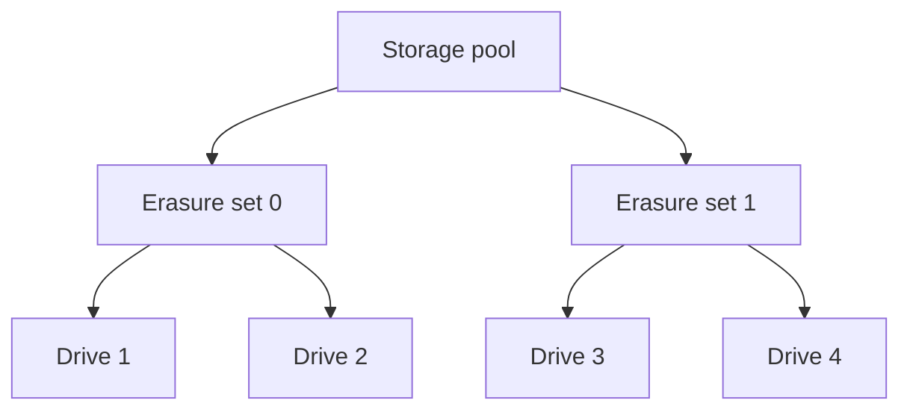

# Урок 24. Физическая организация хранения RustFS

> [!abstract] Цель урока
> Понять различия между **диском**, **storage endpoint**, **pool**, **erasure set**, внутренними файлами данных и метаданными. Безопасно исследовать Docker-том RustFS и не спутать каталоги на одном диске с независимыми носителями.

**Предварительные знания:** внутренняя схема RustFS, запись и чтение из уроков 21–23.  
**Практическая среда:** текущая лаборатория RustFS SNSD, Docker, AWS CLI, `fish`.  
**Критерий завершения:** найдены монтирование данных и файлы внутреннего формата; объяснено, почему наблюдаемая структура отличается от `bucket/key` и почему одна папка не равна одному диску.

---

## 1. От физического диска к erasure set

| Термин | Строгое значение |
|---|---|
| **Physical disk** | Отдельный физический носитель или устройство хранения |
| **Storage endpoint / drive** | Путь или сетевой адрес диска, используемый RustFS как единица хранения |
| **Pool** | Группа storage endpoints в конфигурации кластера |
| **Erasure set** | Подмножество дисков pool, в пределах которого размещаются shards **одного объекта** |
| **Shard** | Фрагмент объекта: data либо parity |

Схема многодискового размещения:



Это **схема понятий**, а не утверждение о текущем количестве sets или дисков. В реальной конфигурации ширина set и их число выводятся из топологии и фиксируются в формате хранилища.

## 2. Как RustFS выбирает место для объекта

1. На уровне pool/set система определяет, в какую группу дисков должен попасть объект.
2. В RustFS выбор erasure set зависит от хеша ключа и сохранённой версии алгоритма размещения.
3. Внутри выбранного set данные распределяются по дискам согласно схеме shard distribution.
4. **Один объект не разбивается произвольно по всем sets кластера**: его EC-фрагменты принадлежат выбранному set.

> [!important] Два разных алгоритма
> **Object-to-set placement** определяет набор дисков. **Intra-set distribution** определяет, на каких дисках выбранного набора окажутся конкретные shards. Это разные стадии размещения.

## 3. Что лежит на дисках RustFS

В документированном внутреннем формате RustFS встречаются:

- **`xl.meta`** — бинарные метаданные объекта и его версий, включая информацию об erasure coding и частях.
- **`part.1`, `part.N`** — файлы фрагментов или частей данных в соответствующих внутренних каталогах.
- **`.rustfs.sys`** — служебная область метаданных и конфигурации.
- **Inline data** — для небольших объектов payload может быть встроен в метаданные вместо отдельного файла части.

**Важное следствие:** нельзя требовать наличия ровно одного файла `part.1` на каждый S3 object или ожидать, что все `key/` будут привычными POSIX-каталогами. Версионирование, multipart и inline меняют внутреннюю картину.

## 4. Чем режим SNSD отличается от нескольких дисков

- **SNSD:** один узел и один путь хранения; erasure parity `0`; дополнительных фрагментов для восстановления нет.
- **SNMD:** один сервер, несколько отдельных дисков; EC может сохранить объект при отказе части дисков, но отказ всего сервера остаётся общим риском.
- **MNMD:** несколько узлов и несколько дисков; EC распределяется между узлами согласно топологии, а отказоустойчивость зависит от числа потерянных shards в **каждом set**.

Четыре каталога на **одном** физическом SSD не равны четырём независимым SSD. Они создают отдельные пути, но имеют общий домен отказа.

## 5. Практика: определить том Docker

В каталоге `compose.yaml`:

```fish
docker compose ps

docker inspect (docker compose ps -q rustfs) \
    --format '{{range .Mounts}}{{println .Destination .Type .Name}}{{end}}'
```

Для базовой лаборатории путь назначения — `/data`, тип — `volume`. Найди имя тома именно у работающего контейнера:

```fish
set VOL (docker inspect (docker compose ps -q rustfs) \
    --format '{{range .Mounts}}{{if eq .Destination "/data"}}{{.Name}}{{end}}{{end}}')

echo $VOL
```

Если монтирование задано как `bind`, поле `.Name` пустое: для такого случая сначала проверь реальный путь `.Source` и **не запускай** следующую команду с пустым `VOL`.

## 6. Практика: исследовать данные только для чтения

**Для named volume** из предыдущего шага запусти отдельный временный контейнер с правом `readonly`:

```fish
docker run --rm --network none \
    --mount "type=volume,source=$VOL,target=/mnt/store,readonly" \
    alpine:3.20 \
    sh -c 'find /mnt/store -maxdepth 6 -type f | head -40'
```

Найти метаданные (при наличии объектов в выбранном томе):

```fish
docker run --rm --network none \
    --mount "type=volume,source=$VOL,target=/mnt/store,readonly" \
    alpine:3.20 \
    sh -c 'find /mnt/store -type f -name xl.meta | head -20'
```

Параллельно сравни логическое представление через API:

```fish
aws --endpoint-url http://127.0.0.1:9000 --region us-east-1 \
    s3api list-objects-v2 --bucket s3-course-lesson1 --prefix arch/
```

**Запиши наблюдения:** какие ключи выдаёт S3 и какие файлы/служебные директории находятся внутри тома. Не делай вывод об отсутствии объекта только из отсутствия отдельного `part.1`.

> [!warning] Не модифицируй данные напрямую
> Нельзя удалять, копировать, переименовывать или изменять `xl.meta`, shards, `format.json` и `.rustfs.sys` вручную. Даже если API продолжает отвечать, можно нарушить согласованность версий и внутреннего размещения. Чтение работающего тома также **не является** консистентным резервным снимком.

## 7. Самостоятельные задания

1. Объясни разницу между **Docker volume**, **storage endpoint** и **physical disk**.
2. Почему S3-ключ `docs/a.txt` не обязан соответствовать пользовательскому файлу `/data/docs/a.txt`?
3. В кластере два sets по шесть дисков. Сколько sets участвует в хранении **одного** объекта?
4. Почему нельзя «расширить SNSD» простым добавлением второго пути к уже инициализированной топологии? (Подсказка: persisted layout.)

## 8. Контрольные вопросы и итог

- [ ] Я различаю pool, erasure set, storage endpoint и диск.
- [ ] Я понимаю, что placement и shard distribution — разные действия.
- [ ] Я знаю назначение `xl.meta` и `.rustfs.sys`.
- [ ] Я понимаю ограничения SNSD и логических дисков на одном SSD.
- [ ] Я исследовал том без записи в служебные файлы.

> [!success] Результат урока
> Ключ объекта — внешний адрес. Физическое содержимое RustFS определяется внутренним форматом и топологией. Защита от отказов зависит не от числа папок, а от независимости носителей и количества доступных shards.

**Следующий урок:** №25 — «Репликация и Erasure Coding: 3×, 4+2 и 8+4».

---

## Источники

1. [RustFS — Erasure Coding: pools, sets, distribution, `xl.meta`](https://github.com/rustfs/rustfs/blob/main/docs/architecture/erasure-coding.md)
2. [RustFS — ECStore layout boundary](https://github.com/rustfs/rustfs/blob/main/docs/architecture/ecstore-layout-boundary.md)
3. [RustFS — Placement and Repair Invariants](https://github.com/rustfs/rustfs/blob/main/docs/architecture/placement-repair-invariants.md)
4. [RustFS — Cluster lifecycle and immutable layout](https://github.com/rustfs/rustfs/blob/main/docs/operations/cluster-lifecycle-operations.md)
5. [RustFS — режимы установки](https://docs.rustfs.com/en/installation/linux)

**Дата сверки с документацией:** 2026-10-28. Внутренние имена файлов относятся к документированному формату RustFS; не использовать их как публичный API.
