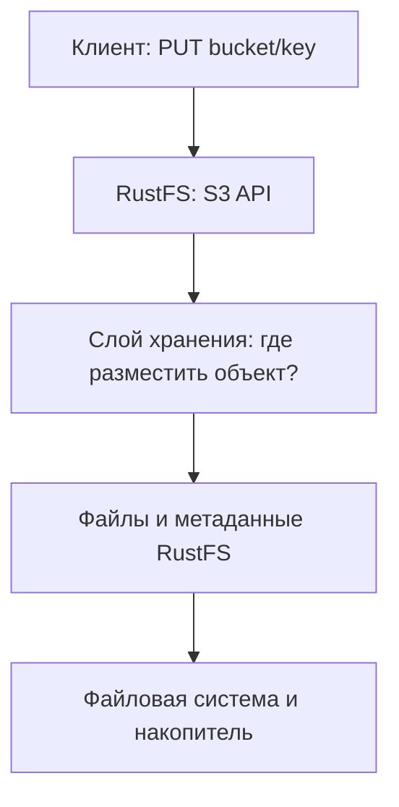
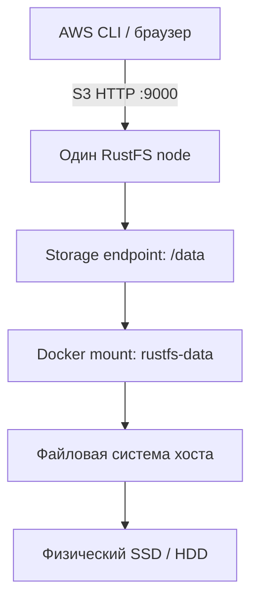
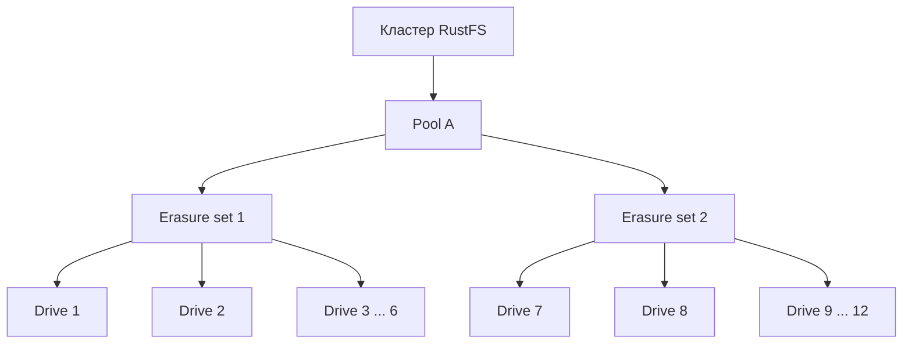
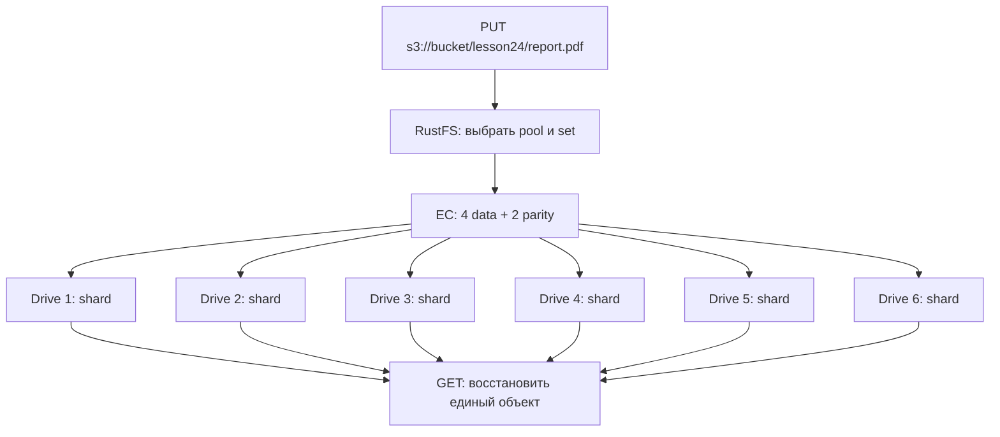

# Урок 24. Физическая организация хранения RustFS

> [!abstract] Цель урока
> Понять **от начала до конца**, как объект с адресом `bucket + key` оказывается на накопителях: что такое физический диск, файловая система, Docker volume, storage endpoint, node, pool, erasure set и shard; зачем нужны метаданные `xl.meta`; чем отличается размещение в одиночном RustFS от многодискового кластера.

**Предварительные знания:** S3 API (`PUT`, `GET`, `HEAD`), бакеты, ключи, Docker Compose. Знание внутреннего устройства RustFS не требуется.  
**Практическая среда:** Linux + `fish`, текущий RustFS, Docker, AWS CLI.  
**Критерий завершения:** можешь пройти путь от `s3://bucket/key` до файлов во внутреннем томе, объяснить схему `pool → erasure set → drives → shards` и безопасно найти метаданные на диске.

---

## 1. Сначала разделим два мира: S3 и физическое хранение

В S3 ты обращаешься к объекту так:

```text
Bucket: s3-course-lesson1
Key:    lesson24/report.pdf

S3-адрес: s3://s3-course-lesson1/lesson24/report.pdf
```

Здесь **bucket** — логический контейнер объектов, а **key** — имя объекта внутри бакета. Они не сообщают, на каком диске хранятся байты.

У RustFS есть две разные задачи:

1. **Логическая:** принять S3-запрос, найти нужный объект, проверить права, отдать правильные байты и метаданные.
2. **Физическая:** определить, на какие устройства записать данные, в каком внутреннем формате и как прочитать их обратно.



> [!important] Главное различие
> `s3://bucket/key` — **публичный адрес объекта**. `/data/...` — **внутреннее пространство хранения RustFS**. Совпадение части имен не превращает S3 в файловую систему, с которой можно безопасно работать напрямую.

**Пример.** Через API можно создать объект с ключом `photos/cat.jpg`. Это не значит, что на хосте должен существовать обычный пользовательский файл `/data/photos/cat.jpg`. RustFS вправе хранить данные в другом формате, разбивать их на фрагменты, добавлять каталоги версий и служебные файлы.

---

## 2. Что находится между S3-запросом и физическим SSD

Начнём с самой простой лаборатории — одного контейнера RustFS.

### 2.1. Физический диск (physical disk)

**Физический диск** — самостоятельное устройство хранения: HDD или SSD. На компьютере это может быть NVMe SSD, доступный Linux как `/dev/nvme0n1`.

- Он хранит реальные байты.
- На нём могут находиться разделы и файловые системы.
- Один диск может содержать сотни папок и несколько Docker volumes.

**Важно:** два каталога на одном SSD **не являются** двумя независимыми дисками. Если сам SSD неисправен, оба каталога находятся в одном домене отказа.

**Домен отказа (failure domain)** — группа компонентов, которые теряются из-за одной общей неисправности. Например, все каталоги на одном SSD разделяют отказ этого SSD.

### 2.2. Файловая система и путь (filesystem, path)

**Файловая система** (`ext4`, `XFS` и др.) организует файлы и каталоги на блочном устройстве. Путь `/srv/rustfs/data` обозначает каталог в пространстве имён Linux, а не отдельный физический диск.

```text
Физический SSD
  └── раздел / файловая система
       ├── /home/...
       └── /var/lib/docker/...
```

Файловая система хранит файлы RustFS, но не знает, что такое S3-бакет, `VersionId` или erasure set. Эти понятия реализует RustFS.

### 2.3. Docker volume и bind mount

Docker даёт контейнеру доступ к данным двумя распространёнными способами:

| Способ | Что настраиваем | Пример |
|---|---|---|
| **Bind mount** | Конкретный путь хоста | `/srv/rustfs:/data` |
| **Named volume** | Том под управлением Docker | `rustfs-data:/data` |

В обоих случаях `/data` — **путь внутри контейнера**. Это не утверждение, что у контейнера имеется собственный физический SSD.

**Пример с нашей лабораторией:**

```yaml
services:
  rustfs:
    environment:
      RUSTFS_VOLUMES: /data
    volumes:
      - rustfs-data:/data

volumes:
  rustfs-data:
```

Разбор по шагам:

1. Docker создаёт или подключает том `rustfs-data`.
2. Docker монтирует его в контейнер по пути `/data`.
3. Параметр `RUSTFS_VOLUMES=/data` сообщает **RustFS**, что этот путь нужно использовать для данных.
4. RustFS записывает свои служебные файлы и данные объектов в этот путь.
5. После удаления контейнера **без удаления тома** данные остаются.

`RUSTFS_VOLUMES` — конфигурация приложения RustFS; секция `volumes:` — конфигурация Docker. Они решают **разные** задачи.

### 2.4. Storage endpoint (точка хранения)

**Storage endpoint** — адрес места хранения, с которым работает RustFS. Он может указывать на локальный путь или на путь диска другого участника распределённого развёртывания.

Примеры адресов в конфигурации:

```text
/data
/data/disk1
/data/disk2
http://node1:9000/data/disk1
```

**Drive** — логическая единица хранения, представленная таким endpoint в топологии RustFS. В правильно спроектированном кластере каждому drive соответствует отдельный физический накопитель или независимое устройство хранения.

> [!warning] Не путай
> `Drive` в архитектуре RustFS означает **элемент топологии хранения**, а не доказательство наличия отдельного SSD. Четыре endpoint, направленные в четыре папки на одном SSD, по-прежнему разделяют один физический отказ.

### 2.5. Node (узел)

**Node** — запущенный экземпляр сервера RustFS, принимающий запросы и работающий с назначенными ему дисками. В нашей лаборатории один контейнер RustFS — один узел.

Узел и диск не одно и то же:

- один узел может обслуживать один диск;
- один узел может обслуживать несколько дисков;
- в распределённой системе несколько узлов работают с общей топологией хранения.

**Итоговая цепочка для SNSD:**



**SNSD (Single Node Single Disk)** — один узел, один диск/endpoint хранения. В такой лаборатории **нет избыточности, способной восстановить данные после потери единственного диска**.

---

## 3. Зачем RustFS нужны pool и erasure set

У одиночного сервера всё просто: объект записывается в единственное место хранения. При добавлении десятков дисков возникает задача **выбрать, где хранить каждый объект**.

Представим хранилище с 12 дисками. Нельзя ограничиться правилом «выбрать произвольный диск»: для отказоустойчивости один объект должен быть распределён по определённой группе устройств, а система должна помнить, **какой именно группе**.

### 3.1. Pool (пул хранения)

**Pool** — группа storage endpoints (дисков), объединённых в одну конфигурацию хранения. Pool состоит из одного или нескольких erasure sets.

Зачем он нужен:

- группировать диски в пределах управляемой топологии;
- добавлять ёмкость отдельными пулами в поддерживаемых сценариях расширения;
- выбирать подходящий пул для записи новых объектов;
- учитывать свободное пространство и состояние пула.

Не путай **storage pool RustFS** с Docker volume или RAID-массивом. Это сущности на разных уровнях.

### 3.2. Erasure set (группа кодирования)

**Erasure set** — фиксированная группа drives внутри pool, на которых размещаются фрагменты **одного** объекта при erasure coding.

Если выбрана группа из шести дисков, то фрагменты объекта распределяются **внутри этой группы**, а не по всем дискам кластера без правил.

**Зачем создавать несколько sets?** Так можно разделить большой pool на группы хранения, каждая из которых выполняет операции кодирования и восстановления в пределах собственного набора дисков.

### 3.3. Полная иерархия



Это **учебная топология: один pool, два set по шесть дисков**. Она не означает, что RustFS автоматически разобьёт любые 12 дисков именно так. Реальный размер set определяется допустимой топологией и параметрами инициализации, а затем сохраняется во внутреннем формате.

**Пример:**

- `report.pdf` размещён в **set 1**: его фрагменты лежат на дисках 1–6.
- `video.mp4` размещён в **set 2**: его фрагменты лежат на дисках 7–12.
- При отказе диска 2 затронут набор `set 1`, но не `set 2`.

> [!important] Запомни
> **Pool содержит sets. Set содержит drives. Drives хранят shards объекта.** При этом один drive принадлежит определённому узлу RustFS и соответствует настроенному storage endpoint.

---

## 4. Что такое shard и откуда берутся data/parity

**Shard** — фрагмент закодированных данных объекта, размещаемый на одном drive в erasure set. У shards два назначения.

- **Data shard:** содержит часть полезных данных объекта после разбиения кодировщиком.
- **Parity shard:** содержит рассчитанную избыточную информацию, позволяющую восстановить отсутствующие shards.

**Erasure coding (EC)** — способ хранения, при котором данные превращаются в `K` data shards и `M` parity shards. Всего требуется `N = K + M` мест размещения в одном set. Для схемы Reed–Solomon из любых `K` доступных shards можно восстановить объект при соблюдении целостности данных.

### Пример 4+2 на шести независимых дисках

```text
Один объект  →  кодирование EC 4+2

Drive 1  →  Data shard 1
Drive 2  →  Data shard 2
Drive 3  →  Data shard 3
Drive 4  →  Data shard 4
Drive 5  →  Parity shard 1
Drive 6  →  Parity shard 2
```

Если недоступны любые **два** из шести shards, оставшихся четырёх хватает для чтения и восстановления объекта. Если недоступны три shards, эта схема уже не гарантирует восстановление.

**Числовой пример:** объект содержит 40 MiB полезных данных. В упрощённой модели без накладных расходов `4+2` даёт 4 доли данных по 10 MiB и 2 доли избыточности по 10 MiB. Получается 60 MiB закодированного содержимого: коэффициент `6/4 = 1,5`.

Это **математическая модель**, а не обещание точного объёма `du` на настоящем диске: RustFS работает блоками, использует метаданные, служебные структуры, версии и контроль целостности.

> [!note] Важная оговорка о RustFS
> В документации RustFS для **шести** дисков в set указан **стандартный parity = 3**, то есть без особой настройки базовая схема для такого set — `3+3`. Здесь `4+2` используется как специально выбранный пример для понимания механизма, а не как утверждение о конфигурации по умолчанию. Реальная схема записывается в метаданные объекта.

**EC отличается от полного копирования:** при `3× replication` хранились бы три полные копии по 40 MiB (всего 120 MiB). При `4+2` хранятся части и восстановительная информация, а не шесть полных копий.

### Что находится на каждом диске

Участвующий drive хранит **свой** shard данных объекта и относящуюся к нему служебную информацию. Один drive не обязан содержать весь исходный объект в виде файла, который можно открыть стандартным просмотрщиком.

Подробное устройство Reed–Solomon и сравнение коэффициентов избыточности — тема урока 25. Для урока 24 важно **физическое размещение фрагментов**.

---

## 5. Как RustFS выбирает конкретные диски для объекта

Теперь известны все сущности — можно разобрать алгоритм без пропусков.

Пусть клиент выполняет:

```text
PUT /s3-course-lesson1/lesson24/report.pdf
```

### Этап 1. Выбор pool

Если в кластере несколько пулов, RustFS определяет подходящий pool для новой записи. На выбор влияют текущая доступность и свободное место. **Это не хеширование объекта сразу на произвольный диск.**

### Этап 2. Выбор erasure set внутри pool

**Object-to-set placement** — правило, определяющее, **в какой erasure set** попадёт объект.

RustFS вычисляет индекс set из ключа и сохранённого алгоритма распределения (в разных версиях формата используются разные хеш-алгоритмы). **Хеш** — функция, преобразующая входную строку в числовое значение. Это позволяет воспроизводимо определить место объекта.

Упрощённый учебный пример, **не формула RustFS**:

```text
В пуле 2 sets: 0 и 1.
Хеш ключа report.pdf дал число 137.
137 mod 2 = 1  →  set 1.
```

Здесь `mod` означает остаток от деления. Настоящий RustFS использует алгоритмы размещения, привязанные к формату хранилища; вручную вычислять индекс по этой игрушечной формуле нельзя.

### Этап 3. Выбор положения shards внутри set

**Intra-set distribution** — распределение конкретных data/parity shards по дискам **уже выбранного set**.

Даже если два объекта находятся в одном set, порядок расположения их shards на drives может быть разным. Это нужно отделять от выбора самого set.

```text
Объект A, set 1:   drive 1 → shard 1, drive 2 → shard 2, ...
Объект B, set 1:   drive 1 → shard 4, drive 2 → shard 5, ...
```

Номера здесь схематические. В формате RustFS сведения о фактической схеме и индексе фрагмента хранятся вместе с метаданными объекта.

### Этап 4. Запись файлов и метаданных

RustFS записывает закодированные данные и метаданные на выбранные drives. Успешное завершение записи зависит от правил подтверждения (quorum), а не просто от успешной записи на первый попавшийся диск. Quorum подробно разбирается в уроке 28.

> [!important] Два решения, которые нельзя смешивать
> **Placement** отвечает на вопрос: «Какую группу дисков выбрать?»  
> **Distribution** отвечает на вопрос: «Как распределить фрагменты по дискам выбранной группы?»

---

## 6. Что физически лежит в каталоге данных RustFS

Когда RustFS записывает S3-объект, он создаёт **внутреннее представление**, которое может включать каталоги, метаданные, служебные файлы и фрагменты содержимого.

### 6.1. Payload и metadata

**Payload** — полезные байты объекта, которые клиент получит при `GET`.

**Metadata** — сведения о содержимом и его хранении: размер, версия, временные метки, тип объекта, информация о кодировании, частях данных и прочее.

Метаданные бывают двух уровней:

| Уровень | Пример | Для чего нужен |
|---|---|---|
| **Публичные S3-метаданные** | `Content-Type`, `ETag`, пользовательские `x-amz-meta-*` | Доступны через API по правилам S3 |
| **Внутренние метаданные RustFS** | Схема EC, индексы shards, внутренние данные версий | Нужны самой системе для хранения, чтения и восстановления |

### 6.2. Файл `xl.meta`

**`xl.meta`** — файл внутреннего бинарного формата метаданных объекта RustFS. Он содержит информацию о версиях объекта и о том, как связаны данные объекта с его физическим размещением.

Важные особенности:

- Это **не JSON-файл** и не текстовый файл S3-метаданных.
- Он может описывать **несколько версий** одного ключа.
- В многодисковом режиме относящиеся к объекту метаданные присутствуют на участвующих drives; нет требования хранить всё только в одном центральном `xl.meta` для кластера.
- Формат используется для согласованного чтения и восстановления данных.

### 6.3. `part.1`, `part.2` и каталоги данных

При хранении **не-inline** объектов RustFS использует внутренние файлы частей данных (например, `part.1`) в каталогах, связанных с данными объекта или версии. В многодисковом режиме такие файлы на отдельных drives содержат соответствующие закодированные фрагменты.

**Не путай три понятия:**

1. **S3 Multipart Upload:** сетевой протокол загрузки объекта отдельными частями (`UploadPart`).
2. **Внутренний `part.N`:** файл во внутренней структуре RustFS; его имя не доказывает, что клиент делал multipart upload.
3. **Erasure shard:** кодированный фрагмент, распределяемый между drives. Он не является отдельным S3-объектом.

### 6.4. Inline data

**Inline data** — способ хранения небольшого payload прямо внутри контейнера метаданных `xl.meta`, без обязательного отдельного файла `part.1`.

**Пример:** ты загрузил `note.txt` размером 20 байт. В одном варианте внутреннего размещения эти 20 байт находятся прямо в `xl.meta`. Поиск только файлов `part.1` тогда не найдёт содержимое, хотя объект существует и корректно скачивается.

Порог inline зависит от параметров и конфигурации; его не следует определять на глаз по одному объекту.

### 6.5. `.rustfs.sys` и служебные структуры

**`.rustfs.sys`** — внутреннее служебное пространство RustFS для информации, необходимой самому хранилищу. Там встречаются данные конфигурации и другие служебные структуры. Это **не пользовательский бакет** и не место, в котором нужно вручную создавать S3-объекты.

### 6.6. Как может выглядеть дерево файлов

Следующая схема **иллюстративная**: показывает отношения между сущностями, а не гарантирует посимвольный путь в каждой версии RustFS.

```text
/data/                        ← storage endpoint внутри контейнера
├── .rustfs.sys/              ← служебная область
└── s3-course-lesson1/        ← внутренняя область бакета
    └── lesson24/
        ├── small.txt/
        │   └── xl.meta      ← может содержать inline payload
        └── large.bin/
            ├── xl.meta      ← метаданные и сведения о версиях
            └── <data-id>/
                └── part.1   ← данные / фрагмент данных
```

`<data-id>` здесь означает **внутренний идентификатор размещения данных**, а не часть ключа S3. Реальное дерево может содержать дополнительные файлы и каталоги, особенно при versioning, multipart, lifecycle и работе кластера.

**Почему RustFS не отдаёт клиенту путь к `part.1`?** Потому что API обещает получить **логический объект**. Для этого RustFS должен найти нужную версию, прочитать метаданные, при необходимости объединить фрагменты и проверить целостность.

---

## 7. Три варианта: как это выглядит на практике

### Вариант A. Один node и один диск: SNSD

```text
RustFS node 1
    └── /data  →  один storage endpoint
```

- Один объект сохраняется в единственном месте хранения.
- Избыточных EC-фрагментов для отказа диска нет.
- Docker named volume сохраняет данные при пересоздании контейнера, **но не при физической гибели накопителя**.

**Пример:** `PUT photo.jpg` успешен, а затем единственный SSD полностью потерян. Восстановить объект из второго диска RustFS невозможно — второго диска нет. Требуется независимая резервная копия.

### Вариант B. Один node и несколько независимых дисков: SNMD

```text
RustFS node 1
    ├── SSD 1
    ├── SSD 2
    ├── SSD 3
    ├── SSD 4
    ├── SSD 5
    └── SSD 6
```

- В поддерживаемой многодисковой конфигурации RustFS распределяет shards по дискам set.
- Потерю ограниченного числа дисков можно пережить в пределах выбранной схемы EC.
- Отказ всего сервера делает недоступными сразу все его drives: один сервер остаётся общей точкой отказа.

**Пример:** если объект записан по схеме `4+2`, отказ двух независимых дисков не препятствует восстановлению по оставшимся четырём shards. Это **условный пример схемы**, не описание parity по умолчанию.

### Вариант C. Несколько nodes и несколько дисков: MNMD

```text
Node A → SSD 1, SSD 2
Node B → SSD 3, SSD 4
Node C → SSD 5, SSD 6
Node D → SSD 7, SSD 8
```

- Drives принадлежат разным узлам и объединяются в общую конфигурацию хранения.
- Система связывается с удалёнными узлами по сети.
- Устойчивость к падению узла зависит от **того, сколько shards конкретного set потеряно**, а не только от количества живых nodes.

**Пример:** если на одном узле находились два drives выбранного set, отказ этого узла означает потерю доступа к двум shards. Выдержит ли set отказ, определяется его фактической схемой кодирования и необходимыми quorum.

> [!warning] Четыре Docker-контейнера на одном SSD
> Они могут моделировать **сетевые узлы** и особенности распределённой конфигурации, но **не обеспечивают физическую независимость накопителей**. Все контейнеры потеряют данные при гибели общего SSD.

---

## 8. Сквозной пример: что происходит с `report.pdf`

Рассмотрим учебную многодисковую конфигурацию: один pool, один set из шести **физически независимых** drives; для объекта выбрана схема EC `4+2`.

1. Клиент отправляет `PUT` с ключом `lesson24/report.pdf`.
2. RustFS проверяет операцию S3, определяет pool и set для нового объекта.
3. RustFS делит содержимое на блоки и получает data/parity shards.
4. Для конкретного объекта определяется распределение shards по шести drives.
5. Каждый drive получает **свою часть** закодированных данных и нужные метаданные.
6. После успешного выполнения условий записи RustFS отвечает клиенту.
7. Позже клиент отправляет `GET` по тому же S3-ключу.
8. RustFS находит версию, читает нужные метаданные и достаточное число shards, восстанавливает исходные байты и отправляет их клиенту.



**Что здесь важно:** клиент видит **один объект** с одним ключом, а не шесть файлов и не шесть отдельных S3-объектов.

---

## 9. Практика на текущем RustFS: от API до Docker volume

Практика выполняется на **одиночной лаборатории SNSD**. Её цель — увидеть внутренние файлы, **не** включать EC и не менять топологию.

### 9.1. Убедись, что RustFS запущен

Перейди в каталог, где расположен файл `compose.yaml`, затем выполни:

```fish
docker compose ps
```

Здесь и далее имя сервиса в Compose предполагается равным `rustfs`. Если у тебя другое имя, подставь его.

### 9.2. Подготовь два объекта разного размера

```fish
printf 'Hello from lesson 24!\n' > lesson24-small.txt

dd if=/dev/urandom of=lesson24-large.bin bs=1M count=8 status=none
```

Что получилось:

- `lesson24-small.txt` — несколько десятков байт;
- `lesson24-large.bin` — 8 MiB случайных данных.

Загрузи оба файла в существующий учебный бакет:

```fish
aws --endpoint-url http://127.0.0.1:9000 --region us-east-1 \
    s3api put-object \
    --bucket s3-course-lesson1 \
    --key lesson24/small.txt \
    --body lesson24-small.txt

aws --endpoint-url http://127.0.0.1:9000 --region us-east-1 \
    s3api put-object \
    --bucket s3-course-lesson1 \
    --key lesson24/large.bin \
    --body lesson24-large.bin
```

Ожидаемый результат: оба `PutObject` завершились успешно.

Проверь логический вид через S3 API:

```fish
aws --endpoint-url http://127.0.0.1:9000 --region us-east-1 \
    s3api list-objects-v2 \
    --bucket s3-course-lesson1 \
    --prefix lesson24/ \
    --query 'Contents[].{Key:Key,Size:Size}' \
    --output table
```

**Вопрос:** почему в выводе два объекта, а не каталог `lesson24` и два POSIX-файла?

### 9.3. Найди путь к данным контейнера

```fish
set CID (docker compose ps -q rustfs)

docker inspect $CID \
    --format '{{range .Mounts}}{{println .Type .Name .Source .Destination}}{{end}}'

docker exec $CID printenv RUSTFS_VOLUMES
```

Пример значений для named volume:

```text
volume  s3course_rustfs-data  /var/lib/docker/volumes/.../_data  /data
/data
```

Читаем строку слева направо:

- `volume` — тип Docker-монтирования;
- `s3course_rustfs-data` — имя Docker volume (твоё будет другим);
- `/var/lib/docker/...` — путь размещения данных в окружении Docker;
- `/data` — путь внутри контейнера, который видит RustFS.

> [!note] Где именно находится SSD?
> `docker inspect` показывает путь хранения и монтирование, но не доказывает, **какой физический диск** расположен под файловой системой. Это отдельный вопрос Linux: `lsblk -f`, `findmnt` и конфигурация Docker помогут сопоставить монтирование с устройством.

### 9.4. Просмотри Docker volume только для чтения

Для случая **named volume**, монтированного в `/data`:

```fish
set VOL (docker inspect $CID \
    --format '{{range .Mounts}}{{if and (eq .Destination "/data") (eq .Type "volume")}}{{.Name}}{{end}}{{end}}')

echo $VOL
```

**Продолжай только если `$VOL` не пустой.** Если у тебя `bind`, этот способ не применяется: используй прочитанный из `docker inspect` путь `.Source` и не подставляй его вместо имени volume.

Показать первые найденные файлы:

```fish
docker run --rm --network none \
    --mount "type=volume,source=$VOL,target=/read,readonly" \
    alpine:3.20 \
    sh -c 'find /read -type f | head -40'
```

Найти метаданные:

```fish
docker run --rm --network none \
    --mount "type=volume,source=$VOL,target=/read,readonly" \
    alpine:3.20 \
    sh -c 'find /read -type f -name xl.meta | head -30'
```

Найти отдельные файлы частей (если они есть):

```fish
docker run --rm --network none \
    --mount "type=volume,source=$VOL,target=/read,readonly" \
    alpine:3.20 \
    sh -c 'find /read -type f -name "part.*" | head -30'
```

**Ожидаемые наблюдения:** у объектов могут быть внутренние каталоги и `xl.meta`. У большого объекта можно обнаружить отдельные части данных; у маленького их отсутствие согласуется с inline-хранением. Конкретный список файлов и путей зависит от версии RustFS и состояния бакета.

**Не делай ложный вывод:** если `part.1` не найден, это **не доказывает**, что объект отсутствует. Существование объекта проверяется через S3 API (`HEAD`/`GET`).

### 9.5. Сопоставь содержимое логического объекта с локальным файлом

```fish
aws --endpoint-url http://127.0.0.1:9000 --region us-east-1 \
    s3api get-object \
    --bucket s3-course-lesson1 \
    --key lesson24/large.bin \
    lesson24-downloaded.bin

sha256sum lesson24-large.bin lesson24-downloaded.bin
cmp lesson24-large.bin lesson24-downloaded.bin
```

Если хеши совпали и `cmp` ничего не вывел, RustFS корректно вернул полезные байты. Это **не проверка отказоустойчивости**, а проверка корректности чтения в SNSD.

> [!warning] Никогда не редактируй внутренний том вручную
> Не удаляй, не переименовывай и не изменяй `xl.meta`, `part.*`, `format.json` и `.rustfs.sys`. Эти файлы связаны внутренними инвариантами системы. Просмотр работающего тома — **не** консистентный снимок для резервного копирования.

---

## 10. Частые ошибки понимания

| Утверждение | Правильно или нет? | Объяснение |
|---|---|---|
| «Bucket — это отдельный SSD» | **Нет** | Бакет — логическая сущность S3 |
| «Docker volume — это физический диск» | **Нет** | Это механизм предоставления хранения контейнеру |
| «Один endpoint всегда означает отдельный SSD» | **Нет** | Endpoint — адрес элемента топологии; независимость диска надо обеспечить отдельно |
| «Pool и erasure set — одно и то же» | **Нет** | Pool содержит один или несколько sets |
| «Set из шести drives хранит шесть копий объекта» | **Нет** | При EC drives содержат data/parity shards, а не шесть целых копий |
| «Shard и S3 object — одно и то же» | **Нет** | Shard — внутренний фрагмент объекта |
| «Файл `part.1` означает S3 Multipart Upload» | **Нет** | Это файл внутренней структуры RustFS |
| «В `xl.meta` лежат только `Content-Type` и размер» | **Нет** | В нём есть внутренние сведения о версиях, кодировании и размещении |
| «На одном SSD можно создать четыре папки и пережить его отказ» | **Нет** | Все четыре папки разделяют общий физический отказ |

---

## 11. Самостоятельные задания

### Задание 1. Разложи сущности по уровням

Для конфигурации:

```yaml
volumes:
  - rustfs-data:/data
environment:
  RUSTFS_VOLUMES: /data
```

Объясни своими словами:

1. Чем Docker volume `rustfs-data` отличается от каталога `/data`?
2. Кто использует `RUSTFS_VOLUMES` — Docker или RustFS?
3. Является ли `/data` доказательством наличия отдельного SSD?
4. Почему объект `docs/a.txt` нельзя безопасно заменить редактированием файла внутри тома?

### Задание 2. Воображаемый кластер

Есть **один pool, два sets по шесть drives**. Для объекта действует схема `4+2`, и он размещён в первом set.

1. В скольких sets находятся shards **этого объекта**?
2. Сколько shards необходимо для восстановления?
3. Что произойдёт, если два независимых drives первого set станут недоступны?
4. Изменит ли доступность этого объекта отказ одного drive второго set?

### Задание 3. Интерпретация файлов

В томе найдены:

```text
.../small.txt/xl.meta
.../large.bin/xl.meta
.../large.bin/<data-id>/part.1
```

Ответь:

1. Значит ли отсутствие `small.txt/part.1`, что содержимое `small.txt` потеряно?
2. Почему `xl.meta` нельзя заменить выводом `HEAD Object`?
3. Почему `part.1` нельзя автоматически считать файлом исходных байтов клиента?

### Задание 4. Установи физическую независимость

На одном хосте созданы четыре пути `/srv/d1`, `/srv/d2`, `/srv/d3`, `/srv/d4`; все они расположены на одном SSD.

**Вопрос:** сколько независимых физических дисков участвует в хранении? Что случится, если SSD полностью выйдет из строя?

---

## 12. Контрольные вопросы для перехода к уроку 25

- [ ] Я различаю S3 bucket/key и внутренние файлы RustFS.
- [ ] Я могу объяснить `SSD → файловая система → Docker volume → /data → storage endpoint`.
- [ ] Я знаю, чем node отличается от drive.
- [ ] Я понимаю, зачем нужны pool и erasure set и как они связаны.
- [ ] Я знаю разницу между data shard и parity shard.
- [ ] Я понимаю две стадии: выбор set и размещение shards внутри set.
- [ ] Я знаю, зачем нужен `xl.meta` и почему маленький объект может не иметь `part.1`.
- [ ] Я различаю SNSD, SNMD и MNMD, а также понимаю общий домен отказа.
- [ ] Я могу проверить наличие объекта через API и исследовать Docker volume только для чтения.

> [!success] Результат урока
> **S3 показывает клиенту единый объект по `bucket + key`. RustFS преобразует его в внутренние данные и метаданные, выбирает место хранения и записывает их на drives. В SNSD место одно и дисковой избыточности нет; в многодисковой конфигурации объект кодируется в shards внутри выбранного erasure set.**

**Следующий урок:** №25 — «Репликация и Erasure Coding: полные копии, схемы `4+2` и `8+4`, пределы отказоустойчивости».

---

## Источники и границы применимости

1. [RustFS — Erasure Coding: geometry, distribution, inline data и `xl.meta`](https://github.com/rustfs/rustfs/blob/main/docs/architecture/erasure-coding.md)
2. [RustFS — Placement and Repair Invariants](https://github.com/rustfs/rustfs/blob/main/docs/architecture/placement-repair-invariants.md)
3. [RustFS — ECStore Layout Boundary](https://github.com/rustfs/rustfs/blob/main/docs/architecture/ecstore-layout-boundary.md)
4. [RustFS — Cluster Lifecycle Operations](https://github.com/rustfs/rustfs/blob/main/docs/operations/cluster-lifecycle-operations.md)
5. [RustFS — режимы установки SNSD/SNMD/MNMD](https://docs.rustfs.com/en/installation/linux)
6. [RustFS — Docker installation](https://docs.rustfs.com/en/installation/container)
7. [RustFS — CLI Reference и параметры `RUSTFS_VOLUMES`](https://docs.rustfs.com/en/reference/cli)

**Дата сверки с документацией:** 2026-10-28. Примеры `4+2`, деревья файлов и учебные схемы размещения обозначены отдельно от фактической конфигурации RustFS. Внутренние каталоги и файлы не являются публичным API и могут меняться между версиями.
