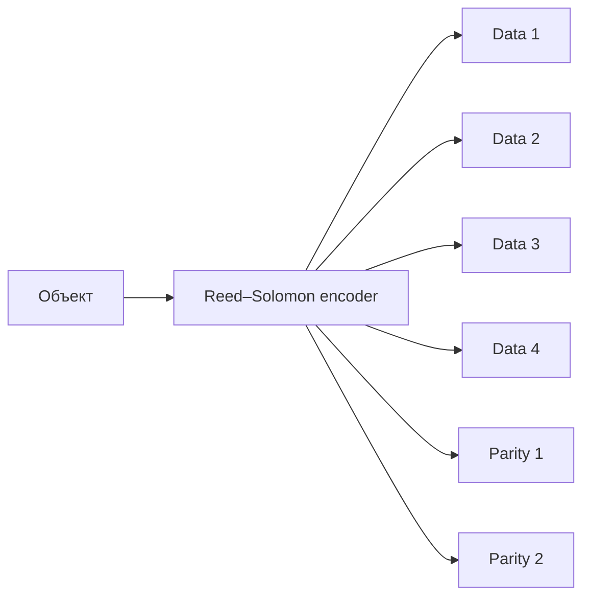

# Урок 25. Репликация и Erasure Coding

> [!abstract] Цель урока
> Различать **полные реплики**, **data/parity shards** и **репликацию между бакетами или сайтами**. Рассчитать затраты на хранение и устойчивость к потере фрагментов для схем **3×**, **4+2** и **8+4**.

**Предварительные знания:** drive, pool, erasure set, расположение данных на дисках (урок 24).  
**Практическая среда:** Python 3; запущенный RustFS для расчётов не нужен.  
**Критерий завершения:** правильно рассчитаны эффективность и число допустимых потерь фрагментов; объяснена разница между достаточным количеством shards и доступностью сервиса.

---

## 1. Три разных механизма

| Механизм | Что хранится | Задача |
|---|---|---|
| **3× replication** | Три полных экземпляра данных | Продолжить чтение, если часть полных копий потеряна |
| **Erasure coding (EC)** | `K` фрагментов данных + `M` фрагментов избыточности | Восстановить объект без хранения нескольких полных копий |
| **Bucket/site replication** | Копирование объектов в другой бакет, сайт или регион | Отдельная копия на уровне объектов и иной домен отказа |

Последний механизм **не является** размещением EC-shards внутри erasure set. В AWS S3 существуют SRR (Same-Region Replication) и CRR (Cross-Region Replication). Настройка bucket replication не превращает автоматически каждую локальную запись в `3×`.

## 2. Полные копии: схема 3×

```text
Исходный объект: 120 MiB
Диск A: полный объект 120 MiB
Диск B: полный объект 120 MiB
Диск C: полный объект 120 MiB
Итого: 360 MiB без учёта метаданных
```

- **Эффективность хранения:** `1/3 = 33,33 %`.
- **Затраты:** `3×` относительно размера исходных данных.
- **Потери:** из трёх **независимых** копий достаточно одной. Можно потерять две копии, если оставшаяся исправна и доступна.

Три файла на одном SSD — три логические копии, но **один общий физический домен отказа**.

## 3. Erasure Coding: `K+M`

**Data shards (`K`)** — фрагменты, из которых формируется исходное содержимое. **Parity shards (`M`)** — математически вычисленные избыточные фрагменты.



В Reed–Solomon (MDS) исходное содержимое восстанавливается из **любых `K` корректных shards** из `N = K + M`. Это позволяет потерять до `M` shards **в пределах одного erasure set**.

> [!important] Parity — не полная копия
> В `4+2` нет двух дисков, на каждом из которых лежит целый исходный объект. На шести дисках лежат шесть разных фрагментов, работающих как единая схема кодирования.

## 4. Сравнение 3×, 4+2 и 8+4

Для идеальной модели без служебных расходов:

\[
\eta=\frac{K}{K+M},\qquad
S_{\text{physical}}=S_{\text{logical}}\frac{K+M}{K}
\]

| Схема | Фрагменты / копии | Допустимая потеря | Доля полезных данных | Физический объём при объекте 120 MiB |
|---|---|---|---|---|
| **3× replication** | 3 полные копии | 2 копии | 33,33 % | 360 MiB |
| **4+2 EC** | 4 data + 2 parity | 2 shards | 66,67 % | 180 MiB |
| **8+4 EC** | 8 data + 4 parity | 4 shards | 66,67 % | 180 MiB |

**Почему 4+2 и 8+4 занимают одинаковую долю?** В обоих случаях число parity shards составляет половину числа data shards (`M/K = 0,5`), хотя количество переносимых отказов различается.

В реальной системе метаданные, небольшие объекты, размер блоков, версии, контрольные суммы и свободная ёмкость увеличивают фактическое потребление места. Таблица показывает **математическую модель**, не измерение диска RustFS.

## 5. Reed–Solomon и quorum — не одно и то же

- **Восстановимость:** при `K+M` нужно не меньше `K` корректных shards.
- **Read quorum RustFS:** определяется данными и согласованными метаданными выбранной версии; базовый численный порог соответствует `K`.
- **Write quorum RustFS:** базово `K`, а в симметричной схеме `K=M` — `K+1`.
- **Доступность сервиса:** дополнительно требует работоспособного узла входа, сети, согласованных метаданных и выполнения условий конкретной операции.

Пример: `4+2` сохраняет возможность восстановления после потери двух разных shards. Но это **не гарантия**, что любой отказ двух серверов безопасен: на одном сервере может находиться несколько shards того же set.

## 6. Практика: смоделировать потери

Скрипт проверяет **математическое** условие доступности shards, а не запускает настоящий Reed–Solomon decoder.

```python
from itertools import combinations

for k, m in [(4, 2), (8, 4)]:
    n = k + m
    print(f"EC {k}+{m}: всего {n} shards")
    for lost_count in [m, m + 1]:
        lost = next(combinations(range(n), lost_count))
        available = n - len(lost)
        can_restore = available >= k
        print(f"  потеряно {lost_count}: осталось {available}; "
              f"восстановление = {can_restore}")
```

**Ожидаемые результаты:** `4+2` выдерживает 2 потерянных shards, но не 3; `8+4` выдерживает 4, но не 5. Здесь предполагается, что все оставшиеся фрагменты корректны, а нужные метаданные доступны.

## 7. Самостоятельные задания

1. Для объекта размером `600 MiB` вычисли физический объём в схемах 3×, 4+2 и 8+4 по идеальной модели.
2. Для `8+4` осталось восемь shards. Возможно ли восстановить содержимое? Что изменится после потери девятого по счёту фрагмента?
3. В `4+2` на одной ноде находятся три shards. Защищает ли схема от полной потери этой ноды?
4. Объясни, почему bucket replication между двумя независимыми площадками решает другую задачу, чем EC на дисках одной площадки.

## 8. Контрольные вопросы и итог

- [ ] Я различаю полные реплики, EC и bucket/site replication.
- [ ] Я знаю формулы `N=K+M`, `η=K/N`.
- [ ] Я умею считать стоимость 3×, 4+2 и 8+4.
- [ ] Я понимаю зависимость отказоустойчивости от расположения shards по узлам.
- [ ] Я не смешиваю восстановимость объекта, quorum и доступность S3 endpoint.

> [!success] Результат урока
> Erasure Coding обеспечивает восстановление из части фрагментов с меньшими затратами на хранение, чем полное многократное копирование. Максимальное число отказов задаётся схемой shards **и** фактическими доменами отказа.

**Следующий урок:** №26 — «Устройство кластера RustFS и локальная многоконтейнерная топология».

---

## Источники

1. [RustFS — Erasure Coding (алгоритм, quorum, ограничения)](https://github.com/rustfs/rustfs/blob/main/docs/architecture/erasure-coding.md)
2. [RustFS — EC Configuration](https://docs.rustfs.com/en/installation/requirement/ec-configuration)
3. [RustFS — Cluster lifecycle operations](https://github.com/rustfs/rustfs/blob/main/docs/operations/cluster-lifecycle-operations.md)
4. [AWS S3 — Replicating objects within and across Regions](https://docs.aws.amazon.com/AmazonS3/latest/userguide/replication.html)

**Дата сверки с документацией:** 2026-10-28. Приведённые расчёты — учебные, без накладных расходов на физическое хранение.
