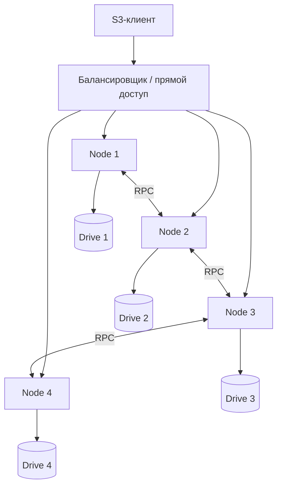

# Урок 26. Кластер RustFS: узлы, сеть и диски

> [!abstract] Цель урока
> Понять устройство многонодового хранилища: **node**, **drive**, **pool**, **erasure set**, межузловые вызовы, точку входа клиента. Создать отдельную учебную топологию из четырёх контейнеров RustFS, не затрагивая существующую SNSD-лабораторию.

**Предварительные знания:** уроки 21–25, Docker Compose, AWS CLI, `fish`.  
**Практическая среда:** Docker на Linux; свободные порты `9100`, `9101`, `9102`.  
**Критерий завершения:** подняты четыре узла, S3-запрос выполняется через один узел и читается через другой; различаются потеря точки входа и потеря данных. **Все контейнеры остаются на одном физическом компьютере.**

---

## 1. Основные компоненты кластера

- **Node** — экземпляр RustFS, принимающий S3-запросы и участвующий в работе распределённого storage engine.
- **Drive/endpoint** — принадлежащее узлу место хранения. Один узел может предоставлять несколько endpoint-дисков.
- **Pool** — заданная группа endpoint-адресов, из которой формируются erasure sets.
- **Erasure set** — диски, содержащие `K+M` shards конкретного объекта.
- **Inter-node RPC** — сетевое взаимодействие узлов для операций с удалёнными дисками, состоянием и координацией.
- **Load balancer** — внешняя точка входа для распределения запросов; сам по себе **не** создаёт дополнительные копии объекта.



Схема упрощена: в настоящем кластере коммуникация не ограничивается нарисованными соседними парами.

## 2. Где находится объект и кто принимает запрос

1. Запрос `PUT bucket/key` поступает на **любой доступный клиентский endpoint** кластера.
2. Сервер проверяет запрос, определяет pool/set и выполняет операции над локальными и удалёнными дисками.
3. Shards и метаданные записываются согласно правилам erasure coding и quorum.
4. При GET запрос также может прийти на другой узел: объект не привязан к одному HTTP-серверу.

В RustFS межузловой транспорт использует внутренние RPC. **Отдельных ролей «только master», «только data-node» для нашей базовой четырёхузловой схемы не назначаем.** Административные операции могут иметь внутреннего координатора; это не делает S3-запросы зависимыми от единственного «главного» узла.

## 3. Топология учебного стенда

Создадим **4 контейнера × 1 Docker volume на узел**, один логический pool из четырёх endpoint-дисков.

```text
node1 -> /data (volume node1_data) -> host SSD
node2 -> /data (volume node2_data) -> host SSD
node3 -> /data (volume node3_data) -> host SSD
node4 -> /data (volume node4_data) -> host SSD
```

> [!warning] Это эмуляция, а не реальная отказоустойчивость
> Все Docker volumes лежат на одном физическом хосте и могут использовать один SSD. Физическая поломка этого SSD уничтожит все shards. `RUSTFS_UNSAFE_BYPASS_DISK_CHECK=true` используется **только** для стенда и обходит проверку независимости носителей; для промышленного размещения его применять нельзя.

## 4. Практика: каталог и реквизиты

В терминале `fish`:

```bash
mkdir -p ~/s3-course/lesson-26-cluster
cd ~/s3-course/lesson-26-cluster

printf 'RUSTFS_ACCESS_KEY=lab%s\nRUSTFS_SECRET_KEY=%s\n' \
    (openssl rand -hex 8) \
    (openssl rand -hex 24) > .env
chmod 600 .env
```

Файл `.env` содержит секреты учебного кластера: не добавляй его в Git. Эти реквизиты **отличаются** от настроек действующей SNSD-лаборатории.

## 5. Практика: `compose.yaml`

Создай в новом каталоге следующий файл:

```yaml
x-node-common: &node-common
  image: rustfs/rustfs:latest
  restart: unless-stopped
  environment:
    RUSTFS_VOLUMES: "http://node{1...4}:9000/data"
    RUSTFS_ADDRESS: ":9000"
    RUSTFS_CONSOLE_ADDRESS: ":9001"
    RUSTFS_CONSOLE_ENABLE: "true"
    RUSTFS_ACCESS_KEY: ${RUSTFS_ACCESS_KEY:?set in .env}
    RUSTFS_SECRET_KEY: ${RUSTFS_SECRET_KEY:?set in .env}
    RUSTFS_OBS_LOGGER_LEVEL: "info"
    RUSTFS_UNSAFE_BYPASS_DISK_CHECK: "true"

services:
  node1:
    <<: *node-common
    hostname: node1
    ports:
      - "127.0.0.1:9100:9000"
      - "127.0.0.1:9101:9001"
    volumes:
      - node1_data:/data

  node2:
    <<: *node-common
    hostname: node2
    ports:
      - "127.0.0.1:9102:9000"
    volumes:
      - node2_data:/data

  node3:
    <<: *node-common
    hostname: node3
    volumes:
      - node3_data:/data

  node4:
    <<: *node-common
    hostname: node4
    volumes:
      - node4_data:/data

volumes:
  node1_data:
  node2_data:
  node3_data:
  node4_data:
```

**Почему это одна система:** у всех узлов одинаковый список `RUSTFS_VOLUMES` и одинаковые учётные данные. Внутри Docker-сети имена `node1`–`node4` разрешаются через DNS. Снаружи опубликованы только нужные для проверки порты.

**Почему не заданы четыре роли дисков в одном контейнере:** здесь один endpoint принадлежит одному узлу. Конфигурацию `4 узла × 4 диска` разберём отдельно при расширении лаборатории; добавлять диски к **уже инициализированному** pool простым изменением списка endpoints нельзя.

## 6. Практика: запуск, PUT через node1, GET через node2

```bash
docker compose config -q
docker compose up -d
docker compose ps
docker compose logs --tail=30 node1 node2 node3 node4

curl -i http://127.0.0.1:9100/health
curl -i http://127.0.0.1:9102/health
```

Задай временные реквизиты AWS CLI **в этом терминале**:

```bash
set -gx AWS_ACCESS_KEY_ID (string replace 'RUSTFS_ACCESS_KEY=' '' \
    (grep '^RUSTFS_ACCESS_KEY=' .env))
set -gx AWS_SECRET_ACCESS_KEY (string replace 'RUSTFS_SECRET_KEY=' '' \
    (grep '^RUSTFS_SECRET_KEY=' .env))
```

Создай бакет и объект через первый контейнер:

```bash
aws --endpoint-url http://127.0.0.1:9100 --region us-east-1 \
    s3api create-bucket --bucket s3-course-cluster26

printf 'Hello from distributed RustFS\n' > cluster26.txt
aws --endpoint-url http://127.0.0.1:9100 --region us-east-1 \
    s3api put-object \
    --bucket s3-course-cluster26 \
    --key lab/test.txt --body cluster26.txt
```

Прочитай через **второй** контейнер:

```bash
aws --endpoint-url http://127.0.0.1:9102 --region us-east-1 \
    s3api get-object \
    --bucket s3-course-cluster26 \
    --key lab/test.txt received26.txt

cmp cluster26.txt received26.txt
```

`cmp` без различий подтверждает, что два разных S3 endpoint предоставляют доступ к **одному логическому кластеру**. Это **не проверка физической независимости дисков**.

Если кластер не выходит в готовность, проверь `docker compose logs` и `/health/ready` каждого узла. Не удаляй данные и `format.json` для обхода ошибки инициализации; сначала исправь топологию или конфигурацию.

## 7. Контрольный эксперимент и безопасная остановка

После успешного PUT/GET останови **только один HTTP-узел**:

```bash
docker compose stop node1
curl -i http://127.0.0.1:9102/health

aws --endpoint-url http://127.0.0.1:9102 --region us-east-1 \
    s3api get-object \
    --bucket s3-course-cluster26 \
    --key lab/test.txt after-stop26.txt

cmp cluster26.txt after-stop26.txt
docker compose start node1
```

В конфигурации из четырёх дисков стандартная автоматическая схема RustFS — **2 data + 2 parity**. Отказ одного storage endpoint оставляет три shards; этого хватает для чтения и штатного write quorum. Фактическую работу проверяй экспериментом: доступность зависит также от межузловой сети и готовности сервера.

**Остановка с сохранением данных:** `docker compose down`. **Не используй** `docker compose down -v`, если нужны файлы в учебных томах. После работы убери временные переменные доступа: `set -e AWS_ACCESS_KEY_ID AWS_SECRET_ACCESS_KEY`.

## 8. Контрольные вопросы и итог

- [ ] Я различаю узел, дисковый endpoint, pool и erasure set.
- [ ] Я понимаю, как один объект доступен через разные узлы.
- [ ] Я знаю назначение межузловых RPC и балансировщика.
- [ ] Я запустил **отдельный** четырёхконтейнерный кластер без изменения основной лаборатории.
- [ ] Я знаю, почему четыре Docker volumes на одном SSD не являются защитой от отказа SSD.
- [ ] Я понимаю, почему persisted layout нельзя менять редактированием `RUSTFS_VOLUMES` у действующего pool.

> [!success] Результат урока
> Кластер RustFS — единое логическое S3-хранилище, составленное из узлов и disk endpoints. Запрос может поступать на разные узлы, а содержимое объекта распределяется внутри erasure set. **Сетевая доступность, достаточность shards и физическая независимость оборудования — три разных свойства.**

**Следующий урок:** №27 — «Логическая репликация на одном физическом диске и независимые экземпляры RustFS».

---

## Источники

1. [RustFS — Multiple Node Multiple Disk Installation](https://docs.rustfs.com/en/installation/linux/multiple-node-multiple-disk)
2. [RustFS — Docker installation](https://docs.rustfs.com/en/installation/container/docker)
3. [RustFS — EC Configuration (автоматическое parity)](https://docs.rustfs.com/en/installation/requirement/ec-configuration)
4. [RustFS — Cluster lifecycle operations (immutable layout)](https://github.com/rustfs/rustfs/blob/main/docs/operations/cluster-lifecycle-operations.md)
5. [RustFS — Cluster Compose reference](https://github.com/rustfs/rustfs/blob/main/.docker/compose/docker-compose.cluster.yaml)

**Дата сверки с документацией:** 2026-10-28. Compose — отдельная лабораторная топология, созданная по принципам документированной распределённой установки RustFS; действующую сборку необходимо проверить по логам и readiness-пробам.
