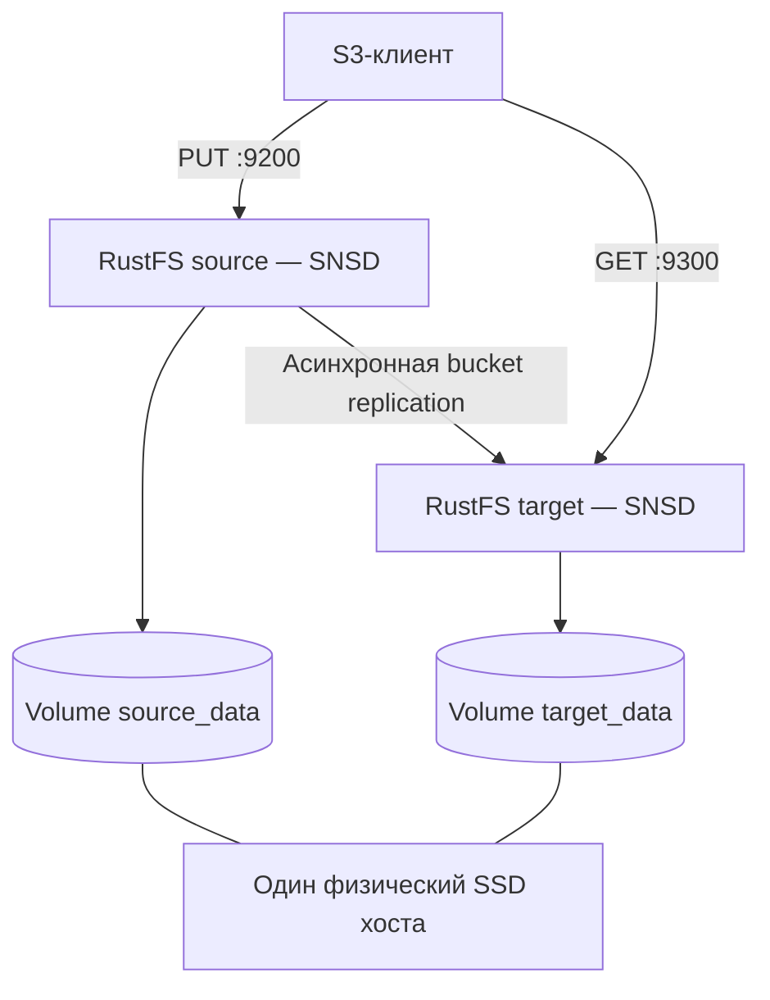

# Урок 27. Репликация на одном диске: две независимые копии

> [!abstract] Цель урока
> Разделить **полные копии объектов**, **erasure coding** и **bucket/site replication**. Запустить два независимых RustFS на одном компьютере, настроить копирование между бакетами, проверить получение новой версии и понять, **от каких отказов это не защищает**.

**Предварительные знания:** уроки 11, 25 и 26; Docker Compose, AWS CLI, терминал `fish`.  
**Практическая среда:** Linux, отдельные порты `9200–9201` и `9300–9301`.  
**Критерий завершения:** два самостоятельных RustFS принимают S3-запросы; запись в исходный бакет появляется в целевом; скачанные данные совпадают; после остановки источника целевая копия читается.

---

## 1. Что именно называют репликацией

| Механизм               | Устройство                                                                                 | Что проверяем                                       |
| ---------------------- | ------------------------------------------------------------------------------------------ | --------------------------------------------------- |
| **Полные копии**       | Два самостоятельных экземпляра объекта                                                     | Можно читать одну копию без другой                  |
| **Erasure coding**     | Один объект разложен на `K+M` shards внутри erasure set                                    | Достаточно ли здоровых shards для восстановления    |
| **Bucket replication** | Правило копирует выбранные версии между бакетами                                           | Изменение на источнике передаётся в цель            |
| **Site replication**   | Связывает независимые RustFS и синхронизирует также поддерживаемые настройки бакетов и IAM | Согласованность данных и конфигурации между сайтами |

**Bucket replication в RustFS** — направленная операция между версионируемыми бакетами. По умолчанию она **асинхронная**: успешный `PUT` на источнике не означает, что объект уже находится у получателя. **Site replication** тоже не является внутренним EC.

> [!important] Главное различие
> **4 Docker volumes на одном SSD** в кластере урока 26 имитируют размещение EC-shards. **2 независимых RustFS на том же SSD** создают два отдельных объекта на уровне бакетов. Ни один вариант не спасает от физической поломки общего SSD.

## 2. Топология эксперимента



- **Источник** и **получатель** имеют отдельные бакеты, тома, процессы и S3 endpoints. Они **не состоят в одном erasure set**.
- Для лаборатории оба экземпляра используют **одни тестовые ключи**, но их хранилища не объединяются. В рабочей среде для целевого бакета нужен **отдельный ограниченный аккаунт**.
- Внутри Docker-сети источник видит получателя как `target:9000`; адрес `127.0.0.1:9300` предназначен для команд с хоста.

## 3. Запускаем два RustFS

Создай **новый** каталог, не меняя лабораторию урока 26:

```bash
mkdir -p ~/s3-course/lesson-27-replication
cd ~/s3-course/lesson-27-replication

printf 'RUSTFS_ACCESS_KEY=lab%s\nRUSTFS_SECRET_KEY=%s\n' \
    (openssl rand -hex 8) \
    (openssl rand -hex 24) > .env
chmod 600 .env
```

Создай `compose.yaml`:

```yaml
x-rustfs: &rustfs
  image: rustfs/rustfs:latest
  restart: unless-stopped
  environment:
    RUSTFS_ACCESS_KEY: ${RUSTFS_ACCESS_KEY:?set in .env}
    RUSTFS_SECRET_KEY: ${RUSTFS_SECRET_KEY:?set in .env}
    RUSTFS_VOLUMES: /data
    RUSTFS_ADDRESS: ":9000"
    RUSTFS_CONSOLE_ADDRESS: ":9001"
    RUSTFS_CONSOLE_ENABLE: "true"
    RUSTFS_OBS_LOGGER_LEVEL: "info"

services:
  source:
    <<: *rustfs
    ports:
      - "127.0.0.1:9200:9000"
      - "127.0.0.1:9201:9001"
    volumes:
      - source_data:/data

  target:
    <<: *rustfs
    ports:
      - "127.0.0.1:9300:9000"
      - "127.0.0.1:9301:9001"
    volumes:
      - target_data:/data

volumes:
  source_data:
  target_data:
```

```bash
docker compose config -q
docker compose up -d
docker compose ps

curl -i http://127.0.0.1:9200/health/ready
curl -i http://127.0.0.1:9300/health/ready
```

Для AWS CLI установи реквизиты этого проекта **в текущем терминале fish**:

```bash
set -gx AWS_ACCESS_KEY_ID (string replace 'RUSTFS_ACCESS_KEY=' '' \
    (grep '^RUSTFS_ACCESS_KEY=' .env))
set -gx AWS_SECRET_ACCESS_KEY (string replace 'RUSTFS_SECRET_KEY=' '' \
    (grep '^RUSTFS_SECRET_KEY=' .env))
```

## 4. Создаём два версионируемых бакета

```bash
aws --endpoint-url http://127.0.0.1:9200 --region us-east-1 \
    s3api create-bucket --bucket s3-course-repl27-src
aws --endpoint-url http://127.0.0.1:9300 --region us-east-1 \
    s3api create-bucket --bucket s3-course-repl27-dst

aws --endpoint-url http://127.0.0.1:9200 \
    s3api put-bucket-versioning --bucket s3-course-repl27-src \
    --versioning-configuration Status=Enabled
aws --endpoint-url http://127.0.0.1:9300 \
    s3api put-bucket-versioning --bucket s3-course-repl27-dst \
    --versioning-configuration Status=Enabled
```

**Почему versioning обязателен:** реплицируется конкретная версия объекта. У источника и получателя возникают независимые записи о версиях; отдельные `VersionId` не следует считать универсально равными. Правила удаления версий и переноса delete markers настраиваются отдельно.

## 5. Настраиваем настоящую bucket replication

У RustFS есть два интерфейса: **Console** и клиент администрирования **`rc`**. Здесь используем Console, чтобы не устанавливать новый инструмент только ради одного урока.

1. Открой источник: <http://127.0.0.1:9201>, затем бакет `s3-course-repl27-src` → **Settings** → **Bucket Replication**.
2. Создай правило. **Endpoint:** `target:9000` (без `http://`), **Use TLS:** выключено только в этой локальной Docker-сети; **Bucket:** `s3-course-repl27-dst`.
3. Введи ключи из `.env`, **Region:** `us-east-1`, **Mode:** `Asynchronous`.
4. Включи копирование новых объектов. Для проверки delete markers отдельно активируй **Replicate Delete Markers**. Сохрани правило и проверь его статус.

**Не указывай `127.0.0.1:9300` в поле Endpoint:** этот адрес внутри контейнера `source` ссылается на сам контейнер. Если интерфейс отличается в установленной версии, проверь текущую документацию и журнал `docker compose logs source`.

> [!warning] Привилегии и безопасность
> В данном стенде целевые реквизиты административные ради минимального примера. На реальных серверах выделяй отдельный сервисный аккаунт для записи только в целевой бакет, применяй TLS, защищай конфигурацию репликации. Не копируй сюда реальные данные.

## 6. Проверка: новая версия и независимое чтение

```bash
printf 'replication lesson 27 v1\n' > repl27.txt
aws --endpoint-url http://127.0.0.1:9200 \
    s3api put-object --bucket s3-course-repl27-src \
    --key lab/demo.txt --body repl27.txt
```

Проверь объект у получателя; если его пока нет, сначала проверь состояние правила — передача асинхронна:

```bash
aws --endpoint-url http://127.0.0.1:9300 \
    s3api head-object --bucket s3-course-repl27-dst --key lab/demo.txt
aws --endpoint-url http://127.0.0.1:9300 \
    s3api get-object --bucket s3-course-repl27-dst \
    --key lab/demo.txt received27.txt
cmp repl27.txt received27.txt
```

Затем обнови объект, проверь **две версии** и скачай текущую целевую версию:

```bash
printf 'replication lesson 27 v2\n' > repl27.txt
aws --endpoint-url http://127.0.0.1:9200 \
    s3api put-object --bucket s3-course-repl27-src \
    --key lab/demo.txt --body repl27.txt

aws --endpoint-url http://127.0.0.1:9200 \
    s3api list-object-versions --bucket s3-course-repl27-src --prefix lab/demo.txt
aws --endpoint-url http://127.0.0.1:9300 \
    s3api list-object-versions --bucket s3-course-repl27-dst --prefix lab/demo.txt
```

После подтверждения доставки новой версии:

```bash
docker compose stop source
aws --endpoint-url http://127.0.0.1:9300 \
    s3api get-object --bucket s3-course-repl27-dst \
    --key lab/demo.txt after-source-stop27.txt
cmp repl27.txt after-source-stop27.txt
docker compose start source
```

**Что доказывает опыт:** целевой RustFS способен самостоятельно обслужить GET уже скопированного объекта при остановленном источнике. **Что не доказывает:** защиту от отказа SSD, синхронность копирования, автоматический переход клиентов на другой endpoint.

## 7. Задания и ограничения

1. **Delete marker.** После включения соответствующей опции удали исходный объект *без `version-id`*, затем сравни `list-object-versions` на обеих сторонах. Отличай delete marker от физического удаления версий.
2. **Пауза получателя.** Останови `target`, создай на источнике новую версию, запусти `target` и проверь доставку. Запиши время фактической синхронизации; заранее гарантированного интервала нет.
3. **Авария диска.** Представь, что отказал единственный физический SSD. Объясни, почему обе копии становятся недоступны.
4. **Различия механизмов.** Когда нужны независимый backup, bucket replication, site replication и EC? Для каждого назови отдельную задачу.

Остановка без удаления данных: `docker compose down`. Команда `docker compose down -v` **удаляет учебные тома**. После экспериментов: `set -e AWS_ACCESS_KEY_ID
set -e AWS_SECRET_ACCESS_KEY`.

## 8. Контрольные вопросы и итог

- [ ] Я различаю два независимых хранилища и два узла одного кластера.
- [ ] Я знаю, почему для bucket replication нужен versioning.
- [ ] Я понимаю, что успешный PUT не гарантирует доставку асинхронной реплики.
- [ ] Я проверил получение новой версии и чтение при остановленном источнике.
- [ ] Я понимаю общий домен отказа двух Docker volumes на одном SSD.
- [ ] Я не называю асинхронную репликацию полноценным резервным копированием.

> [!success] Результат урока
> **Bucket replication копирует версии объектов между самостоятельными бакетами.** Она создаёт вторую логическую копию, но реальная аварийная устойчивость зависит от независимости площадок/дисков, задержки передачи, политики удалений и готовности клиентов переключаться на резервный endpoint.

**Следующий урок:** №28 — «Consistency, quorum, потеря узла и healing».

---

## Источники

1. [RustFS — Bucket Replication](https://docs.rustfs.com/en/administration/data/bucket/replication)
2. [RustFS — Site Replication](https://docs.rustfs.com/en/operations/high-availability/site-replication)
3. [RustFS — SNSD, SNMD, MNMD](https://docs.rustfs.com/en/installation/linux)
4. [AWS S3 — Replication](https://docs.aws.amazon.com/AmazonS3/latest/userguide/replication.html)

**Дата сверки с документацией:** 2026-10-28. Совместимость и названия пунктов Console зависят от сборки RustFS; работу репликации нужно проверять по объектам и версиям, а не только по состоянию правила.
