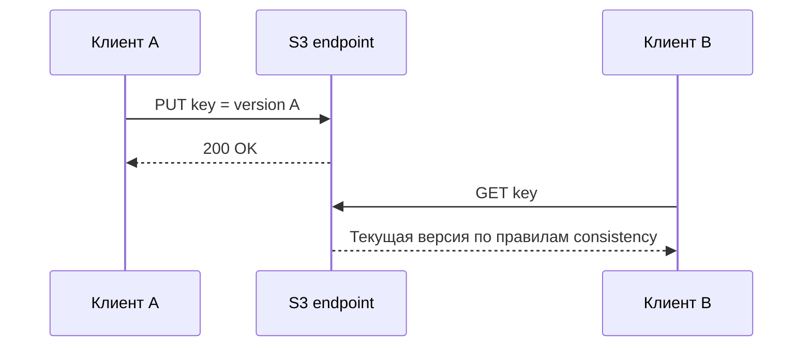

# Урок 28. Consistency, quorum и сбои кластера

> [!abstract] Цель урока
> Понять, чем отличаются **согласованность чтения**, **количество доступных shards**, **read/write quorum** и **готовность S3 endpoint**. На четырёхузловом RustFS проверить потерю одного и двух узлов, восстановление доступности и назначение healing.

**Предварительные знания:** уроки 11, 20, 25 и 26; Docker Compose, AWS CLI, `fish`.  
**Практическая среда:** *существующий* кластер урока 26: узлы `node1`–`node4`, API `127.0.0.1:9100` и `127.0.0.1:9102`.  
**Критерий завершения:** известны фактические результаты GET и PUT при двух сценариях отказа; узлы возвращены в рабочее состояние; сохранённые данные проверены; механизмы quorum и healing не смешиваются.

---

## 1. Согласованность — что увидит клиент

**Consistency** — правила, по которым результат записи становится виден последующим операциям чтения.

- **Read-after-write:** клиент выполнил успешный `PUT`, затем `GET` того же ключа. Важно, какую версию он получит.
- **Overwrite:** два последовательно записанных содержимых под одним ключом. Клиент должен понимать, когда становится видна новая версия.
- **Concurrent writes:** два клиента одновременно пишут один key; результат зависит от порядка завершения конфликтующих операций и правил реализации.
- **Versioning:** сохраняет отдельные версии объекта, но **сам по себе не гарантирует**, что параллельные изменения логически объединятся.

AWS S3 документирует **strong read-after-write consistency** для операций чтения и листинга в обычных бакетах. Это поведение **нельзя автоматически приписывать RustFS** только из-за совместимости API: его проверяют для используемой версии и топологии. Даже при сильной согласованности последняя запись не решает проблему прикладного конфликта двух авторов.



## 2. Quorum, данные и метаданные

**Quorum** — минимальное количество согласованных ответов от компонентов, требуемое для выполнения операции. Для EC-схемы `K+M` одновременно существуют математические условия восстановления данных и прикладные требования к подтверждению записи.

В учебной топологии урока 26 — **4 диска, 2 data + 2 parity**:

| Условие | Базовое число shards | Смысл |
|---|---:|---|
| **Восстановить данные** | Не менее `K = 2` корректных shards | Условие Reed–Solomon |
| **Read quorum RustFS** | Базово `K = 2` | Нужны также согласованные метаданные выбранной версии |
| **Write quorum RustFS** | `K+1 = 3` при `K=M` | Запись требует трёх подтверждений |

**Более широкий перечень условий:** сетевое соединение, работающий входной узел, согласованные `xl.meta`/версии, namespace locks и состояние кластера. Поэтому `2 shards доступны` **не означает** «любой GET обязан успешно выполниться».

```text
4 диска: D1 D2 P1 P2

Работают все 4   -> возможно чтение и запись
Потерян 1 диск   -> 3 shards: хватает для read и write quorum
Потеряны 2 диска -> 2 shards: математически чтение возможно,
                    но для write quorum не хватает подтверждений
Потеряны 3 диска -> 1 shard: объект из 2+2 не восстановить
```

> [!warning] Граница эксперимента
> Один узел в нашем стенде содержит один диск. В другом кластере **один узел может содержать несколько shards одного erasure set**: потеря одной ноды не равна потере одного shard. Четыре Docker volumes на одном SSD не защищают от отказа самого SSD.

## 3. Что различаем при отказе

| Событие | Что произошло | Чего это не доказывает |
|---|---|---|
| Упал HTTP-узел входа | Адрес клиента недоступен | Потерю всех данных кластера |
| Недоступен storage endpoint | Отсутствует один или несколько shards | Необратимую потерю объекта |
| Не набран write quorum | Запись не может быть подтверждена | То, что старые объекты нельзя читать |
| Readiness вернул HTTP `503` | Кластер сообщает о сниженной готовности | Что **каждая** S3-операция обязательно отказала |
| Healing восстановил shards | Потерянные/рассогласованные части реконструированы | Наличие резервной копии вне кластера |

`GET /health` проверяет **liveness** процесса; `/health/ready` проверяет зависимости хранилища, IAM и peers. Отдельные cluster read/write health probes проверяют quorum и дополнительные блокировки. Эти пробы имеют разное назначение.

## 4. Подготовка: проверяем исправный кластер

Все команды ниже выполняй в **каталоге урока 26**, не в каталоге репликации урока 27:

```bash
cd ~/s3-course/lesson-26-cluster
docker compose ps
docker compose start node1 node2 node3 node4

curl -i http://127.0.0.1:9100/health/ready
curl -i http://127.0.0.1:9102/health/ready
```

В этом терминале восстанови реквизиты кластера 26:

```bash
set -gx AWS_ACCESS_KEY_ID (string replace 'RUSTFS_ACCESS_KEY=' '' \
    (grep '^RUSTFS_ACCESS_KEY=' .env))
set -gx AWS_SECRET_ACCESS_KEY (string replace 'RUSTFS_SECRET_KEY=' '' \
    (grep '^RUSTFS_SECRET_KEY=' .env))
```

Создай контрольный объект через `node1`:

```bash
printf 'lesson 28: quorum and recovery\n' > lesson28.txt
aws --endpoint-url http://127.0.0.1:9100 --region us-east-1 \
    s3api put-object --bucket s3-course-cluster26 \
    --key lesson28/control.txt --body lesson28.txt

aws --endpoint-url http://127.0.0.1:9102 --region us-east-1 \
    s3api get-object --bucket s3-course-cluster26 \
    --key lesson28/control.txt before28.txt
cmp lesson28.txt before28.txt
```

Если кластер не готов или контрольное чтение не проходит, **не запускай отказные эксперименты**. Сначала исправь исходное состояние.

## 5. Опыт A: потеря одной ноды

Остановим `node4`, оставив S3-вход `node1` и `node2` доступными:

```bash
docker compose stop node4
curl -i http://127.0.0.1:9100/health
curl -i http://127.0.0.1:9100/health/ready

aws --endpoint-url http://127.0.0.1:9100 \
    s3api get-object --bucket s3-course-cluster26 \
    --key lesson28/control.txt one-node-down28.txt
cmp lesson28.txt one-node-down28.txt

printf 'created with node4 stopped\n' > write28.txt
aws --endpoint-url http://127.0.0.1:9100 \
    s3api put-object --bucket s3-course-cluster26 \
    --key lesson28/write-during-failure.txt --body write28.txt
```

**Разбор:** в идеализированной схеме `2+2` после потери одного shard остаётся три — достаточно для базовых read/write quorum. Зафиксируй **реальные** HTTP-ответы, код AWS CLI и сообщения RustFS: проверка кластера не заменяется расчётом EC.

Верни узел:

```bash
docker compose start node4
docker compose logs --tail=50 node4
curl -i http://127.0.0.1:9100/health/ready
```

## 6. Опыт B: потеря двух нод

Убедись, что все четыре узла снова работают, затем останови `node3` и `node4`, сохранив клиентский вход `node1`:

```bash
docker compose ps
docker compose stop node3 node4

curl -i http://127.0.0.1:9100/health/ready

aws --endpoint-url http://127.0.0.1:9100 \
    --cli-connect-timeout 3 --cli-read-timeout 5 \
    s3api get-object --bucket s3-course-cluster26 \
    --key lesson28/control.txt two-nodes-down28.txt

printf 'should require write quorum\n' > write-fail28.txt
aws --endpoint-url http://127.0.0.1:9100 \
    --cli-connect-timeout 3 --cli-read-timeout 5 \
    s3api put-object --bucket s3-course-cluster26 \
    --key lesson28/attempt-two-down.txt --body write-fail28.txt
```

**Ожидаемый вывод из модели:** два shards ещё позволяют реконструкцию `K=2`, но **write quorum = 3** недостижим. Реальный GET зависит и от состояния метаданных/блокировок; при ошибке **не делай вывод о потере всех данных**. Проверяй статус команды и логи. Ошибку записи **не считай успешной операцией** и не рассчитывай на существование объекта `attempt-two-down.txt`.

Немедленно восстанови исходную конфигурацию:

```bash
docker compose start node3 node4
docker compose ps
curl -i http://127.0.0.1:9100/health/ready

aws --endpoint-url http://127.0.0.1:9100 \
    s3api get-object --bucket s3-course-cluster26 \
    --key lesson28/control.txt recovered28.txt
cmp lesson28.txt recovered28.txt
```

## 7. Healing: когда требуется реконструкция

**Healing** в RustFS восстанавливает отсутствующие или рассогласованные EC-shards из доступных корректных shards. Работу инициируют, в частности, **autoHeal**, **scanner**, **readRepair** и административные операции.

1. Остановка и последующий запуск контейнера с **тем же исправным томом** не означают, что часть объекта утрачена; healing может быть не нужен.
2. При **реальной потере диска** и установке пустого заменяющего носителя система должна восстановить shards из оставшихся, пока сохранено достаточное количество корректных частей.
3. **Healing не возвращает намеренно удалённый объект**, не компенсирует потерю избыточности сверх предела EC и не заменяет backup.

Если установлен административный клиент `rc` с настроенным alias к **кластеру 26**, выполни диагностику без изменения данных:

```text
rc ready cluster26
rc admin info storage cluster26
rc admin scanner status cluster26
rc admin heal status cluster26

# Только просмотр плана для конкретного бакета:
rc admin heal start cluster26 --bucket s3-course-cluster26 --dry-run
```

`cluster26` здесь — **название alias**, которое предварительно создают средствами `rc`; это не имя контейнера. Для первого опыта **не удаляй Docker volumes и не редактируй** `format.json`, `xl.meta` и `.rustfs.sys`. Восстановление диска и ручной deep heal — отдельные процедуры с предварительной проверкой топологии и резервных копий.

## 8. Самостоятельные задания

1. Для `4+2` и `8+4` отдельно вычисли **максимальные потери shards для чтения** и **требования write quorum** по правилам RustFS из урока 25.
2. Объясни, почему `GET` при двух отказавших нодах нельзя оценивать лишь по формуле `N-lost >= K`.
3. Два клиента одновременно пишут `invoice.pdf`; чем помогут versioning и условные запросы (`If-Match`), а чего они не решают?
4. Опиши процедуру восстановления после утраты реального диска: обнаружение, замена, проверка адреса и пути, healing, контроль чтения.
5. Отдели последствия: **недоступен HTTP endpoint**, **не набран quorum**, **данные безвозвратно утрачены**.

## 9. Контрольные вопросы и итог

- [ ] Я различаю consistency, read/write quorum и recoverability.
- [ ] Я знаю, почему для `2+2` базовый write quorum равен трём.
- [ ] Я сравнил GET/PUT при отказе одного и двух узлов.
- [ ] Я различаю `/health` и `/health/ready`.
- [ ] Я понимаю, когда healing нужен и почему его нельзя считать backup.
- [ ] Все остановленные контейнеры вновь запущены; исходный объект читается без ошибок.

> [!success] Результат урока
> **Erasure coding отвечает за восстановимость данных, quorum — за допустимость операции, consistency — за видимость изменений, а readiness — за готовность системы обслуживать запросы.** Это четыре разных свойства. Отказоустойчивость кластера проверяется только вместе с фактическим расположением shards, связностью узлов и состоянием метаданных.

**Следующий урок:** №29 — «Масштабирование, производительность, метрики и эксплуатация».

---

## Источники

1. [RustFS — Cluster Lifecycle Operations: layout, quorum, healing](https://docs.rustfs.com/en/operations/cluster-lifecycle)
2. [RustFS — Node Healing](https://docs.rustfs.com/en/operations/high-availability/node-healing)
3. [RustFS — Status Check](https://docs.rustfs.com/en/operations/status-check)
4. [RustFS — Erasure Coding](https://github.com/rustfs/rustfs/blob/main/docs/architecture/erasure-coding.md)
5. [AWS S3 — Consistency model](https://docs.aws.amazon.com/AmazonS3/latest/userguide/Welcome.html#ConsistencyModel)

**Дата сверки с документацией:** 2026-10-28. Таблицы quorum описывают указанную учебную топологию; результаты реального сбоя зависят от состояния установленного кластера.
