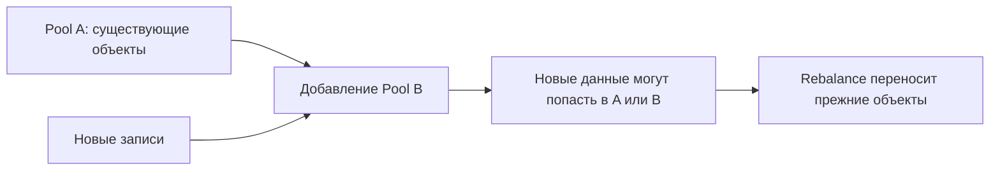
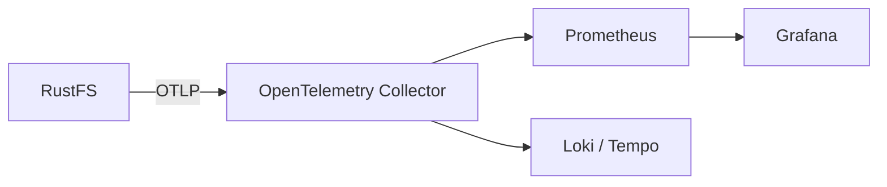

# Урок 29. Масштабирование, производительность и эксплуатация

> [!abstract] Цель урока
> Научиться отличать **логическую ёмкость от физической**, планировать рост хранилища, искать узкие места, измерять пропускную способность и задержки S3-операций, проверять метрики, логи и возможности восстановления. Провести серию тестов на четырёхузловом RustFS из урока 26.

**Предварительные знания:** уроки 19–20, 24–26 и 28; AWS CLI, Docker, Python и `boto3`.  
**Практическая среда:** отдельный четырёхконтейнерный кластер урока 26, Python 3, `boto3`, терминал `fish`.  
**Критерий завершения:** рассчитан бюджет места для EC, собраны результаты тестов маленьких и крупных объектов при разной конкурентности, понятны признаки CPU/дискового/сетевого bottleneck и правила безопасного расширения.

---

## 1. Сколько места реально доступно

**Raw capacity** — суммарный физический объём дисков. **Logical data** — полезные байты объектов без избыточности. В EC-схеме `K+M` часть raw capacity занята parity.

Для идеальной модели:

$$\huge
C_{\text{logical}}=C_{\text{raw}}\cdot\frac{K}{K+M}
$$

Пример: **4 независимых диска по 100 GiB**, схема `2+2`:

- Raw capacity: `4 × 100 = 400 GiB`.
- Доля полезных данных: `2/4 = 50 %`.
- Теоретическая полезная ёмкость: `400 × 0,5 = 200 GiB`.
- При плановом резерве 20 % полезной ёмкости: `200 × 0,8 = 160 GiB` по **условной расчётной модели**.

**Не включено**: метаданные, версии объектов, незавершённые multipart uploads, фрагментация, особенности small objects и неравномерность заполнения pool/set. У реального объёма — отдельные измерения, а не число из этой формулы.

> [!warning] Ограничение нашего стенда
> В уроке 26 четыре Docker volumes размещены на **одном физическом хосте**. Они не равны четырём независимым устройствам по 100 GiB. Нельзя сложить их «максимальные размеры» и объявить это реальной ёмкостью SSD. Проверяй пространство и свободные inode на файловой системе хоста.

## 2. Масштабирование: диски, pool и rebalance

| Действие | Что меняется | Что нужно помнить |
|---|---|---|
| **Добавить новый pool** | Появляется дополнительная группа дисков | Старые объекты автоматически не переезжают в неё |
| **Rebalance** | Существующие объекты перераспределяются между действующими pool | Нагрузка на CPU, сеть и диски; требуются запас места и контроль состояния |
| **Decommission pool** | Данные выводятся с pool перед его исключением | Не удалять исходные диски до подтверждения завершения переноса |
| **Добавить клиентские узлы/балансировщик** | Меняется обработка входящих запросов | Само по себе не увеличивает запас shards и ёмкость хранения |

В RustFS **число endpoints, ширина erasure set, порядок дисков и pool** относятся к сохранённой топологии. Нельзя увеличить уже созданный pool, просто дописав ещё один диск внутрь старого выражения `RUSTFS_VOLUMES`: сервер проверяет persisted layout и отвергает несовместимый запуск. Поддерживаемый путь масштабирования — **добавить отдельный pool** ко всей согласованной конфигурации и затем, при необходимости, запустить rebalance.



**Перед изменением топологии:** сделай независимую резервную копию, запиши список endpoints и pool, проверь здоровье дисков и свободное место. После изменения проверь готовность всех узлов, состав pool и доступность старых объектов. **Не меняй вручную** `format.json`, `.rustfs.sys`, `xl.meta` и shards.

## 3. Что ограничивает производительность

- **CPU:** EC-кодирование, контрольные суммы, TLS, шифрование и обработка большого числа запросов.
- **RAM:** буферы потоковой передачи, очереди и конкурентные запросы; один большой объект не должен целиком загружаться в память приложения.
- **Disk I/O:** последовательная пропускная способность, IOPS, задержка записи и чтения; мелкие объекты создают много операций с метаданными.
- **Network:** полоса между клиентами и узлами, межузловые передачи EC-shards; в одном хосте Docker-сеть не моделирует реальную стойку.
- **Metadata/locks:** много запросов к одному key, многочисленные версии или конкурентные изменения способны ограничить масштабирование.

**Throughput** измеряется в MiB/s или ops/s. **Latency** — время одной операции (`p50`, `p95`, `p99`). Увеличение числа параллельных запросов может поднять throughput и одновременно ухудшить хвостовые задержки.

```text
Клиенты --> HTTP + SigV4 --> Узел RustFS --> EC + metadata
                                        |           |
                                        v           v
                                    Network I/O   Disk I/O
```

## 4. Подготовка к измерениям

Работаем **на исправном кластере урока 26**. Не используй стенд репликации урока 27:

```fish
cd ~/s3-course/lesson-26-cluster
docker compose ps
curl -i http://127.0.0.1:9100/health/ready
```

Установи реквизиты этого кластера для `boto3` и AWS CLI:

```fish
set -gx AWS_ACCESS_KEY_ID (string replace 'RUSTFS_ACCESS_KEY=' '' \
    (grep '^RUSTFS_ACCESS_KEY=' .env))
set -gx AWS_SECRET_ACCESS_KEY (string replace 'RUSTFS_SECRET_KEY=' '' \
    (grep '^RUSTFS_SECRET_KEY=' .env))
set -gx S3_ENDPOINT http://127.0.0.1:9100
python -c 'import boto3; print(boto3.__version__)'
```

Если `boto3` отсутствует, установи его в используемое Python-окружение. В тестах **не применяем** реальные пользовательские данные.

## 5. Практика: измеряем PUT и GET на Python

Создай в каталоге лаборатории файл `bench29.py`. Он загружает объекты в **отдельный префикс `bench29/`**, затем читает их, сверяет байты и измеряет каждую операцию. Параметры командной строки позволяют повторить тест с 1 и 4 потоками.

```python
import argparse
import math
import os
import statistics
import time
from concurrent.futures import ThreadPoolExecutor, as_completed

import boto3
from botocore.config import Config

parser = argparse.ArgumentParser()
parser.add_argument("--count", type=int, default=32)
parser.add_argument("--size-kib", type=int, default=256)
parser.add_argument("--workers", type=int, default=1)
args = parser.parse_args()
assert 1 <= args.count <= 1000
assert 1 <= args.size_kib <= 16384
assert 1 <= args.workers <= 32

bucket = "s3-course-cluster26"
endpoint = os.environ.get("S3_ENDPOINT", "http://127.0.0.1:9100")
payload = os.urandom(args.size_kib * 1024)
prefix = f"bench29/size-{args.size_kib}/workers-{args.workers}/"
keys = [f"{prefix}{i:04d}.bin" for i in range(args.count)]

client = boto3.client(
    "s3",
    endpoint_url=endpoint,
    region_name="us-east-1",
    config=Config(
        s3={"addressing_style": "path"},
        max_pool_connections=max(10, args.workers + 2),
        retries={"max_attempts": 1},
        connect_timeout=5,
        read_timeout=30,
    ),
)


def put_one(key):
    start = time.perf_counter()
    client.put_object(Bucket=bucket, Key=key, Body=payload)
    return time.perf_counter() - start


def get_one(key):
    start = time.perf_counter()
    response = client.get_object(Bucket=bucket, Key=key)
    try:
        body = response["Body"].read()
    finally:
        response["Body"].close()
    if body != payload:
        raise ValueError(f"Different bytes: {key}")
    return time.perf_counter() - start


def run_phase(name, action):
    latencies = []
    started = time.perf_counter()
    with ThreadPoolExecutor(max_workers=args.workers) as executor:
        futures = {executor.submit(action, key): key for key in keys}
        for future in as_completed(futures):
            latencies.append(future.result())
    elapsed = time.perf_counter() - started
    ordered = sorted(latencies)
    p95 = ordered[math.ceil(len(ordered) * 0.95) - 1]
    transferred_mib = len(keys) * len(payload) / (1024 * 1024)
    print(
        f"{name:3s} | requests={len(keys)} | "
        f"elapsed={elapsed:.3f}s | "
        f"rate={transferred_mib / elapsed:.2f} MiB/s | "
        f"ops={len(keys) / elapsed:.2f}/s | "
        f"p50={statistics.median(ordered) * 1000:.1f} ms | "
        f"p95={p95 * 1000:.1f} ms"
    )


run_phase("PUT", put_one)
run_phase("GET", get_one)
```

Запусти четыре **отдельных прогона**:

```fish
# Маленькие объекты: IOPS, накладные расходы на запрос
python bench29.py --count 64 --size-kib 16 --workers 1
python bench29.py --count 64 --size-kib 16 --workers 4

# Крупные объекты: передача данных и дисковая подсистема
python bench29.py --count 24 --size-kib 1024 --workers 1
python bench29.py --count 24 --size-kib 1024 --workers 4
```

**Результат скрипта** — реальные `MiB/s`, `ops/s`, `p50`, `p95`. Точные значения станут известны только после запуска на твоём компьютере. Это **клиентские end-to-end измерения**, в которые входят HTTP, Python и Docker, а не чистый тест производительности SSD.

> [!note] Как сделать сравнение честным
> Не запускай тяжёлые задачи параллельно с тестом; повтори каждый профиль несколько раз; сравни одинаковые размеры и число объектов; фиксируй версию образа RustFS и конфигурацию CPU/RAM. GET после PUT может читать данные из системного кэша, поэтому его нельзя объявлять «скоростью физического диска».

## 6. Что смотреть во время теста

В **другом терминале**, в каталоге стенда:

```fish
docker compose ps
docker stats --no-stream
docker compose logs --tail=50 node1 node2 node3 node4

df -h
lsblk -o NAME,SIZE,FSTYPE,MOUNTPOINTS
```

Для дополнительной диагностики хоста при наличии утилит:

```fish
# iostat входит в пакет sysstat
iostat -xz 1 3
# Просмотр основных процессов
htop
```

| Наблюдение | Следующая проверка |
|---|---|
| CPU RustFS близок к пределу ядра | EC, checksums, TLS/SSE, число параллельных операций |
| Диски дают большие задержки | `iostat` (`await`, busy), запись shards, общие контейнерные I/O |
| HTTP-задержки выросли при `workers=4` | Очереди, пул соединений, блокировки, ресурсы |
| PUT быстрее GET или наоборот | Кэш, размер объектов, схема передачи, параметры клиента |
| Появились ошибки S3 | Логи приложения, доступность, quorum, timeout, ресурсы |

Не делай вывод «узкое место найдено» по одному показателю. Сопоставляй **клиентскую метрику**, **ресурсы хоста** и **логи сервера** в один временной интервал.

## 7. Monitoring, logs и backup

**Проверки здоровья:**

```fish
curl -i http://127.0.0.1:9100/health
curl -i http://127.0.0.1:9100/health/ready
```

**RustFS Observability** отправляет метрики, логи и трассировки через **OTLP** в OpenTelemetry Collector. У RustFS **нет собственного** scrape endpoint `/metrics` в формате Prometheus. Для Prometheus требуется цепочка:



- `RUSTFS_OBS_ENDPOINT=http://otel-collector:4318` — пример адреса OTLP HTTP receiver в Docker-сети с настроенным Collector; для подключения требуется отдельный сервис.
- `rustfs_runtime_readiness_ready` — готовность ноды.
- `rustfs_start_total` — количество запусков процесса.
- `rustfs_heal_task_running` и `rustfs_heal_queue_delay_seconds` — активные healing-задачи и время в очереди.
- `rustfs_capacity_current_bytes` — использование пространства по описанию метрики; **это не свободный объём конкретного физического SSD**.

**Резервирование:** EC защищает от предусмотренных потерь shards, но не от ошибочного удаления всех нужных версий, потери общей площадки или превышения предела отказоустойчивости. Создавай **независимую копию** с отдельной политикой хранения и регулярно проверяй восстановление.

- **RPO** — максимальный допустимый интервал потерянных изменений относительно момента аварии.
- **RTO** — максимальное допустимое время восстановления работы.
- Асинхронная репликация из урока 27 имеет ненулевой риск отставания; для RPO нужны измерение лага и правила recovery.
- **Backup отличается от replication**: политика хранения и возможность возврата к прошлому состоянию должны защищать от ошибок и удаления, которые могут быть распространены репликацией.

## 8. Самостоятельные задания

1. Посчитай raw и полезную ёмкость для `8+4`, если каждый из 12 независимых дисков имеет `2 TiB`; затем введи резерв 15 % в учебной модели.
2. Сравни `ops/s`, `MiB/s`, `p50`, `p95` для всех четырёх прогонов. Запиши, где сильнее помогли четыре потока — для маленьких или крупных объектов.
3. Для случая, когда `p95` вырос вдвое, а throughput повысился, объясни, почему метрики не противоречат друг другу.
4. Составь план расширения: новый pool, согласованная топология узлов, проверка готовности, rebalance, контроль старых объектов.
5. Опиши, как будешь восстанавливать данные после потери общего SSD на учебном хосте. Может ли EC кластера урока 26 восстановить их сам?

## 9. Контрольные вопросы и итог

- [ ] Я различаю raw capacity, полезную ёмкость и свободное место с резервом.
- [ ] Я знаю, что существующий pool нельзя расширять произвольным редактированием числа его endpoints.
- [ ] Я умею измерить throughput, ops/s, p50 и p95 для PUT и GET.
- [ ] Я могу перечислить CPU, RAM, disk, network и metadata как потенциальные bottlenecks.
- [ ] Я знаю разницу между liveness, readiness, OTLP-метриками и серверными логами.
- [ ] Я отличаю EC и репликацию от независимого восстановления из backup.

> [!success] Результат урока
> **Эксплуатация объектного хранилища — это измерение ёмкости, доступности, задержек и восстановления на реальной топологии.** Увеличить число контейнеров недостаточно: важны физические домены отказа, формат pool, согласованная конфигурация, наблюдаемость и проверяемая резервная копия.

**Следующий урок:** №30 — «Итоговый проект: FastAPI + Auth Service + RustFS».

---

## Источники

1. [RustFS — Cluster Lifecycle Operations](https://docs.rustfs.com/en/operations/cluster-lifecycle)
2. [RustFS — Pool Expansion](https://docs.rustfs.com/en/operations/scaling/storage-pool-expansion)
3. [RustFS — Rebalancing](https://docs.rustfs.com/en/operations/scaling/data-rebalancing)
4. [RustFS — Observability / OTLP](https://docs.rustfs.com/en/operations/observability)
5. [RustFS — Status Check](https://docs.rustfs.com/en/operations/status-check)
6. [RustFS — Node Healing](https://docs.rustfs.com/en/operations/high-availability/node-healing)

**Дата сверки с документацией:** 2026-10-28. Числа производительности в уроке не заданы: их получает пользователь при выполнении нагрузочного теста на своей машине.
