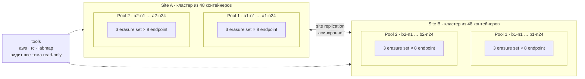

# Урок 27. Два кластера RustFS: pools, erasure sets, quorum и site replication

> [!abstract] Цель урока
> Собрать два независимых кластера RustFS (**site A** и **site B**). В каждом по **2 pool-а**, в каждом pool-е по **3 erasure set-а**, в каждом set-е по **8 endpoint-ов**, где **один endpoint = один контейнер = один Docker volume**. Затем своими глазами увидеть: на каких endpoint-ах лежат shards, как объект выбирает pool и set, при каком числе отказов пропадает чтение и запись (quorum) и как **site replication** связывает два кластера. Всё делается и из терминала, и из RustFS Console.

**Предварительные знания:** урок 26 (node, endpoint, pool, erasure set, shard), Docker Compose, AWS CLI, `fish`.
**Практическая среда:** Docker Engine + Compose v2 на Linux; Python 3 на хосте; свободные порты `9100 9101 9110 9111 9200 9201 9210 9211`.
**Критерий завершения:** заполнены три таблицы наблюдений (раздел 5, 6, 7), объект из site A появился в site B, а его shards лежат на других endpoint-ах.

> [!warning] Тяжёлый стенд
> Это **96 контейнеров RustFS** (48 на кластер) + 1 контейнер `tools`. Все они на одном компьютере и на одном SSD, так что это учебная модель, а не настоящая отказоустойчивость. До запуска проверь память: `docker stats --no-stream` после старта кластера A покажет реальный расход. Если ресурсов мало, собери мини-стенд (см. раздел 10): `python3 generate.py --pools 2 --sets 1 --drives 4` даёт 16 контейнеров с той же логикой.

---

## 1. Что мы строим



Соответствие терминов урока 26 и этого стенда:

| Термин | Что это в лаборатории |
|---|---|
| Physical disk | один SSD вашего компьютера (общий для всех 96 томов) |
| Storage endpoint / drive | один контейнер, например `a1-n7`, с одним томом `/data` |
| Node | тот же контейнер: здесь 1 node = 1 endpoint |
| Pool | 24 endpoint-а: `http://a1-n{1...24}:9000/data` |
| Erasure set | 8 endpoint-ов внутри pool-а, 3 набора на pool |
| Shard | одна из 8 частей объекта (по умолчанию 4 data + 4 parity) |
| Cluster / site | 48 контейнеров с общим `RUSTFS_VOLUMES` и общими ключами |

Имена: `a1-n7` читается как «кластер **a**, pool **1**, узел **7**».

### Что известно из документации, а что мы проверяем сами

| Утверждение | Статус |
|---|---|
| Несколько pool-ов задаются в `RUSTFS_VOLUMES` через пробел | документация RustFS (CLI reference) |
| Ширина set-а закрепляется `RUSTFS_ERASURE_SET_DRIVE_COUNT`, должна делить pool без остатка | документация (cluster lifecycle) |
| Для 8 дисков авто-parity = EC:4, то есть 4 data + 4 parity | документация (EC configuration) |
| Чтение требует `K` shards, запись `K`, а при `K == M` нужно `K+1` | документация (cluster lifecycle) |
| Какие именно endpoint-ы попадают в какой set | **в документации не описано**, смотрим наблюдением |
| По какому правилу объект выбирает pool | **не описано**, смотрим наблюдением |
| Объект целиком живёт в одном set-е, наборы не пересекаются | документация + проверим скриптом |

> [!info] Зачем закреплён `RUSTFS_ERASURE_SET_DRIVE_COUNT=8`
> RustFS обычно сам подбирает ширину набора из топологии, а допустимых делителей числа 24 несколько (12, 8, 6 …). Чтобы получить ровно **3 набора по 8**, ширина закреплена в `compose.yaml`. Менять её у уже инициализированного pool-а нельзя.

---

## 2. Подготовка

Распакуй архив лаборатории и перейди в каталог. В `fish`:

```bash
mkdir -p ~/s3-course
unzip lesson-27-lab.zip -d ~/s3-course
cd ~/s3-course/lesson-27-lab
ls
```

Состав каталога:

```text
lesson-27-lab/
├── generate.py            # генератор compose.yaml (кластеры × pool × set × endpoint)
├── compose.yaml           # результат генератора (уже сгенерирован для 2×2×3×8)
├── quorum_demo.py         # опыт с quorum: гасит узлы одного set-а по одному
└── toolbox/
    ├── Dockerfile         # образ tools: aws cli, rc, python
    ├── bin/               # s3a, s3b, lab-aliases, labmap, mkfile
    └── py/                # labmap.py (карта shards), probe.py (замер для quorum)
```

Ключи двух кластеров **разные** (это независимые системы). Файл `.env` содержит секреты, не добавляй его в Git:

```bash
printf 'A_ACCESS_KEY=lab%s\nA_SECRET_KEY=%s\nB_ACCESS_KEY=lab%s\nB_SECRET_KEY=%s\n' \
    (openssl rand -hex 8) (openssl rand -hex 24) \
    (openssl rand -hex 8) (openssl rand -hex 24) > .env
chmod 600 .env
```

Сгенерируй и проверь compose, затем собери образ `tools`:

```bash
python3 generate.py
docker compose config -q
docker compose build tools
```

`generate.py` должен ответить: `96 контейнеров RustFS, 4 pool-ов, 12 erasure set-ов по 8 endpoint-ов`. `config -q` при успехе молчит.

> [!note] Что делает контейнер `tools`
> Он стоит в той же Docker-сети, поэтому видит узлы по DNS-именам (`a1-n1`, `b1-n1`). Туда же **только для чтения** примонтированы все 96 томов под `/v/<узел>`. Поэтому скрипт `labmap` может показать, какие файлы-shards лежат на каком endpoint-е. Все команды ниже запускаются так: `docker compose exec tools <команда>`.

---

## 3. Запуск site A и первый взгляд в Console

Профиль `a` запускает только кластер A (48 контейнеров). Кластер B включим позже, чтобы не нагружать машину раньше времени.

```bash
docker compose --profile a up -d
docker compose --profile a ps | wc -l
```

Узлы стартуют не мгновенно: им нужно найти друг друга. Дождись готовности (команда сама повторяется, пока все 48 не ответят на `/health/ready`):

```bash
while not docker compose exec tools labmap ready a
    sleep 5
end
```

Ожидаемый финал:

```text
OK  кластер A pool 1: готово 24/24
OK  кластер A pool 2: готово 24/24
```

Сколько памяти занял кластер:

```bash
docker stats --no-stream --format '{{.Name}}\t{{.MemUsage}}' | head -5
```

Если узлы долго не готовы, смотри логи одного узла и раздел 10:

```bash
docker compose logs --tail=40 a1-n1
```

### Console site A

Адрес: **http://127.0.0.1:9101** (консоль узла `a1-n1`). Резервная консоль: **http://127.0.0.1:9111** (узел `a2-n1`, пригодится, когда мы будем гасить узлы). Логин и пароль берём из `.env`:

```bash
grep '^A_' .env
```

Что посмотреть, названия пунктов меню могут слегка отличаться в вашей версии:

1. Общий обзор кластера: сколько узлов и дисков онлайн. Ожидаем 48 дисков.
2. Раздел **Rebalance**. На уроке 26 там было `Pool Count: 1` и `Unsupported`. Теперь pool-ов **2**, и кнопка *Start Rebalance* должна стать доступной. Не нажимай её сейчас: это отдельный опыт в разделе 8.

### Алиасы `rc` и административная информация

```bash
docker compose exec tools lab-aliases
docker compose exec tools rc admin info cluster site-a
docker compose exec tools rc admin pool list site-a
```

Ожидаем, что `pool list` покажет **два** pool-а с выражениями `http://a1-n{1...24}:9000/data` и `http://a2-n{1...24}:9000/data`.

---

## 4. Как читать карту

Команда `labmap map` ничего не угадывает: она заглядывает в каталоги всех 48 томов и смотрит, у каких endpoint-ов лежат shards одних и тех же объектов. Endpoint-ы, у которых есть общие объекты, объединяются в один set. Поэтому после загрузки достаточного числа объектов вы увидите **реальные** наборы, а не предположение из документации.

Команда `labmap where` показывает путь одного объекта.

---

## 5. Опыт 1. Куда ложатся shards

### 5.1. Один объект

Создаём бакет и объект 4 MiB со случайным содержимым через узел `a1-n1`:

```bash
docker compose exec tools s3a s3api create-bucket --bucket lab
docker compose exec tools mkfile big1.bin 4
docker compose exec tools s3a s3api put-object --bucket lab --key demo/big1.bin --body /work/big1.bin
docker compose exec tools labmap where a lab demo/big1.bin --size 4194304
```

**До запуска предскажи:**

- В каком числе endpoint-ов найдутся shards? (подсказка: размер set-а)
- Сколько весит один shard при схеме 4 data + 4 parity?
- Во сколько раз суммарный размер на дисках больше размера файла?

Проверь: должно получиться **8 endpoint-ов** в **одном** pool-е, около **1 MiB** на endpoint, суммарно около **8 MiB**, то есть примерно **×2.0**. Это и есть цена parity: вы платите вдвое больше места за право потерять до 4 дисков из 8.

Теперь прочитай объект через **другой** узел и сравни байты (урок 26, только на другом масштабе):

```bash
docker compose exec -e ENTRY_A=a2-n9 tools s3a s3api get-object --bucket lab --key demo/big1.bin /work/got.bin
docker compose exec tools cmp /work/big1.bin /work/got.bin
```

### 5.2. Много объектов: видим 2 pool-а × 3 set-а

Загружаем 40 объектов по 1 MiB под разными ключами:

```bash
docker compose exec tools sh -c 'mkfile one.bin 1 >/dev/null; for i in $(seq 1 40); do s3a s3api put-object --bucket lab --key spread/obj-$i.bin --body /work/one.bin >/dev/null; done; echo готово'
docker compose exec tools labmap map a lab --keys 2
```

Что искать в выводе:

| Вопрос | Где смотреть |
|---|---|
| Сколько set-ов в каждом pool-е? | заголовки `Set A / B / C` |
| Сколько endpoint-ов в set-е? | число строк под заголовком, ожидаем 8 |
| Пересекаются ли наборы? | строка `Проверка:` в конце каждого pool-а |
| Идут ли узлы одного set-а подряд (`n1…n8`)? | сравни номера `aX-nN` в наборе |
| Попали ли объекты в оба pool-а? | число `объектов` в заголовке pool-а |
| Равномерно ли заполнены endpoint-ы? | столбики использования |

Здесь ответ на вопрос «может ли endpoint входить в два erasure set-а»: скрипт строит наборы только по наблюдениям, и если бы endpoint принадлежал двум наборам, наборы слились бы в один и размер получился бы больше 8.

> [!tip] Заполни таблицу наблюдений 1
> | Параметр | Мой результат |
> |---|---|
> | set-ов в pool 1 / pool 2 | |
> | endpoint-ов в каждом set-е | |
> | узлы одного set-а идут подряд? | |
> | объектов в pool 1 / pool 2 | |
> | суммарный размер на дисках / размер файла для `big1.bin` | |

### 5.3. То же в Console

1. Открой Object Browser (раздел бакетов) в Console A и найди бакет `lab`.
2. Загрузи через браузер файл примерно 5 MiB под именем `console/upload1.bin`.
3. В терминале найди его shards: `docker compose exec tools labmap where a lab console/upload1.bin`.
4. Убедись, что shards загруженного через UI файла лежат так же: 8 endpoint-ов в одном set-е.

Вывод: UI, `aws` и `rc` ходят в один и тот же S3-слой, раскладка по дискам не зависит от клиента.

---

## 6. Опыт 2. Quorum: сколько узлов set-а можно потерять

### 6.1. Теория на одной формуле

Для set-а из 8 дисков с авто-parity **EC:4**: `K = 4` data, `M = 4` parity.

| Операция | Нужно живых shards | При `N = 8` |
|---|---|---|
| Чтение объекта | `K` | **4** |
| Запись объекта | `K`, а если `K == M`, то `K + 1` | **5** |

Отсюда ожидание для одного set-а:

| Остановлено узлов | Живых | Чтение | Запись в этот set |
|---|---|---|---|
| 0–3 | 8–5 | да | да |
| 4 | 4 | **да** | **нет** |
| 5–8 | 3–0 | нет | нет |

Главный вывод: между «чтение ещё есть» и «запись уже невозможна» есть зона из одного узла. RustFS не подтверждает запись, которая не добралась до quorum.

### 6.2. Вручную: теряем 3 узла

Узнай, какие endpoint-ы держат `demo/big1.bin`, и возьми три из них (подставь **свои** имена из вывода `where`; ниже они для примера):

```bash
docker compose exec tools labmap where a lab demo/big1.bin
docker compose --profile a stop a1-n3 a1-n9 a1-n14
```

Читаем объект, выбрав точку входа **вне** остановленных узлов:

```bash
docker compose exec -e ENTRY_A=a2-n9 tools s3a s3api get-object --bucket lab --key demo/big1.bin /work/got2.bin
docker compose exec tools cmp /work/big1.bin /work/got2.bin
```

Чтение должно пройти: 5 живых shards ≥ 4. Верни узлы: `docker compose --profile a start a1-n3 a1-n9 a1-n14`.

### 6.3. Автоматически: полная лестница отказов

Скрипт определит set объекта по расположению shards, затем по одному гасит его узлы. После каждого шага он читает известный объект и пишет 60 новых. В конце он сам поднимает всё обратно.

```bash
python3 quorum_demo.py --cluster a --bucket lab --key demo/big1.bin --size 4194304
```

Таблица на выходе: колонки `остановлено`, `живых`, результат `GET`, число успешных `PUT` и коды ошибок.

> [!important] Как читать колонку PUT
> Новый ключ попадает в **один** из 6 set-ов кластера (2 pool-а × 3 set-а). Деградировал только **один** set, поэтому после порога quorum откажут не **все** записи, а только те, чей ключ попал в этот set. Из 60 записей ожидаем порядка **10 отказов** (≈ 1/6), остальные проходят. Это иллюстрация правила из документации «наборы не делят общий бюджет отказов»: отказ одного set-а не останавливает кластер. Точное число зависит от того, как ключи распределятся по pool-ам и set-ам, и ровно 10 оно не будет. Если отказов нет совсем или они на всех 60 ключах, это тоже результат: запиши его и разберись, почему.

> [!tip] Заполни таблицу наблюдений 2
> | Остановлено | Живых | GET | PUT ok из 60 | Коды ошибок |
> |---|---|---|---|---|
> | 0 | 8 | | | |
> | 3 | 5 | | | |
> | 4 | 4 | | | |
> | 5 | 3 | | | |
>
> На каком шаге **впервые** появились отказы PUT? На каком отказал GET? Совпало ли с таблицей из 6.1?

### 6.4. То же глазами Console

Повтори опыт руками, наблюдая в Console:

1. Останови 3 узла набора (как в 6.2), обнови обзор: число онлайн-дисков должно упасть с 48 до 45.
2. Скачай `demo/big1.bin` через Object Browser: работает.
3. Останови ещё 1 узел того же набора (всего 4) и загрузи через UI новый файл. Если ключ попадёт в деградировавший set, загрузка не пройдёт, но файлы с другими ключами могут пройти.
4. Останови 5-й узел набора и скачай `demo/big1.bin` ещё раз: ожидаем отказ.
5. Консоль работает на узле `a1-n1`. Если он оказался среди остановленных, открой резервную консоль `http://127.0.0.1:9111` (узел `a2-n1`).
6. Запусти всё обратно: `docker compose --profile a start <узлы>`.

> [!note] После возврата узлов
> Объекты, записанные в период деградации, лежат на меньшем числе shards, чем обычно. RustFS восстанавливает недостающие shards фоновым heal-процессом. Как запускать и смотреть heal вручную, проверь командой `docker compose exec tools rc admin --help`: в документации, по которой собран этот урок, команда не описана.

Очистка опытных данных:

```bash
docker compose exec tools s3a s3 rm s3://lab/ --recursive --exclude "demo/*" --exclude "spread/*" --exclude "console/*"
```

---

## 7. Опыт 3. Site replication между A и B

### 7.1. Запуск site B

```bash
docker compose --profile b up -d
while not docker compose exec tools labmap ready b
    sleep 5
end
```

Console site B: **http://127.0.0.1:9201** (резервная: **9211**). Ключи: `grep '^B_' .env`. Убедись, что это **другой** кластер: здесь свои ключи, нет бакета `lab` и свои 48 дисков.

### 7.2. Чистое начало

Документация рекомендует первую связку делать на **пустых** сайтах. Убери бакет опытов с A:

```bash
docker compose exec tools s3a s3 rb s3://lab --force
docker compose exec tools s3b s3 ls
```

Вторая команда ничего не должна показать: на B данных нет.

### 7.3. Связываем сайты

Сайты видят друг друга по DNS внутри Docker-сети, поэтому адреса `http://a1-n1:9000` и `http://b1-n1:9000` доступны обоим. Это не loopback, поэтому флаг `RUSTFS_REPLICATION_ALLOW_LOOPBACK_TARGET` **не нужен** (его нельзя включать в продакшене).

```bash
docker compose exec tools lab-aliases
docker compose exec tools rc ready site-a
docker compose exec tools rc ready site-b
docker compose exec tools rc admin replicate add site-a site-b
docker compose exec tools rc admin replicate info site-a
docker compose exec tools rc admin replicate info site-b
docker compose exec tools rc admin replicate status site-a
```

В `info` ищи два сайта с их **deployment ID**, они пригодятся в 7.6. Все сайты нужно добавлять **одной** командой `add`.

> [!warning] Одна точка входа на сайт
> В лаборатории адрес сайта это один узел (`a1-n1`, `b1-n1`). В настоящей эксплуатации сайту нужен стабильный адрес балансировщика, иначе остановка этого узла ломает репликацию. Лабораторный набор опытов этого не затрагивает: узлы `a1-n1` и `b1-n1` мы не гасим.

### 7.4. Бакет, объект и метаданные расходятся сами

```bash
docker compose exec tools s3a s3api create-bucket --bucket shared
docker compose exec tools s3b s3api list-buckets
docker compose exec tools s3a s3api get-bucket-versioning --bucket shared
docker compose exec tools mkfile rep1.bin 4
docker compose exec tools s3a s3api put-object --bucket shared --key rep/rep1.bin --body /work/rep1.bin
```

Репликация **асинхронная**, поэтому дай ей несколько секунд и проверь на B:

```bash
sleep 10
docker compose exec tools s3b s3api head-object --bucket shared --key rep/rep1.bin
docker compose exec tools s3b s3api get-object --bucket shared --key rep/rep1.bin /work/rep1.fromB.bin
docker compose exec tools cmp /work/rep1.bin /work/rep1.fromB.bin
docker compose exec tools rc admin replicate status site-a --buckets
docker compose exec tools rc admin replicate status site-a --metrics
```

Ожидаем: бакет `shared` появился на B сам, объект идентичен по байтам. Версионирование site replication требует на каждом сайте, поэтому проверь вывод `get-bucket-versioning`: скорее всего, оно включено.

### 7.5. Два кластера хранят один объект по-разному

Это главное наблюдение урока: репликация копирует **объект**, а не shards. У каждого кластера собственная раскладка.

```bash
docker compose exec tools labmap where a shared rep/rep1.bin --size 4194304
docker compose exec tools labmap where b shared rep/rep1.bin --size 4194304
```

Сравни: pool, номера endpoint-ов, размер shard-а. Номера узлов и pool, скорее всего, будут разными: у кластеров свои диски и своя история записей, а в MinIO-подобных системах раскладка ещё и зависит от идентификатора развёртывания (для RustFS в документации это не описано, поэтому сравни сам). Размер shard-а и общий коэффициент должны совпасть.

Теперь в обратную сторону: запись в **B** должна появиться в **A**.

```bash
docker compose exec tools s3b s3api put-object --bucket shared --key rep/from-b.bin --body /work/rep1.bin
sleep 10
docker compose exec tools s3a s3api head-object --bucket shared --key rep/from-b.bin
```

То же в Console: открой **9101** (A) и **9201** (B) в двух вкладках, загрузи файл в `shared` через одну консоль и найди его в другой.

> [!tip] Заполни таблицу наблюдений 3
> | Параметр | Site A | Site B |
> |---|---|---|
> | pool объекта `rep1.bin` | | |
> | endpoint-ы (номера) | | |
> | размер shard-а | | |
> | через сколько секунд объект появился | — | |

### 7.6. Что бывает, если B недоступен

Сайт B пропадает целиком (авария площадки). Репликация асинхронная: запись в A должна продолжать работать.

```bash
docker compose --profile b stop
docker compose exec tools s3a s3api put-object --bucket shared --key rep/while-b-down-1.bin --body /work/rep1.bin
docker compose exec tools s3a s3api put-object --bucket shared --key rep/while-b-down-2.bin --body /work/rep1.bin
docker compose exec tools rc admin replicate status site-a --metrics
```

Затем верни B и проследи за догоняющей репликацией:

```bash
docker compose --profile b start
while not docker compose exec tools labmap ready b
    sleep 5
end
sleep 30
docker compose exec tools s3b s3api list-objects-v2 --bucket shared --prefix rep/
```

Если после ожидания объектов `while-b-down-*` на B всё ещё нет, запусти ресинхронизацию. Идентификатор берётся из `rc admin replicate info site-a`:

```bash
docker compose exec tools rc admin replicate resync start site-a --site <deployment-id-сайта-B> --yes
docker compose exec tools rc admin replicate resync status site-a --site <deployment-id-сайта-B>
```

> [!note] Чего site replication НЕ делает
> Она не переключает DNS, не направляет трафик и не восстанавливает приложения. Это только синхронизация данных и настроек между сайтами. Так что B пока лишь «второй склад в другом городе», а переключать клиентов на него придётся отдельно.

### 7.7. Необязательно: пользователи (IAM)

Site replication синхронизирует и IAM. Синтаксис команд управления пользователями уточни через `rc admin user --help` и `rc admin policy --help`: документация, по которой собран урок, упоминает `rc admin user info`, `rc admin user rm` и `rc admin policy attach ... --user`. Идея проверки: создать пользователя на A, найти его на B, удалить.

---

## 8. Необязательно: ребаланс между pool-ами

Теперь, когда в кластере 2 pool-а, в Console на странице **Rebalance** можно нажать *Start Rebalance*. Ожидаем: на странице появятся прогресс, число перенесённых байтов и объектов по pool-ам. Сделай этот опыт на кластере A, **до** того как наполнишь его большим объёмом данных, и сравни `labmap map a shared` до и после. Условия из документации: нужно больше одного pool-а и не должно идти снятие pool-а с эксплуатации.

---

## 9. Контрольные вопросы

- [ ] Я могу назвать, где в стенде «один endpoint = один контейнер = один том».
- [ ] Я объясняю, почему 4 + 4 shards дают чтение при 4 живых и запись только при 5.
- [ ] Я знаю, почему при 4 остановленных узлах set-а не **все** PUT-ы отказывают.
- [ ] Я видел, что endpoint принадлежит ровно одному erasure set-у, и могу доказать это выводом `labmap map`.
- [ ] Я понимаю, чем site replication отличается от erasure coding и от bucket replication.
- [ ] Я знаю, почему один и тот же объект лежит на разных endpoint-ах в A и B.
- [ ] Я знаю, почему стенд на одном SSD не защищает от потери SSD и не моделирует отказ площадки по-настоящему.

> [!success] Результат урока
> Три разных механизма устойчивости работают на разных уровнях: **erasure set** переживает потерю дисков внутри set-а (пока выполнен quorum), **pool-ы** расширяют ёмкость, не меняя раскладку существующих данных, а **site replication** переживает потерю целой площадки, но асинхронно и без автоматического переключения клиентов.

---

## 10. Если что-то пошло не так

| Симптом | Что проверить |
|---|---|
| Узлы долго «не готовы» | `docker compose logs --tail=60 a1-n1`; 48 контейнеров стартуют минуты. Узел может несколько раз перезапуститься, пока не увидит остальных (`restart: unless-stopped`) |
| `PoolTopologyMismatch` в логах | порядок и список `RUSTFS_VOLUMES` должны быть одинаковы на всех узлах и между запусками. Не удаляй `format.json` для обхода; пересоздай стенд: `docker compose --profile a --profile b down -v` |
| Видишь не 3 набора по 8 | `docker compose logs a1-n1 \| grep -i -E 'set\|pool\|erasure'`; проверь, что `RUSTFS_ERASURE_SET_DRIVE_COUNT: "8"` попал в окружение узла |
| `labmap where` не находит объект | `docker compose exec tools labmap tree a1-n1 --depth 4`: так видна фактическая раскладка файлов на диске. Если она отличается от `bucket/ключ/xl.meta`, пришли вывод `tree` |
| Мало памяти / Docker тормозит | мини-стенд: `python3 generate.py --pools 2 --sets 1 --drives 4` (16 контейнеров). Пересчитай quorum по формуле: при 4 дисках EC:2, `K = 2`, чтение при 2, запись при 3 |
| Не собирается `tools` на arm64 | `docker compose build tools --build-arg RC_VERSION=<версия>`; имя архива `rc` для arm64 в Dockerfile перебирается автоматически, но проверь релизы `rustfs/cli` |
| Сайты не связываются | `rc ready site-a` и `rc ready site-b` из `tools`; убедись, что оба кластера запущены; не повторяй `replicate add` при таймауте, сначала смотри `replicate info` |
| Порт занят | поменяй порты публикации в `generate.py` (функция `ports`) и сгенерируй compose заново |

**Остановка с сохранением данных:**

```bash
docker compose --profile a --profile b stop
```

**Полная очистка стенда вместе с томами** (все 96 учебных томов будут удалены):

```bash
docker compose --profile a --profile b down -v
```

---

## Что в этой лабораторной проверено, а что нет

> [!warning] Честная оговорка
> Сгенерированный `compose.yaml` проверен командой `docker compose config` (структура, 97 сервисов, 96 томов, порты, подстановка переменных). Скрипты `labmap` и `quorum_demo.py` проверены на **имитированном** дереве каталогов. Сам образ `tools` и живые контейнеры RustFS при подготовке урока запустить было нельзя, поэтому **не подтверждены на практике**: фактическая раскладка файлов на диске, имена кодов ошибок при потере quorum, точный вывод `rc` и названия пунктов в Console. Там, где результат зависит от версии, в тексте стоит «ожидаем», а не «получится».

## Источники

1. [RustFS — CLI Reference (несколько pool-ов через пробел)](https://docs.rustfs.com/reference/cli)
2. [RustFS — Cluster Lifecycle Operations (set width, quorum, rebalance, decommission)](https://docs.rustfs.com/en/operations/cluster-lifecycle)
3. [RustFS — EC Configuration (авто-parity для 8 дисков)](https://docs.rustfs.com/installation/requirement/ec-configuration)
4. [RustFS — Site Replication](https://docs.rustfs.com/operations/high-availability/site-replication)
5. [RustFS — CLI Client (rc)](https://docs.rustfs.com/en/operations/rc)
6. [RustFS — Pool Decommission and Rebalance](https://docs.rustfs.com/operations/decommission)
7. [RustFS — Architecture (set, drive, node)](https://docs.rustfs.com/concepts/architecture)

**Дата сверки с документацией:** 2026-10-29.
**Следующий урок:** на выбор — снятие pool-а (decommission) или heal и восстановление shards.
