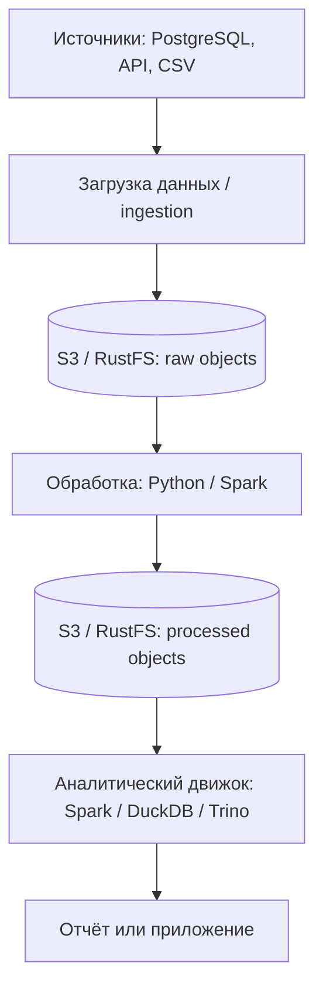
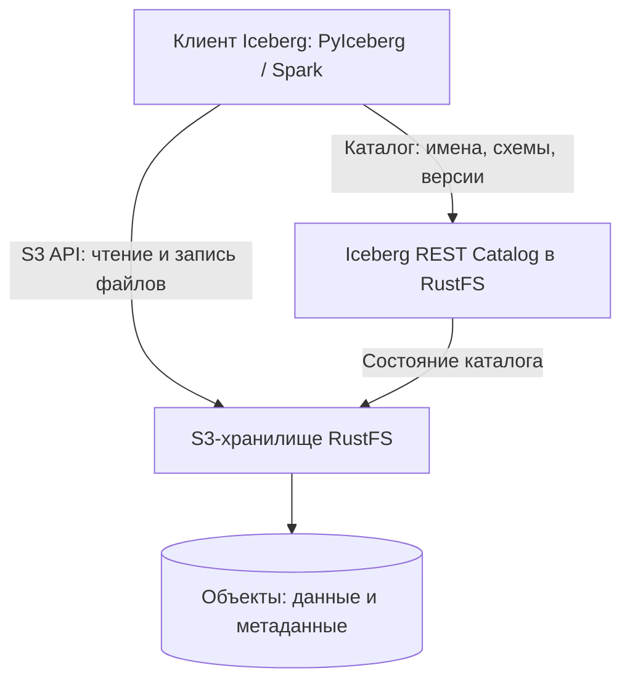

# Дополнительный урок. Роль S3 в Data Lake и знакомство с S3 Tables

> [!abstract] Цель урока
> Понять, зачем объектное хранилище используется для аналитических данных, почему S3 сам по себе не является базой данных и что добавляет раздел **S3 Tables** в RustFS. В устройство Apache Iceberg пока не углубляемся.

**Предварительные знания:** bucket, object, key, S3 API, метаданные объектов.  
**Практическая среда:** RustFS Console (`http://127.0.0.1:9001`) и локальный S3 API (`http://127.0.0.1:9000`).  
**Критерий завершения:** я могу объяснить роли S3, вычислительного движка и каталога; включил табличный режим для *отдельного тестового бакета* и понимаю, чего эта операция не делает.

---

## 1. Что такое Data Lake

**Data Lake (озеро данных)** — архитектура, в которой большие наборы данных из разных источников хранятся в исходном или подготовленном виде, а специальные программы обрабатывают и анализируют их по мере необходимости.

Пример: интернет-магазин ежедневно собирает:

- заказы из PostgreSQL;
- события пользователей из backend;
- отчёты поставщиков в CSV;
- фотографии товаров.

В Data Lake данные можно хранить вместе, **не требуя заранее превращать каждый файл в таблицу одной базы данных**. Важное различие: Data Lake — это *вся архитектура*, а не название конкретного бакета или продукта.

Обычно выделяют три логические зоны:

| Зона | Что содержит | Пример ключа S3 |
|---|---|---|
| **Raw** | Данные без изменения | `raw/orders/2026-10-29.csv` |
| **Processed** | Очищенные и преобразованные данные | `processed/orders/part-0001.parquet` |
| **Curated** | Наборы данных для готовых отчётов | `curated/sales/daily.parquet` |

Это **соглашение по организации**. Зоны могут быть префиксами одного бакета или отдельными бакетами; S3 не создаёт их автоматически.

## 2. Какую роль выполняет S3

**S3 — слой хранения (storage layer)**. Он принимает и выдаёт объекты по API и обеспечивает работу с бакетами, ключами, доступом и сохранностью данных. В роли S3 может выступать AWS S3 или локальный RustFS.

**Ingestion** — получение данных из источников и запись в хранилище.  
**Processing** — очистка, объединение и преобразование данных.  
**Query engine (вычислительный движок)** — программа, которая действительно читает файлы, выполняет запросы и считает результат.

> [!important] Главное разделение
> **S3 хранит байты объектов.** Он не выполняет `SELECT`, `JOIN`, `GROUP BY` над содержимым обычного CSV-файла. Для этого нужен вычислительный движок.

Пример: `s3://lake/raw/orders.csv` — обычный объект S3. Если внутри написано `order_id,price`, S3 **не понимает**, что это столбцы таблицы. Это понимает программа, которая читает CSV.

## 3. Почему недостаточно просто хранить CSV и Parquet

Предположим, аналитикам нужны продажи за год. В S3 лежат 365 файлов CSV или Parquet.

- **CSV** — текстовый формат строк и столбцов.
- **Parquet** — бинарный столбцовый формат, удобный для аналитического чтения и сжатия.
- **Dataset (набор данных)** — логически связанные файлы, которые программа рассматривает как один источник данных.

S3 способен сохранить все эти файлы, но **не ведёт сам по себе каталог аналитических таблиц**: не определяет их схему, актуальный набор файлов и согласованное обновление данных.

**Catalog (каталог)** — компонент, который помогает программам найти таблицу и её метаданные: имя, схему, местоположение и сведения о текущем состоянии. Табличный формат **Apache Iceberg** описывает, как организовать и безопасно обновлять такие таблицы поверх файлов. Подробности Iceberg разберём следующим уроком.

## 4. Что добавляет S3 Tables в RustFS

В обычной модели клиент знает `bucket + key` и обращается к объектам. В **RustFS S3 Tables** поверх S3 API появляется встроенный **Iceberg REST Catalog** — HTTP-интерфейс для работы с логическими таблицами. Оба интерфейса обслуживаются RustFS через порт **9000**.

| Сущность | Простое определение | Пример |
|---|---|---|
| **Table bucket** | S3-бакет, для которого включена работа с каталогом таблиц | `s3-course-tables` |
| **Warehouse** | Корневое хранилище таблиц; в RustFS это имя табличного бакета | `s3-course-tables` |
| **Namespace** | Логическая группа таблиц, аналог пространства имён | `sales` |
| **Table** | Логическая таблица со схемой и метаданными, данные которой хранятся объектами | `sales.orders` |
| **REST Catalog** | API, через которое клиент ищет и изменяет информацию о таблицах | `/iceberg/v1` |
| **Query engine** | Программа, исполняющая SQL и читающая табличные файлы | Spark, DuckDB |

Пример будущего результата: `warehouse=s3-course-tables`, `namespace=sales`, `table=orders`, столбцы `order_id`, `amount`. **Это не означает, что в бакете появился файл `orders` или что RustFS стал PostgreSQL.**

> [!warning] Что НЕ происходит при Enable table bucket
> Существующие CSV/Parquet-файлы **не становятся автоматически** таблицами Iceberg. Включение табличного режима только регистрирует бакет для каталога. Создание таблицы и запись строк — отдельные операции клиента.

## 5. Разбираем твой экран RustFS Console

На скриншоте выбран бакет **`s3-course-cluster26`**, и для него написано **Not enabled**. Это значит, что бакет существует как обычный S3-бакет, но его ещё не зарегистрировали как tabular warehouse.

| Поле на экране | Значение |
|---|---|
| **Catalog endpoint: `/iceberg/v1`** | HTTP API встроенного каталога. Не путать с обычным S3 API объектов. |
| **Catalog backing: Object-backed** | Состояние каталога сохраняется в объектах RustFS, без отдельной обязательной базы данных для этой конфигурации. |
| **Credential mode: Client-provided S3 credentials** | Клиент использует предоставленные ему учётные данные; для операций нужны соответствующие права. |
| **Catalog contract: 21 endpoints** | Число доступных маршрутов/операций API каталога, **не** число таблиц. |
| **Warehouse: `s3://s3-course-cluster26/`** | Выбранный бакет как предполагаемое корневое хранилище таблиц. |
| **Enable table bucket** | Включает табличный режим для выбранного бакета. |

**Особенность RustFS:** здесь табличным делают *существующий обычный бакет*. В AWS S3 Tables используется отдельный тип ресурса **table bucket**; реализация RustFS **не заявляет полной совместимости управляющего API** AWS S3 Tables.

## 6. Что безопасно попробовать в Console прямо сейчас

> [!warning] Не нажимай Enable для `s3-course-cluster26`
> Это бакет существующей учебной лаборатории. В RustFS включение режима table bucket меняет поведение lifecycle expiration: такой бакет исключается из обычного истечения объектов по lifecycle-правилам. Для эксперимента используй **новый пустой бакет**.

1. Открой раздел **Buckets** в Console. Создай пустой бакет **`s3-course-tables`** (или другое свободное имя).
2. Вернись в раздел **S3 Tables** и выбери новый бакет слева. Убедись, что показывает **Not enabled**.
3. Нажми **Enable table bucket**. Убедись, что новый бакет отображается как включённый. Эта операция не должна создавать пользовательскую таблицу сама по себе.
4. Изучи появившиеся разделы **Namespaces**, **Tables**, **Views**, если они есть в твоей версии Console. **Namespace** — группа таблиц; **View** — именованное определение представления, а не автоматически отдельная копия данных.
5. Если интерфейс предлагает создать namespace, создай **`sales`**. Посмотри, появляется ли он в списке. Если кнопки нет, не пытайся вручную создавать «папку `sales/`»: это не та же операция.
6. Если Console поддерживает создание таблицы, можно попробовать **`orders`** со столбцами `order_id` и `amount` исключительно в новом бакете. Если такой кнопки нет, оставь эксперимент на следующую тему: **таблицы создают клиенты Iceberg**, например PyIceberg.
7. Открой обычный раздел **Buckets** и сравни его с **S3 Tables**. Первый показывает **объекты и ключи**, второй — **логические сущности каталога**.

**Не удаляй руками** файлы метаданных таблиц, даже если увидишь их через S3 API. Удаление таблицы через каталог и удаление связанных файлов — разные операции.

## 7. Что важно запомнить перед Iceberg

- **Data Lake** — архитектура хранения и анализа разных наборов данных.
- **S3 / RustFS** — хранилище объектов в этой архитектуре, но не SQL-движок.
- **CSV и Parquet** — файловые форматы, а не сами по себе таблицы с транзакциями.
- **Catalog** — описание и обнаружение логических таблиц.
- **Iceberg** — табличный формат поверх файлов; к его устройству перейдём отдельно.
- **RustFS S3 Tables** — встроенный Iceberg REST Catalog плюс S3-хранилище файлов в одном сервисе.
- **Preview:** S3 Tables в RustFS — экспериментальная функциональность; совместимость и операции обслуживания зависят от версии. Автоматический периодический maintenance по умолчанию не выполняется.

> [!success] Результат
> В обычном S3 клиент знает *где лежит объект*. В S3 Tables клиент дополнительно знает *какие объекты составляют логическую таблицу и как получить её актуальное состояние*. **Расчёты и SQL по-прежнему выполняет отдельный вычислительный движок.**

**Следующая тема:** Apache Iceberg: таблицы поверх файлов, schema, snapshots, manifests и роль REST Catalog.

---

## Источники

1. [AWS — S3 data lakes in lakehouse architecture](https://docs.aws.amazon.com/sagemaker-lakehouse-architecture/latest/userguide/s3-data-lakes.html)
2. [AWS — Storage layer in a data analytics pipeline](https://docs.aws.amazon.com/whitepapers/latest/aws-serverless-data-analytics-pipeline/storage-layer-1.html)
3. [RustFS — S3 Tables: включение бакета, каталог, ограничения](https://docs.rustfs.com/en/administration/data/s3-tables)
4. [RustFS — S3 Tables support matrix](https://github.com/rustfs/rustfs/blob/main/docs/architecture/s3-tables-support-matrix.md)
5. [AWS — Working with Amazon S3 Tables](https://docs.aws.amazon.com/AmazonS3/latest/userguide/s3-tables.html)

**Дата сверки с документацией:** 2026-10-29.
