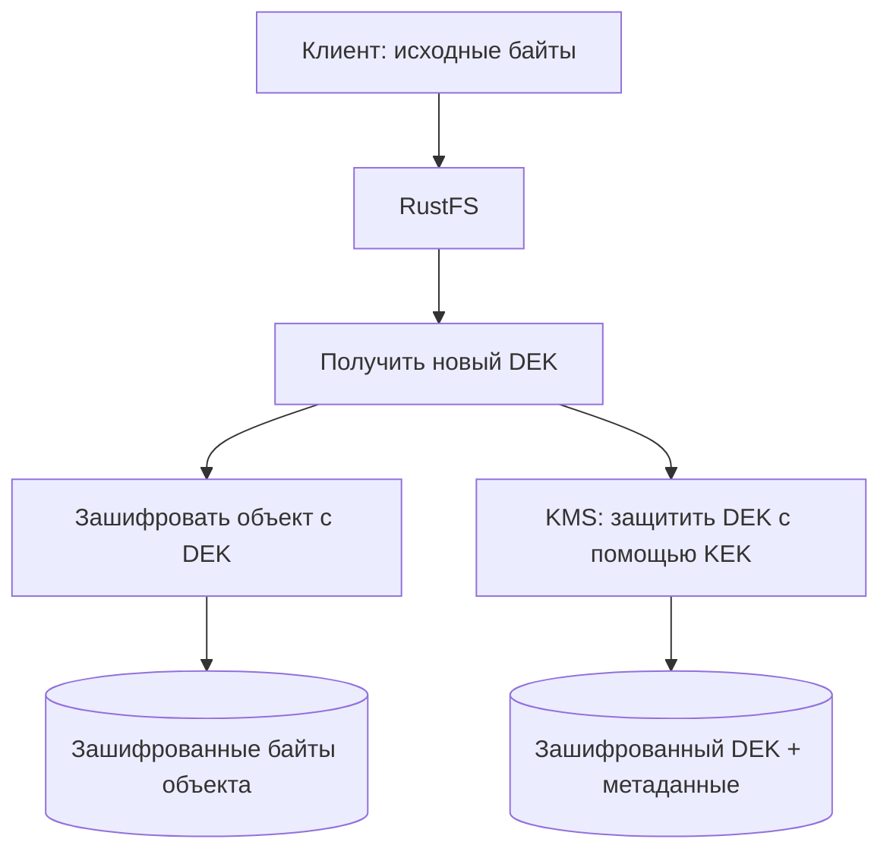

# Урок 16А. Что такое KMS и зачем шифровать ключи другими ключами

> [!abstract] Цель урока
> С нуля разобраться, что такое ключ шифрования, зачем нужны DEK и KEK, как работает **envelope encryption** и какую часть этой схемы выполняют RustFS и KMS. Подготовиться к урокам SSE-S3 и SSE-KMS.

**Предварительные знания:** объект, бакет, `PutObject` и `GetObject`. Знания криптографии не требуются.  
**Практическая среда:** RustFS Console на `http://127.0.0.1:9001`; Vault пока не нужен.  
**Критерий завершения:** ты можешь объяснить цепочку «данные → DEK → KEK», указать, где хранится каждый элемент, и прочитать состояние KMS в Console.  
**Время чтения:** до 5 минут; практика отдельно.

---

## 1. Что такое шифрование и ключ

**Шифрование** преобразует исходные байты (*plaintext*) в зашифрованные (*ciphertext*) с помощью алгоритма и **секретного ключа**. Обратная операция — **расшифрование**.

```text
Исходный объект + секретный ключ
              ↓
           Шифрование
              ↓
       Зашифрованный объект
```

Алгоритм (например, AES) **не обязан быть секретным**. Секретным должен оставаться ключ. **AES-256** означает использование ключа длиной 256 бит (32 байта); конкретный способ применения AES определяется режимом шифрования.

**Проблема:** если сохранить ключ рядом с зашифрованным объектом *в открытом виде*, тот, кто получил доступ к обоим, сможет прочитать данные. Значит, хранение ключей нужно организовать отдельно.

## 2. Два уровня ключей: DEK и KEK

| Термин | Назначение | Что им шифруют |
|---|---|---|
| **DEK — Data Encryption Key** | Ключ данных, предназначенный для конкретного объекта | **Байты объекта** |
| **KEK — Key Encryption Key** | Ключ защиты ключей; его также называют *master key* в схеме KMS | **Сам DEK** |

Пример с одним объектом `photo.jpg`:

```text
photo.jpg ──шифруем ключом DEK-1──► encrypted-photo
DEK-1    ──шифруем ключом KEK-A──► encrypted-DEK-1
```

Для другого объекта используется новый DEK. **Один KEK способен защищать множество разных DEK.**

Это и есть **envelope encryption** — конвертное шифрование, или «шифрование ключа ключом». Зашифрованный DEK называют **wrapped DEK**. Секретный KEK не нужно прикладывать к объекту.

> [!important] Где заканчивается цепочка?
> Можно зашифровать KEK ещё одним ключом, но цепочка не бывает бесконечной. В конечном счёте существует **корневой ключ или иной защищённый секрет**, доверие к которому обеспечивают хранилище ключей, управление доступом и инфраструктура. Дополнительные слои сами по себе не решают проблему защиты корня.

## 3. Что происходит при загрузке объекта (`PutObject`)

При включённом серверном шифровании RustFS работает по следующей логической схеме:



1. Клиент отправляет объект в RustFS.
2. RustFS с помощью KMS получает ключ данных **DEK**.
3. RustFS шифрует содержимое объекта с помощью DEK.
4. KMS **заворачивает DEK** — защищает его ключом KEK.
5. RustFS сохраняет **зашифрованный объект + wrapped DEK + служебные метаданные**.

**Открытый DEK не должен сохраняться на диске как обычные метаданные объекта.** Во время операции он доступен процессу, выполняющему шифрование. Ключ KEK остаётся под управлением выбранного KMS-бэкенда.

## 4. Что происходит при чтении (`GetObject`)

Процесс идёт в обратном порядке:

1. RustFS проверяет **S3-права доступа** запрашивающего клиента.
2. Находит зашифрованные байты и **wrapped DEK** нужного объекта или версии.
3. Обращается к KMS, чтобы **развернуть (unwrap)** DEK с помощью соответствующего KEK.
4. Расшифровывает объект восстановленным DEK.
5. Возвращает клиенту **исходные байты**, защищая их при передаче с помощью TLS, если используется HTTPS.

**Клиенту SSE-S3 и SSE-KMS не требуется знать DEK или KEK.** Он получает обычный ответ `GetObject` при наличии необходимых прав и доступности ключей.

> [!warning] Что защищает SSE, а что — нет
> Шифрование сохранённых объектов защищает данные *at rest*. Оно не заменяет HTTPS, IAM-политики и проверку личности. Если злоумышленник получил действующий S3-доступ на чтение, сервер сможет вернуть ему расшифрованный объект.

## 5. KMS — не просто папка с ключами

**KMS (Key Management Service)** — подсистема управления криптографическими ключами и операциями с ними. Она отвечает за создание или регистрацию ключей, контроль доступа, использование, ротацию и жизненный цикл ключевого материала.

Важно различать три вещи:

- **KMS key ID** — имя или идентификатор ключа (например, `rustfs-default-key`). **Не секрет** и **не сам ключ**.
- **KEK / master key material** — реальные секретные байты, которыми защищают DEK. Потеря нужного ключевого материала делает зависимые объекты нечитаемыми.
- **Токен доступа к KMS** — учётные данные, позволяющие RustFS обращаться к службе. Это **не KEK**, но его компрометация может позволить использовать ключи в пределах выданных прав.

**Ротация KEK** означает выпуск новой версии ключа для новых операций. Сохранённые объекты не перешифровываются автоматически; старые версии KEK должны оставаться доступными, пока от них зависят wrapped DEK.

## 6. Как это устроено в RustFS

В RustFS **SSE-S3 и SSE-KMS используют KMS** для защиты отдельных ключей данных объектов. Разница между режимами — в способе выбора KMS-ключа: по умолчанию или явно по **Key ID**.

| KMS Backend RustFS | Где находится мастер-ключ и что делает KMS |
|---|---|
| **Local** | Ключевой материал хранится на хосте RustFS; подходит для лаборатории при правильной защите и резервном копировании |
| **Vault KV v2** | Мастер-ключ хранится как секрет в Vault; RustFS получает материал ключа и выполняет wrapping самостоятельно |
| **Vault Transit** | RustFS вызывает криптографические операции Vault; материал Transit-ключа не требуется выдавать RustFS |

На твоём экране **Server-Side Encryption (SSE) Configuration**:

- `KMS Backend` выбирает способ работы с ключами.
- `Default SSE Key` задаёт **ID существующего ключа**, а не ввод его секретного значения.
- `Vault Server Address`, `Vault Token`, `Transit Mount Path` нужны для подключения к **Vault Transit**.
- `KMS Status Overview: NOT CONFIGURED` означает, что рабочий KMS **не настроен**. Смена значения в выпадающем списке сама по себе не создаёт ключ.

**Vault** — отдельный сервис, а не часть S3 API. **AWS KMS** — другая реализация службы управления ключами. Значение `aws:kms` в S3-запросе RustFS означает режим API, **не подключение к AWS KMS**.

## 7. Лаборатория в Console и проверка понимания

**Пока ничего не изменяй и не сохраняй.** Открой `http://127.0.0.1:9001`, войди в Console и перейди в **Server-Side Encryption (SSE) Configuration**.

1. В **KMS Status Overview** запиши `Backend Type`, `Status`, `Health` и `Default SSE Key`.
2. Найди **KMS Backend**. Сопоставь варианты с тремя способами хранения и применения KEK из раздела 6.
3. Найди **Default SSE Key** и ответь: почему сюда нельзя просто вставить придуманный пароль и считать KMS готовым?
4. Найди **Vault Token** и объясни, чем токен отличается от ID ключа и самого KEK.
5. Открой список настроек **Advanced Settings** и найди параметры KMS-кеша, если они доступны в твоей версии Console. Объясни, почему кеш может влиять на доступность чтения при кратковременном сбое KMS.

**Контрольные вопросы:**

- [ ] Почему нельзя хранить DEK открытым рядом с объектом?
- [ ] Что шифрует сам объект: DEK или KEK?
- [ ] Где хранится wrapped DEK и почему его можно хранить рядом с объектом?
- [ ] Почему восстановление зашифрованного бакета требует ещё и восстановления ключей KMS?
- [ ] Если KEK ротировали, что нужно сохранить для чтения старых объектов?

> [!success] Результат урока
> **DEK шифрует объект; KEK защищает DEK; KMS управляет KEK и операциями над ключами.** RustFS хранит зашифрованный объект и защищённый DEK. Без доступного KMS-ключа наличие файлов объекта не гарантирует возможность его расшифровать.

## 8. Источники

1. [RustFS — SSE-KMS и бэкенды Local / Vault KV2 / Vault Transit](https://docs.rustfs.com/en/security-compliance/encryption/kms)
2. [RustFS — SSE-S3 и ключи данных](https://docs.rustfs.com/en/security-compliance/encryption/sse-s)
3. [AWS KMS — Envelope encryption](https://docs.aws.amazon.com/kms/latest/developerguide/kms-cryptography.html)
4. [HashiCorp Vault — Transit secrets engine](https://developer.hashicorp.com/vault/docs/secrets/transit)

**Следующий урок:** №17 — SSE-S3; затем №18 — SSE-KMS и практическое подключение Vault.  
**Дата сверки документации:** 2026-10-23.
