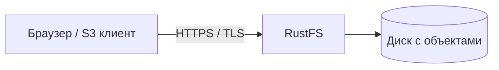

# Урок 16. TLS: защита соединения с RustFS

> [!abstract] Цель урока
> Понять, какие участки передачи защищает TLS, зачем нужен сертификат и как включить HTTPS для S3 API и Console в локальном RustFS.

**Предварительные знания:** HTTP, endpoint, SigV4, Docker Compose.  
**Практическая среда:** лаборатория урока 1, `fish`, OpenSSL, `curl`, Firefox.  
**Критерий завершения:** API и Console доступны по HTTPS, сертификат проверен, разница между TLS и SSE понятна.  
**Время чтения:** до 5 минут; лаборатория отдельно.

---

## 1. Какую проблему решает TLS

**TLS (Transport Layer Security)** защищает данные **во время передачи** между двумя участниками соединения. HTTPS — HTTP поверх TLS.

- **Конфиденциальность:** посторонний участник сети не читает содержимое трафика.
- **Целостность:** изменение данных в пути обнаруживается.
- **Подлинность сервера:** клиент проверяет сертификат и имя сервера.

`SigV4` — другая задача: S3 проверяет, **кто подписал запрос и не изменились ли подписанные поля**. Подпись не шифрует содержимое объекта. TLS не заменяет IAM и политики доступа.

## 2. Где проходит граница защиты



TLS защищает канал **до точки завершения TLS**. Если перед RustFS стоит Nginx/Caddy, возможен другой вариант:

```text
Клиент -- HTTPS --> Reverse proxy -- HTTP или HTTPS --> RustFS
```

Во втором варианте участок `proxy → RustFS` защищается отдельно. **TLS не шифрует объекты на диске** — это задача SSE.

## 3. Что настраивается в RustFS

В лаборатории существуют два адреса:

| Listener | Без TLS | С TLS |
|---|---|---|
| S3 API | `http://127.0.0.1:9000` | `https://127.0.0.1:9000` |
| Console | `http://127.0.0.1:9001` | `https://127.0.0.1:9001` |

В RustFS оба listener используют настройку сервера **`RUSTFS_TLS_PATH`**. Сертификат и ключ должны называться `rustfs_cert.pem` и `rustfs_key.pem`. Это **не** параметр страницы SSE Configuration и **не** параметр OIDC Providers.

## 4. Лаборатория: создаём локальный сертификат

Перейди в каталог с `compose.yaml` из урока 1 и выполни:

```fish
mkdir -p tls
openssl req -x509 -newkey rsa:2048 -sha256 -nodes -days 7 \
  -keyout tls/rustfs_key.pem -out tls/rustfs_cert.pem \
  -subj "/CN=localhost" \
  -addext "subjectAltName=DNS:localhost,IP:127.0.0.1"
chmod 600 tls/rustfs_key.pem
sudo chown 10001:10001 tls/rustfs_key.pem tls/rustfs_cert.pem
```

В **существующий** сервис `rustfs` в `compose.yaml` добавь, не удаляя старые поля:

```yaml
environment:
  RUSTFS_TLS_PATH: /opt/tls
volumes:
  - ./tls:/opt/tls:ro
```

> [!warning] Это фрагменты внутри уже имеющихся `environment` и `volumes`, а не новые дублирующиеся секции. Сохрани старый том `rustfs-data:/data` и остальные переменные.

Примени конфигурацию:

```fish
docker compose config -q
docker compose up -d
```

Сертификат **самоподписанный и лабораторный**. В рабочей системе нужен сертификат от доверенного УЦ и защищённое хранение private key.

## 5. Проверяем в `curl` и Firefox

```fish
curl --cacert tls/rustfs_cert.pem -i https://127.0.0.1:9000/health
curl --cacert tls/rustfs_cert.pem -i https://127.0.0.1:9001/
```

1. Первая команда должна подтвердить TLS-соединение и ответ health endpoint.
2. Вторая проверяет TLS на listener Console; конечный HTTP-статус зависит от маршрута.
3. Открой `https://127.0.0.1:9001` в Firefox, изучи предупреждение о недоверенном локальном сертификате. Для лаборатории разреши исключение **только для этого адреса**.
4. Открой информацию о соединении и посмотри сертификат, имя `127.0.0.1` в SAN и срок его действия.

**Не считай `curl -k` полноценной проверкой TLS:** эта опция отключает проверку подлинности сервера.

## 6. Архитектурные последствия

- В **presigned URL** схема `http://` или `https://` определяет транспорт: подпись не делает HTTP защищённым.
- В **SSE-C** ключ передаётся вместе с запросом — для такой операции требуется HTTPS.
- При **OIDC** корректный публичный HTTPS-адрес и точный callback URL нужны для надёжного входа.
- Для backend важно проверять сертификат S3 endpoint, а не просто включить шифрование.

## 7. Самостоятельные задания и результат

- [ ] Объясни, почему SigV4 не заменяет TLS.
- [ ] Проверь оба порта по HTTPS с проверкой сертификата.
- [ ] Назови участок, который **не защищён TLS**, если reverse proxy подключается к RustFS по HTTP.
- [ ] Объясни, почему после включения HTTPS файлы в Docker volume не становятся автоматически зашифрованными.

> [!success] Результат
> TLS защищает **передачу**, SSE — **хранение**, IAM — **право доступа**. Это независимые механизмы.

## 8. Источники

- [RustFS — TLS Configuration](https://docs.rustfs.com/en/integration/tls-configured)
- [RustFS — Environment Variables: TLS](https://docs.rustfs.com/en/reference/environment-variables)
- [Amazon S3 — Encryption in transit](https://docs.aws.amazon.com/AmazonS3/latest/userguide/UsingEncryptionInTransit.html)

**Следующий урок:** №17 — SSE-S3.  
**Дата сверки документации:** 2026-10-23.
