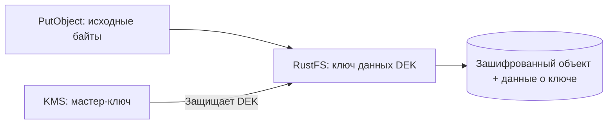

# Урок 17. SSE-S3: шифрование объектов силами хранилища

> [!abstract] Цель урока
> Понять, как RustFS шифрует объекты при записи, почему SSE-S3 зависит от KMS и как проверить режим `AES256` через S3 API и Console.

**Предварительные знания:** объекты и метаданные S3, TLS, AWS CLI.  
**Практическая среда:** RustFS, Console, AWS CLI, `fish`.  
**Критерий завершения:** настроена и проверена запись/чтение SSE-S3 либо точно установлено, какая зависимость KMS отсутствует.  
**Время чтения:** до 5 минут; практика отдельно.

---

## 1. Что означает SSE-S3

**SSE (Server-Side Encryption)**: клиент отправляет объект в хранилище, а сервер шифрует данные перед сохранением и расшифровывает их при разрешённом чтении.

**SSE-S3** — режим, в котором клиент **не создаёт, не передаёт и не хранит** ключ шифрования объекта. Через S3 API он обозначается `AES256`.

Это **не сквозное шифрование**: RustFS получает исходные байты и после проверки прав может вернуть их в открытом виде. SSE не заменяет TLS и не запрещает чтение пользователю с доступом `s3:GetObject`.

## 2. Как RustFS работает с ключами



RustFS создаёт **отдельный ключ данных (DEK)** для каждого шифруемого объекта. Настроенный **KMS** защищает этот DEK посредством envelope encryption — «шифрования ключа ключом».

При чтении RustFS восстанавливает ключ данных с помощью KMS и расшифровывает содержимое. **Потеря KMS-ключа означает потерю возможности прочитать соответствующие объекты.**

> [!important] Специфика RustFS
> Согласно документации RustFS, **SSE-S3 требует работающий KMS**. Это не следует переносить по аналогии с реализацией AWS S3.

## 3. Что проверять в Console

1. Открой **Server-Side Encryption (SSE) Configuration** — экран из присланного скриншота.
2. В **KMS Status Overview** изучи `Status`, `Health` и `Default SSE Key`.
3. Если там **NOT CONFIGURED**, не считай SSE-S3 готовым к работе.
4. Перейди к настройкам своего тестового бакета и найди **Encryption / Default encryption**, **если этот раздел есть в твоей сборке**. Console может не показывать управление правилом бакета; в таком случае используй S3 API или `rc`.

**Важно:** успешное сохранение *правила шифрования бакета* не доказывает, что RustFS сможет зашифровать новую запись при выключенном KMS.

## 4. Два способа выбрать SSE-S3

**На отдельном объекте:** передать при `PutObject` заголовок:

```http
x-amz-server-side-encryption: AES256
```

**По умолчанию для бакета:** задать правило `SSE-S3`. Оно применяется к **новым записям**, которые не указали собственный режим шифрования. Через клиент `rc`, если он установлен:

```fish
rc bucket encryption set rustfs/lesson17 --mode sse-s3
rc bucket encryption info rustfs/lesson17
```

Здесь `rustfs` — заранее настроенный alias клиента `rc`, а `lesson17` — созданный тестовый бакет. Правило не перезаписывает старые версии объектов и не шифрует их задним числом.

## 5. Лаборатория: проверяем фактическую запись

Создай в Console бакет `lesson17` и локальный файл:

```fish
printf 'SSE-S3 test\n' > sse-s3.txt
set EP http://127.0.0.1:9000
```

Если в уроке 16 включён TLS, используй `https://127.0.0.1:9000` и добавь в команды AWS CLI `--ca-bundle tls/rustfs_cert.pem`.

```fish
aws --endpoint-url $EP s3api put-object \
  --bucket lesson17 --key secure.txt --body sse-s3.txt \
  --server-side-encryption AES256
```

**При KMS Status = NOT CONFIGURED запись может завершиться ошибкой.** Зафиксируй код ответа, затем настрой KMS в уроке 18 и повтори запрос.

После успешной записи:

```fish
aws --endpoint-url $EP s3api head-object \
  --bucket lesson17 --key secure.txt
aws --endpoint-url $EP s3api get-object \
  --bucket lesson17 --key secure.txt sse-s3-downloaded.txt
cmp sse-s3.txt sse-s3-downloaded.txt
```

Проверь в `HeadObject` поле `ServerSideEncryption: AES256`, если его возвращает установленная сборка, и совпадение содержимого. **Совпадение байтов само по себе не доказывает шифрование на диске.**

## 6. Ограничения и границы

- Выключение bucket default влияет на **будущие записи**, а не на уже зашифрованные объекты.
- Пользователь с корректными S3-правами читает объект без знания DEK или KMS master key.
- При недоступности KMS операции с зашифрованными объектами зависят от доступности нужного ключа и кеша.
- `AES256` — режим API, а не инструкция пользователю передать ключ AES.

## 7. Самостоятельные задания и результат

- [ ] Найди экран KMS Status и запиши его состояние.
- [ ] Отправь `PutObject` с `AES256`; зафиксируй результат.
- [ ] После настройки KMS проверь `HeadObject`, `GetObject`, `cmp`.
- [ ] Объясни, почему отключение default encryption не расшифровывает существующие версии.

> [!success] Результат
> SSE-S3 управляет шифрованием **объектов при записи**. В RustFS для этого требуется работоспособный KMS, даже если клиент не управляет конкретным ключом.

## 8. Источники

- [RustFS — SSE-S3](https://docs.rustfs.com/en/security-compliance/encryption/sse-s)
- [RustFS — SSE-KMS and KMS backends](https://docs.rustfs.com/en/security-compliance/encryption/kms)
- [Amazon S3 — Server-side encryption](https://docs.aws.amazon.com/AmazonS3/latest/userguide/serv-side-encryption.html)

**Следующий урок:** №18 — SSE-KMS.  
**Дата сверки документации:** 2026-10-23.
