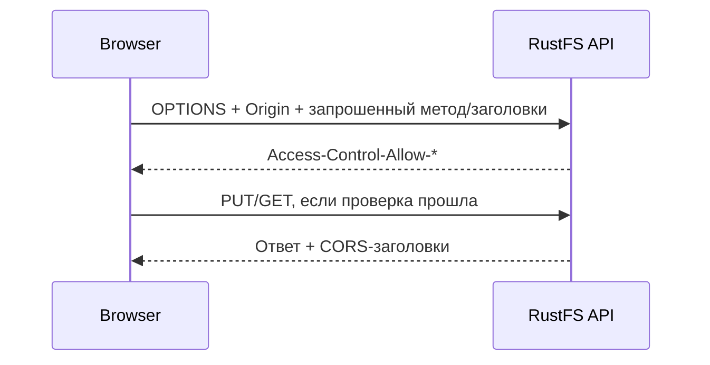

# Урок 20. CORS: браузерные запросы к RustFS

> [!abstract] Цель урока
> Разобраться, зачем браузеру CORS, почему presigned URL может не работать из JavaScript и как проверить разрешённый и запрещённый origin в RustFS.

**Предварительные знания:** HTTP, presigned URL, S3 API, TLS.  
**Практическая среда:** RustFS, Docker Compose, `curl`, Firefox DevTools, AWS CLI.  
**Критерий завершения:** проверена разница CORS-заголовков для двух origin и воспроизведён запрос в браузере.  
**Время чтения:** до 5 минут; практика отдельно.

---

## 1. Что проверяет CORS

**CORS (Cross-Origin Resource Sharing)** — набор HTTP-заголовков, по которым **браузер** решает, может ли JavaScript одной страницы получить ответ от другого origin.

**Origin = схема + hostname + порт.** Например:

- `http://localhost:3000` — страница frontend.
- `http://127.0.0.1:9000` — S3 API RustFS.

Это разные origin: отличается и hostname, и порт. **CORS не проверяет S3-права** и не заменяет SigV4, IAM или bucket policy. `curl` CORS не ограничивается.

## 2. Когда браузер отправляет preflight

Для некоторых cross-origin запросов браузер сначала отправляет **`OPTIONS` preflight**:



- `Access-Control-Allow-Origin` — разрешённый origin.
- `Access-Control-Allow-Methods` — разрешённые HTTP-методы.
- `Access-Control-Allow-Headers` — разрешённые заголовки запроса.
- `Access-Control-Expose-Headers` — дополнительные заголовки ответа, доступные JavaScript.

Даже подписанный `PUT` по presigned URL может **не быть отправлен браузером**, если preflight не прошёл.

## 3. Где настраивается CORS в RustFS

Для проверенной серверной конфигурации RustFS используются **две отдельные переменные**:

| Переменная                            | Для какого listener     |
| ------------------------------------- | ----------------------- |
| `RUSTFS_CORS_ALLOWED_ORIGINS`         | S3 API на порту `9000`  |
| `RUSTFS_CONSOLE_CORS_ALLOWED_ORIGINS` | Console на порту `9001` |

В отличие от привычных настроек CORS **на уровне бакета AWS S3**, документированная здесь конфигурация RustFS задаёт список origin для **S3 listener**. На присланных страницах **SSE Configuration** и **OIDC Providers** CORS не настраивается.

При пустом `RUSTFS_CORS_ALLOWED_ORIGINS` RustFS не добавляет общие CORS-заголовки. `*` разрешает произвольные origin, но не credentialed browser requests. Для приложения задай **явный** список.

## 4. Лаборатория: разрешаем один origin

В `compose.yaml` добавь **в существующий `environment` сервиса `rustfs`**:

```yaml
RUSTFS_CORS_ALLOWED_ORIGINS: "http://localhost:3000"
```

Примени изменение:

```bash
docker compose up -d
```

Если после урока 16 работает HTTPS, в командах ниже измени `http://127.0.0.1:9000` на `https://127.0.0.1:9000` и добавь `--cacert tls/rustfs_cert.pem` для `curl`.

## 5. Сравниваем заголовки

**Разрешённый origin:**

```bash
curl -i -H 'Origin: http://localhost:3000' \
  http://127.0.0.1:9000/
```

**Не включённый в список origin:**

```bash
curl -i -H 'Origin: http://localhost:4000' \
  http://127.0.0.1:9000/
```

Сравни `Access-Control-Allow-Origin` и не путай его с кодом S3 (`403 AccessDenied` здесь допустим). Для проверки preflight:

```bash
curl -i -X OPTIONS http://127.0.0.1:9000/lesson20/example.txt \
  -H 'Origin: http://localhost:3000' \
  -H 'Access-Control-Request-Method: PUT' \
  -H 'Access-Control-Request-Headers: content-type'
```

Проверяй возвращённые `Access-Control-Allow-*`: отсутствие нужного метода или заголовка не даст браузеру выполнить запрос.

## 6. Эксперимент через Firefox

1. Создай бакет `lesson20`, загрузи `hello.txt` и сформируй **presigned GET URL** (при необходимости через `aws s3 presign`).
2. В отдельном терминале выполни `python -m http.server 3000` в пустом тестовом каталоге.
3. Открой **`http://localhost:3000`** в Firefox и нажми **F12 → Console / Network**.
4. В JS Console выполни `fetch('ВСТАВЬ_PRESIGNED_URL').then(r => r.text()).then(console.log).catch(console.error)`.
5. Посмотри заголовки, возможную ошибку CORS и код ответа RustFS; затем исключи `localhost:3000` из списка и повтори.

**Важно:** если presigned URL указывает на HTTP, а страница на HTTPS, браузер дополнительно применяет правила mixed content. Это другой механизм.

## 7. Самостоятельные задания и результат

- [ ] Объясни, почему `curl` может получить ответ, а `fetch` — не прочитать его.
- [ ] Сравни два origin и ответ на `OPTIONS`.
- [ ] Назови различие между `Allow-Origin` и правом `s3:GetObject`.
- [ ] Объясни, почему совпадение доменного имени при разных портах не делает origin одинаковыми.

> [!success] Результат
> CORS ограничивает **браузерный JavaScript**, а не сам S3 API. Подпись и права решают, разрешена ли операция; CORS — разрешено ли браузеру выполнить и прочитать соответствующий cross-origin обмен.

## 8. Источники

- [RustFS — CORS Configuration](https://docs.rustfs.com/en/administration/cors)
- [RustFS — Environment Variables](https://docs.rustfs.com/en/reference/environment-variables)
- [Amazon S3 — CORS](https://docs.aws.amazon.com/AmazonS3/latest/userguide/cors.html)

**Следующий урок:** №21 — OIDC Settings.  
**Дата сверки документации:** 2026-10-23.
