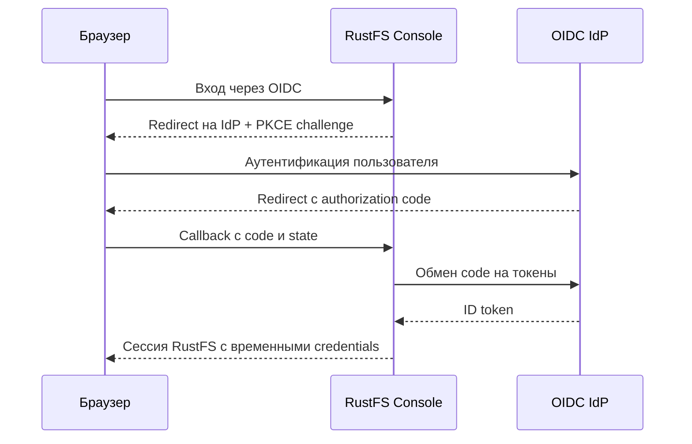

# Урок 21. OIDC Settings: вход в RustFS через внешнего провайдера

> [!abstract] Цель урока
> Разобраться в OIDC Authorization Code Flow, отделить внешнюю аутентификацию от прав RustFS и научиться читать форму **OIDC Providers** из Console.

**Предварительные знания:** IAM Policy/Users/Groups, STS, временные credentials, HTTPS.  
**Практическая среда:** RustFS Console и браузер; для полноценного входа — настроенный Keycloak или иной OIDC provider.  
**Критерий завершения:** понятны все поля OIDC Providers, callback URL и связь OIDC claims с RustFS Policy; выполнена проверка provider при наличии IdP.  
**Время чтения:** до 5 минут; настройка IdP отдельно.

---

## 1. Зачем нужен OIDC

**OIDC (OpenID Connect)** — протокол аутентификации **поверх OAuth 2.0**. Он позволяет использовать внешний **Identity Provider (IdP)**, например Keycloak, для входа в Console без локального пароля RustFS у каждого сотрудника.

- **IdP** отвечает на вопрос **«кто вошёл?»**.
- **RustFS IAM Policies** отвечают на вопрос **«что этому пользователю разрешено?»**.
- После успешного входа RustFS создаёт сессию с **временными STS credentials**.

**ID token — JWT для подтверждения личности; S3 AccessKeyId/SecretAccessKey/SessionToken — отдельные данные для подписи S3-запросов.** Не считай их одним и тем же токеном.

## 2. Последовательность входа



RustFS проверяет подпись ID token через **JWKS**, а также `issuer`, `audience`, время действия и `nonce`. Затем значения групп/ролей из claims сопоставляются с **названиями локальных IAM policies**.

## 3. Поля формы OIDC Providers в твоём Console

| Поле | Назначение |
|---|---|
| **Provider ID** | Стабильный ID интеграции; используется в callback URL |
| **Enabled** | Включить или выключить этот provider |
| **Display Name** | Название, которое видит пользователь на экране входа |
| **Configuration URL** | Адрес discovery-конфигурации IdP (информация об authorize/token/JWKS endpoints) |
| **Client ID** | Идентификатор приложения RustFS, зарегистрированного в IdP |
| **Client Secret** | Секрет этого приложения, **не** пароль пользователя и **не** S3 SecretAccessKey |
| **Scopes** | Запрашиваемые данные/права: `openid` обязателен; `profile,email` опциональны |
| **Other Audiences** | Дополнительные разрешённые значения `aud` токена, если этого требует интеграция |
| **Use Dynamic Redirect URI** | Формирование callback URL динамически; меняет правило выбора redirect |
| **Redirect URI** | Фиксированный адрес, на который IdP возвращает браузер после входа |
| **Advanced Settings** | Поля выбора `Claim Name`, `Groups Claim`, `Roles Claim` для идентичности и IAM mapping |

Верхний блок **Environment Managed** означает, что provider, заданный через переменные окружения, управляется **вне UI** и доступен только для чтения. Для изменений такой конфигурации нужно изменить окружение и перезапустить RustFS. Кнопка **Validate** проверяет настройки формы, **Save** сохраняет provider; в твоём экране указано, что изменения вступают в силу **после перезапуска RustFS**.

## 4. Что именно вносить в Redirect URI

Для фиксированного callback используй шаблон:

```text
https://rustfs.example.com/rustfs/admin/v3/oidc/callback/<provider-id>
```

Например, при `Provider ID = default` последняя часть — `/default`. **В IdP необходимо зарегистрировать точно такой же URL.**

Для учебного развёртывания предпочтителен **фиксированный Redirect URI**. Не включай dynamic redirect без понимания публичного адреса reverse proxy и соответствующих разрешений IdP.

> [!warning] Сторонний IdP — обязательная зависимость
> Пустая форма RustFS **не создаёт сервер OIDC и пользователей**. Для настоящего входа потребуется развернуть/настроить Keycloak (или другой IdP), создать там client, пользователей и claims.

## 5. Практика в Console

**Без внешнего IdP:**

1. Открой **OIDC Providers** и убедись, что список пуст (`No OIDC providers configured yet`).
2. Изучи **Add Provider**; оставь `openid,profile,email` и попробуй **Validate** без `Configuration URL` и `Client ID`.
3. Проверь, какие обязательные поля указывает форма. **Не сохраняй выдуманный provider**.
4. Раскрой **Advanced Settings** и найди поля сопоставления claims.

**Если Keycloak уже настроен:**

1. В Keycloak создай отдельный confidential client для RustFS, включи **Authorization Code + PKCE S256** и зарегистрируй точный callback.
2. В RustFS нажми **Add Provider**, задай `Provider ID`, `Display Name`, discovery URL, `Client ID`, `Client Secret`, `Scopes` и `Redirect URI`.
3. Укажи **Groups Claim = groups**, если IdP выпускает плоский массив `groups`; значения должны **совпадать с названиями RustFS policies** (например, `readonly`).
4. Нажми **Validate → Save**, перезапусти RustFS в соответствии с подсказкой UI, затем открой вход через OIDC в новом приватном окне.
5. Проверь: IdP принимает пароль, браузер возвращается на callback RustFS, Console открывается с ограничениями выбранной policy.

## 6. Типичные ошибки настройки

| Симптом | Что проверять |
|---|---|
| Redirect/callback error | Совпадение URI и `Provider ID`, HTTPS и адрес reverse proxy |
| Provider недоступен | Доступность discovery URL **из контейнера RustFS** и его TLS-сертификат |
| Login успешен, доступа нет | `groups`/`roles` claim и точное совпадение с RustFS Policy |
| Изменения не видны | Перезапуск RustFS и приоритет environment-managed конфигурации |
| Ошибка audience/issuer | `aud` и `iss` ID token, `Client ID`, конфигурация IdP |

## 7. Самостоятельные задания и результат

- [ ] Объясни разницу между ID token и STS SessionToken.
- [ ] Найди все поля формы OIDC Providers и объясни назначение каждого.
- [ ] Построй полный callback URL для `Provider ID = lab`.
- [ ] Объясни, почему пользователь может успешно пройти вход в Keycloak, но не получить доступ к бакету.

> [!success] Результат
> OIDC делегирует **аутентификацию** внешнему IdP. Доступ к S3 и Console по-прежнему определяется **IAM policies RustFS**, а сессия использует временные credentials.

## 8. Источники

- [RustFS — OIDC](https://docs.rustfs.com/en/security-compliance/oidc)
- [RustFS — Keycloak configuration](https://docs.rustfs.com/en/security-compliance/oidc/keycloak)
- [RustFS — IAM](https://docs.rustfs.com/en/security-compliance/iam)

**Следующий урок:** №22 — Event Notifications (бывший урок 17).  
**Дата сверки документации:** 2026-10-23.
