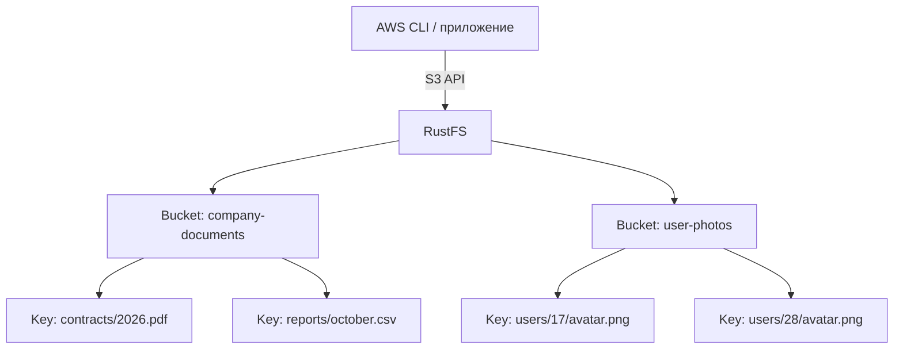
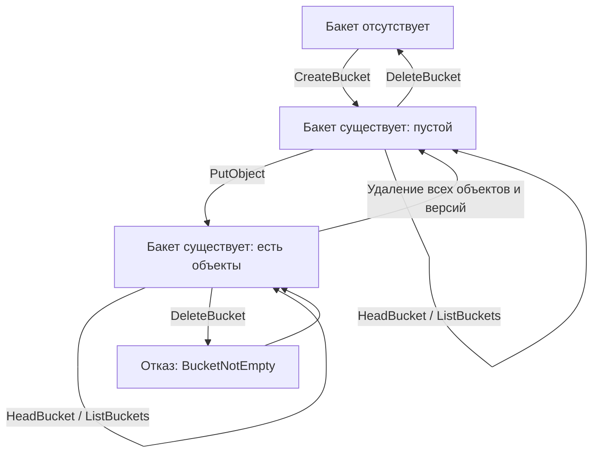
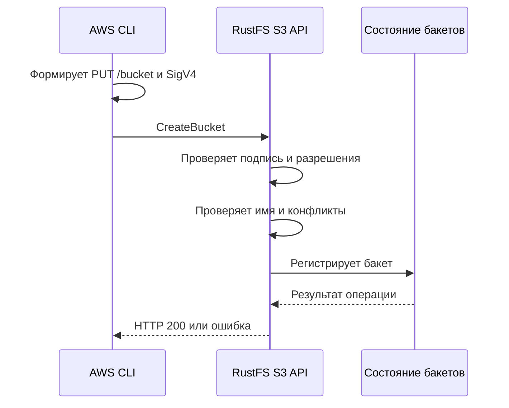

# Урок 03. Buckets: создание, перечисление, проверка и удаление

> [!abstract] Цель урока
> Понять, что представляет собой бакет в модели S3, для чего он нужен, чем его имя отличается от ключа объекта, где действуют ограничения имён и как устроен жизненный цикл бакета. Выполнить операции `CreateBucket`, `ListBuckets`, `HeadBucket`, `DeleteBucket` напрямую через AWS CLI и исследовать соответствующие HTTP-запросы.

**Предварительные знания:** уроки 1–2; `bucket`, `object`, `key`, `endpoint`, `region`, HTTP-методы и статус-коды; настроенный профиль `rustfs-lab`.  
**Практическая среда:** Arch Linux, `fish`, Docker Compose, локальный RustFS на `127.0.0.1:9000`, AWS CLI v2.  
**Критерий завершения:** через S3 API создан бакет, получен его список, выполнена проверка `HeadBucket`, продемонстрирован отказ в удалении непустого бакета и затем успешно удалён пустой учебный бакет. Данные предыдущих уроков сохранены.

---

## 1. Зачем нужен бакет

В уроке 1 мы определили объект как данные вместе с метаданными, а ключ — как идентификатор объекта внутри бакета. Рассмотрим приложение для хранения документов и фотографий:

```text
RustFS endpoint: http://127.0.0.1:9000
|
|-- Bucket: company-documents
|   |-- contracts/2026.pdf
|   `-- reports/october.csv
|
`-- Bucket: user-photos
    |-- users/17/avatar.png
    `-- users/28/avatar.png
```

**Bucket (бакет)** — именованный логический контейнер объектов S3. Бакет определяет область имён объектов и является отдельным ресурсом, к которому могут применяться настройки и политики.

В приведённой схеме:

1. `company-documents` и `user-photos` — два бакета.
2. `contracts/2026.pdf` и `users/17/avatar.png` — ключи объектов.
3. Полный логический адрес объекта определяется парой `(bucket, key)`; при обращении к конкретной версии добавляется `versionId`.
4. Один и тот же ключ `logo.png` может существовать в двух разных бакетах и обозначать разные объекты.



**Бакет не равен директории на диске** и не является физическим устройством. API описывает его как логический ресурс. Способ размещения данных и метаданных на носителях определяется реализацией сервиса.

> [!important] Что даёт бакет
> 1. Отдельное пространство ключей.  
> 2. Ресурс, которому можно назначать настройки и правила.  
> 3. Возможность организовать данные по приложениям, назначению и требованиям доступа.  
> **Но создание второго бакета само по себе не создаёт отдельный сервер, диск, копию данных или новую учётную запись.**

---

## 2. Идентичность бакета: имя, ключ и пространство имён

### 2.1. Имя бакета уникально в пространстве имён сервиса

**Namespace (пространство имён)** — область, внутри которой некоторый идентификатор обязан быть уникальным.

В бакете `documents` можно сохранить объект `report.pdf`. В другом бакете `archive` может существовать собственный объект с тем же ключом:

| Bucket | Key | Идентификатор объекта |
|---|---|---|
| `documents` | `report.pdf` | `(documents, report.pdf)` |
| `archive` | `report.pdf` | `(archive, report.pdf)` |
| `documents` | `2026/report.pdf` | `(documents, 2026/report.pdf)` |

Эти строки обозначают **три разных объекта**.

### 2.2. Где действует уникальность имени в AWS S3

В AWS S3 для обычных бакетов (*general purpose buckets*) имеются разные режимы имён:

- **Shared global namespace** — стандартное общее пространство имён: имя должно быть уникальным среди AWS-аккаунтов и регионов **в пределах AWS partition**. Нельзя создать второй бакет с тем же именем в другом регионе той же partition.
- **Account regional namespace** — отдельный режим AWS, в котором имя включает суффикс с идентификатором аккаунта и региона; это пространство зарезервировано для соответствующего аккаунта.

Наша лаборатория изучает обычные операции над бакетами в локальном RustFS. Мы **не используем** специальные API и имена account regional namespace.

### 2.3. Где действует уникальность имени в RustFS

У локального RustFS собственное пространство имён. Имя, занятое в AWS S3, не препятствует созданию бакета с таким же именем в твоём локальном экземпляре RustFS.

```text
AWS S3:    s3://my-course-data        -> бакет в AWS
RustFS:    s3://my-course-data        -> бакет в локальном RustFS
```

Строка `s3://my-course-data` **не содержит endpoint**. Поэтому один и тот же S3 URI может обозначать разные ресурсы при использовании разных подключений.

> [!warning] `s3://` — не универсальный адрес сервера
> Чтобы однозначно указать хранилище, клиенту нужен S3 URI **и** конфигурация соединения: endpoint, region и учётные данные. При работе с AWS CLI всегда проверяй `--endpoint-url`, прежде чем создавать или удалять бакеты.

---

## 3. Правила именования бакетов

Для **AWS S3 general purpose buckets** применяются следующие основные ограничения:

| Правило | Значение |
|---|---|
| Длина | От 3 до 63 символов |
| Разрешённые символы | Строчные латинские буквы `a–z`, цифры `0–9`, точка `.`, дефис `-` |
| Первый и последний символ | Буква или цифра |
| Две точки подряд | Запрещены |
| Имя в формате IP-адреса | Запрещено (`192.168.1.10`) |
| Зарезервированные префиксы и суффиксы | Запрещены; полный перечень — в документации AWS |

Примеры:

| Имя | Проверка основных правил | Причина |
|---|---|---|
| `s3-course-lesson03` | Допустимо | Строчные буквы, цифры, дефисы |
| `documents-2026` | Допустимо | Верный формат |
| `PhotoStorage` | Недопустимо | Заглавные буквы |
| `user_files` | Недопустимо | Символ `_` |
| `-documents` | Недопустимо | Начинается с дефиса |
| `a..b` | Недопустимо | Две точки подряд |
| `192.168.1.10` | Недопустимо | Формат IP-адреса |

**Допустимость формата не доказывает доступность имени:** в AWS имя может уже принадлежать другому аккаунту, а некоторые строки зарезервированы.

Почему в наших лабораторных именах нет точек:

- Дефисы проще использовать при настройке виртуальных хостов.
- Точки в именах бакетов создают ограничения при использовании некоторых схем HTTPS и TLS-сертификатов.
- AWS рекомендует избегать точек, кроме специальных случаев (например, статического веб-хостинга).

> [!note] AWS S3 против RustFS
> Таблица выше фиксирует правила **AWS S3 general purpose buckets**. RustFS поддерживает базовые операции с бакетами, но точную проверку каждого пограничного имени следует проводить на установленной версии RustFS. Нельзя автоматически считать две реализации идентичными во всех проверках.

**Вопрос:** может ли ключ объекта содержать `reports/2026.pdf`, хотя имя бакета не может содержать `/`? **Да.** У имени бакета и ключа объекта разные ограничения.

---

## 4. Жизненный цикл бакета и четыре операции API

**Жизненный цикл** — последовательность состояний ресурса и операций, изменяющих эти состояния.



Смысл операций:

| Операция S3 API | HTTP | Ресурс | Назначение | Успех в AWS S3 |
|---|---|---|---|---|
| `CreateBucket` | `PUT` | `/{bucket}` | Создать бакет | `200 OK` |
| `ListBuckets` | `GET` | `/` | Перечислить бакеты владельца | `200 OK` |
| `HeadBucket` | `HEAD` | `/{bucket}` | Проверить доступ к бакету | `200 OK` |
| `DeleteBucket` | `DELETE` | `/{bucket}` | Удалить пустой бакет | `204 No Content` |

Примеры путей приведены для **path-style addressing**, которое мы используем в локальном RustFS. Запросы подписываются AWS Signature Version 4.

> [!important] Разные операции отвечают на разные вопросы
> `ListBuckets` — «Какие бакеты принадлежат учётной записи?»  
> `HeadBucket` — «Могу ли я успешно обратиться к этому бакету?»  
> `CreateBucket` — «Можно ли создать бакет с этим именем?»  
> `DeleteBucket` — «Можно ли удалить этот бакет сейчас?»

---

## 5. `CreateBucket`: создание бакета

### 5.1. Что передаёт клиент

Для нашей конфигурации локального RustFS запрос выглядит так:

```http
PUT /s3-course-lesson03 HTTP/1.1
Host: 127.0.0.1:9000
X-Amz-Date: <UTC_TIMESTAMP>
Authorization: <SIGV4_AUTHORIZATION>
Content-Length: 0
```

Это **учебное представление** HTTP-запроса: реальные заголовки и их порядок определяет AWS CLI. В `Authorization` находится подпись, вычисленная клиентом.

В этом примере:

1. `PUT` — HTTP-метод создания ресурса на указанном адресе.
2. `/s3-course-lesson03` — путь к бакету.
3. Тело запроса пустое, поскольку регион лаборатории — `us-east-1`.
4. Сервер проверяет подпись, разрешения, имя и наличие конфликтов.
5. При успехе сервер регистрирует новый бакет.

> [!warning] Не путай `PUT Bucket` и `PUT Object`
> `PUT /s3-course-lesson03` создаёт **бакет**.  
> `PUT /s3-course-lesson03/notes.txt` записывает **объект** с ключом `notes.txt` в существующий бакет.  
> HTTP-метод совпадает; смысл определяется адресом ресурса.

### 5.2. Как выглядит успешный ответ

Упрощённый пример ответа AWS S3:

```http
HTTP/1.1 200 OK
Location: /s3-course-lesson03
```

`Location` указывает на созданный ресурс; набор заголовков RustFS может отличаться. Сам по себе успешный ответ на `CreateBucket` **не означает**, что в бакете появились какие-либо объекты.

### 5.3. Почему мы используем `us-east-1`

Для стандартного AWS S3 `CreateBucket` при создании бакета в `us-east-1` **не требуется** указывать `LocationConstraint`. Для других регионов обычного AWS S3 клиент обычно передаёт соответствующий регион в `CreateBucketConfiguration`.

```fish
# Наша лаборатория RustFS: us-east-1, без LocationConstraint
aws --profile rustfs-lab \
    --endpoint-url $RUSTFS_ENDPOINT \
    s3api create-bucket \
    --bucket s3-course-lesson03
```

Для сравнения — **только синтаксический пример AWS S3**, не выполняй его в лаборатории RustFS:

```fish
aws --profile REAL_AWS_PROFILE \
    --region eu-central-1 \
    s3api create-bucket \
    --bucket UNIQUE_REAL_AWS_BUCKET_NAME \
    --create-bucket-configuration LocationConstraint=eu-central-1
```

- `--region` настраивает регион клиента.
- `LocationConstraint` задаёт регион создания обычного бакета AWS.
- `--endpoint-url` направляет запрос в конкретный сервис хранения.

В локальном RustFS `us-east-1` **не означает**, что данные физически находятся в США. Они хранятся в Docker-томе лаборатории.

---

## 6. `ListBuckets`: перечисление бакетов

`ListBuckets` возвращает сведения о бакетах, принадлежащих отправителю запроса в AWS S3. Это **не список объектов**.

```http
GET / HTTP/1.1
Host: 127.0.0.1:9000
Authorization: <SIGV4_AUTHORIZATION>
```

Сокращённый учебный пример XML-ответа:

```xml
<ListAllMyBucketsResult>
  <Owner>
    <ID>EXAMPLE_OWNER_ID</ID>
  </Owner>
  <Buckets>
    <Bucket>
      <Name>s3-course-lesson1</Name>
      <CreationDate>2026-10-19T12:00:00.000Z</CreationDate>
    </Bucket>
    <Bucket>
      <Name>s3-course-lesson03</Name>
      <CreationDate>2026-10-19T13:00:00.000Z</CreationDate>
    </Bucket>
  </Buckets>
</ListAllMyBucketsResult>
```

Имена и даты здесь **иллюстративные**, не результат запроса к твоему серверу.

| Поле | Смысл |
|---|---|
| `Owner` | Владелец возвращаемых бакетов в модели AWS |
| `Buckets` | Коллекция записей о бакетах |
| `Name` | Имя бакета |
| `CreationDate` | Время создания бакета |

Актуальный AWS API поддерживает дополнительные поля и параметры перечисления, включая пагинацию. Мы работаем с небольшим числом бакетов, поэтому эти параметры сейчас не нужны.

После получения XML AWS CLI преобразует данные в собственный формат вывода — например, JSON:

```json
{
  "Buckets": [
    {"Name": "s3-course-lesson1", "CreationDate": "2026-10-19T12:00:00+00:00"},
    {"Name": "s3-course-lesson03", "CreationDate": "2026-10-19T13:00:00+00:00"}
  ],
  "Owner": {"ID": "EXAMPLE_OWNER_ID"}
}
```

> [!note] Не смешивай две операции
> `ListBuckets` — перечень **бакетов** у учётной записи.  
> `ListObjectsV2` — перечень **объектов внутри одного указанного бакета**. Последнюю операцию подробно изучим в уроке 5.

---

## 7. `HeadBucket`: проверка существования и доступа

`HEAD` — метод HTTP для получения статуса и заголовков ответа **без тела ответа**.

```http
HEAD /s3-course-lesson03 HTTP/1.1
Host: 127.0.0.1:9000
Authorization: <SIGV4_AUTHORIZATION>
```

При успешном запросе AWS S3 возвращает `200 OK` и заголовки, в том числе сведения о регионе бакета:

```http
HTTP/1.1 200 OK
x-amz-bucket-region: us-east-1
```

- `200` означает, что бакет существует и запрос разрешён.
- `400`, `403` или `404` при проверке через AWS могут означать, что бакета нет либо доступ к нему ограничен; точное объяснение **нельзя вывести только из ответа `HEAD`**.
- У `HeadBucket` **нет XML-тела с кодом ошибки** — это важное отличие от многих других S3-операций.
- Заголовок региона документирован для AWS S3; его фактическое наличие в RustFS проверяем на установленной версии.

**Строгий вывод:** отсутствие успешного `HeadBucket` **не доказывает**, что бакет не существует. Проверка объединяет вопросы существования и разрешённого доступа.

---

## 8. `DeleteBucket`: удаление пустого бакета

```http
DELETE /s3-course-lesson03-disposable HTTP/1.1
Host: 127.0.0.1:9000
Authorization: <SIGV4_AUTHORIZATION>
```

При успешном удалении обычного бакета AWS S3 возвращает:

```http
HTTP/1.1 204 No Content
```

**Ограничение:** перед удалением бакет должен быть пустым. В AWS требуется удалить все объекты, **включая версии объектов и delete markers**, если включено версионирование.

Пример ошибки удаления непустого бакета:

```xml
<Error>
  <Code>BucketNotEmpty</Code>
  <Message>The bucket you tried to delete is not empty</Message>
</Error>
```

Это сокращённое представление ошибки; реальные тексты и заголовки могут отличаться.

> [!warning] Удаление бакета — административная операция
> Не применяй очистку `--recursive`, `--force` или `docker compose down -v` к учебному хранилищу без проверки адреса, профиля и содержимого. В практической части удаляем **только специально созданный временный бакет** `s3-course-lesson03-disposable`.

---

## 9. Лаборатория: подготовка окружения

Продолжаем использовать RustFS из урока 1 и профиль AWS CLI из урока 2. **Новый контейнер не создаём.**

### 9.1. Запусти RustFS и проверь API

```fish
cd ~/s3-course/lesson-01

docker compose up -d
docker compose ps
curl -i http://127.0.0.1:9000/health
```

**Критерий успеха:** RustFS запущен; health-проверка отвечает `200 OK`.

### 9.2. Восстанови переменные текущего сеанса fish

```fish
set -gx RUSTFS_ENDPOINT http://127.0.0.1:9000
set -gx MAIN_BUCKET s3-course-lesson03
set -gx TEMP_BUCKET s3-course-lesson03-disposable
```

Если ты оставлял терминал открытым после урока 2, первая переменная уже существует. Повторное присваивание выставляет то же значение.

### 9.3. Проверь конфигурацию клиента

```fish
aws --version
aws configure list --profile rustfs-lab
aws configure get region --profile rustfs-lab
aws configure get s3.addressing_style --profile rustfs-lab
```

Ожидаемые настройки:

| Параметр | Значение |
|---|---|
| Профиль | `rustfs-lab` |
| Region | `us-east-1` |
| Addressing style | `path` |
| Endpoint | `http://127.0.0.1:9000` (явно в командах) |

Убедись, что **Secret Access Key не выводится** в историю терминала, заметку или скриншот. Не копируй содержимое `~/.aws/credentials` в отчёт.

### 9.4. Получи исходный список бакетов

```fish
aws --profile rustfs-lab \
    --endpoint-url $RUSTFS_ENDPOINT \
    s3api list-buckets \
    --query 'Buckets[].Name' \
    --output json
```

Запиши имена бакетов. После урока 1 среди них должен находиться `s3-course-lesson1`, если его не удаляли. В этом уроке **не удаляем и не меняем** данные из предыдущих упражнений.

---

## 10. Практика №1 — `CreateBucket`

### 10.1. Создай основной бакет урока

```fish
aws --profile rustfs-lab \
    --endpoint-url $RUSTFS_ENDPOINT \
    s3api create-bucket \
    --bucket $MAIN_BUCKET
```

**Ожидаемый результат:** команда завершается успешно; AWS CLI может вывести поле `Location` либо другой набор полей, предусмотренный ответом сервера и версией клиента.

> [!note] Повторный запуск
> Если `s3-course-lesson03` уже был создан ранее, не пытайся исправлять ситуацию удалением его вместе с содержимым. Перейди к `HeadBucket` и убедись, что работаешь с существующим учебным ресурсом.

### 10.2. Проверь создание через `ListBuckets`

```fish
aws --profile rustfs-lab \
    --endpoint-url $RUSTFS_ENDPOINT \
    s3api list-buckets \
    --query 'Buckets[].Name' \
    --output json
```

**Критерий успеха:** в списке есть значение `s3-course-lesson03`.

### 10.3. Сопоставь с высокоуровневой командой

```fish
aws --profile rustfs-lab \
    --endpoint-url $RUSTFS_ENDPOINT \
    s3 ls
```

Сравни две команды:

- `aws s3api list-buckets` выполняет операцию `ListBuckets`.
- `aws s3 ls` выводит список бакетов в удобном текстовом формате.

**Содержательная разница:** обе команды используют S3 API; различается представление результата и интерфейс CLI.

---

## 11. Практика №2 — `HeadBucket`

### 11.1. Проверь существующий бакет

```fish
aws --profile rustfs-lab \
    --endpoint-url $RUSTFS_ENDPOINT \
    s3api head-bucket \
    --bucket $MAIN_BUCKET

printf 'Exit code: %s\n' $status
```

**Критерий успеха:** команда `head-bucket` выполняется без ошибки; код завершения равен `0`. Отсутствие текстового вывода **не является ошибкой**: метод `HEAD` не передаёт тело ответа.

### 11.2. Проверь отсутствующий бакет

Для контролируемой проверки используй отдельное имя, которое ты ещё не создавал:

```fish
aws --profile rustfs-lab \
    --endpoint-url $RUSTFS_ENDPOINT \
    s3api head-bucket \
    --bucket s3-course-does-not-exist-lesson03

printf 'Exit code: %s\n' $status
```

Ожидается ненулевой код завершения, если бакет отсутствует. Запиши **фактический HTTP-статус** и сообщение AWS CLI. Не делай вывода о существовании произвольного чужого бакета по одному неуспешному `HEAD`.

### 11.3. Разбери метод и адрес

Для `HeadBucket` в лаборатории:

| Часть запроса | Значение |
|---|---|
| Method | `HEAD` |
| URL | `http://127.0.0.1:9000/s3-course-lesson03` |
| Bucket | `s3-course-lesson03` |
| Key | Отсутствует |
| Body запроса | Не требуется |
| Body ответа | Отсутствует |

---

## 12. Практика №3 — отказ в удалении непустого бакета

Эта практика демонстрирует, что удаление **объекта** и удаление **бакета** — разные действия. Используем отдельный временный бакет; основной `s3-course-lesson03` оставим для урока 4.

### 12.1. Создай временный бакет

```fish
aws --profile rustfs-lab \
    --endpoint-url $RUSTFS_ENDPOINT \
    s3api create-bucket \
    --bucket $TEMP_BUCKET
```

Если имя уже занято в **твоём локальном RustFS**, проверь этот бакет через `HeadBucket` и убедись, что он принадлежит только данному упражнению и не содержит нужных данных. В противном случае выбери новое имя временного бакета и присвой его переменной `TEMP_BUCKET`.

### 12.2. Положи в него один объект

Выполни в каталоге `~/s3-course/lesson-01`:

```fish
printf 'Temporary bucket deletion test\n' > lesson03-disposable.txt

aws --profile rustfs-lab \
    --endpoint-url $RUSTFS_ENDPOINT \
    s3api put-object \
    --bucket $TEMP_BUCKET \
    --key marker.txt \
    --body lesson03-disposable.txt
```

Мы используем знакомый `PutObject` только для подготовки эксперимента. Подробный разбор данных объекта и заголовков отложен до урока 4.

**Проверь содержимое временного бакета:**

```fish
aws --profile rustfs-lab \
    --endpoint-url $RUSTFS_ENDPOINT \
    s3api list-objects-v2 \
    --bucket $TEMP_BUCKET \
    --query 'Contents[].Key' \
    --output json
```

Ожидаемый ключ: `marker.txt`.

### 12.3. Попробуй удалить непустой бакет

```fish
aws --profile rustfs-lab \
    --endpoint-url $RUSTFS_ENDPOINT \
    s3api delete-bucket \
    --bucket $TEMP_BUCKET

printf 'Exit code: %s\n' $status
```

**Критерий успеха эксперимента:** сервер отказывает в удалении; в S3-совместимом поведении это ошибка `BucketNotEmpty` (HTTP `409 Conflict`). Если твоя версия RustFS даёт другой результат, сохрани фактический код и проверь совместимость установленной сборки.

### 12.4. Удали объект, затем сам бакет

Сначала удаляем только специально созданный объект:

```fish
aws --profile rustfs-lab \
    --endpoint-url $RUSTFS_ENDPOINT \
    s3api delete-object \
    --bucket $TEMP_BUCKET \
    --key marker.txt
```

Проверь, что объектов больше нет:

```fish
aws --profile rustfs-lab \
    --endpoint-url $RUSTFS_ENDPOINT \
    s3api list-objects-v2 \
    --bucket $TEMP_BUCKET \
    --query 'Contents[].Key' \
    --output json
```

Для пустого бакета поле `Contents` отсутствует, а JMESPath-запрос выше может вернуть `null` вместо пустого массива. **Не считай `null` ошибкой сервера**: это результат обработки отсутствующего поля клиентом.

Теперь удаляй бакет:

```fish
aws --profile rustfs-lab \
    --endpoint-url $RUSTFS_ENDPOINT \
    s3api delete-bucket \
    --bucket $TEMP_BUCKET
```

**Критерий успеха:** команда завершилась без ошибки; в стандартном AWS S3 HTTP-ответ — `204 No Content`.

### 12.5. Проверь состояние после удаления

```fish
aws --profile rustfs-lab \
    --endpoint-url $RUSTFS_ENDPOINT \
    s3api list-buckets \
    --query 'Buckets[].Name' \
    --output json
```

Проверка:

- `s3-course-lesson03-disposable` отсутствует.
- `s3-course-lesson03` присутствует.
- Все бакеты предыдущих уроков сохранились.

> [!important] Вывод из эксперимента
> 1. `PutObject` создаёт объект внутри бакета, но не создаёт новый бакет.  
> 2. `DeleteBucket` не удаляет автоматически объекты в стандартном S3 API.  
> 3. `DeleteObject` не удаляет бакет.  
> 4. Успешность удаления бакета зависит от его состояния и прав доступа.

---

## 13. Исследуем HTTP-запросы и коды ответов

В уроке 2 мы использовали `--debug`, чтобы увидеть сформированный AWS CLI запрос. Теперь проведём такой опыт для `HeadBucket`: он не изменяет данные.

### 13.1. Сохрани диагностический журнал

```fish
aws --profile rustfs-lab \
    --endpoint-url $RUSTFS_ENDPOINT \
    --debug \
    s3api head-bucket \
    --bucket $MAIN_BUCKET \
    1> lesson03-head-stdout.txt \
    2> lesson03-head-debug.log
```

- `stdout` — обычный вывод команды (при успехе остаётся пустым).
- `stderr` — диагностические записи AWS CLI.
- `--debug` не меняет логику самой S3-операции.

**Не публикуй сырой debug-журнал:** в нём могут присутствовать `Authorization`, идентификаторы ключей и другие данные запроса.

### 13.2. Найди фактический запрос

Изучи журнал локально:

```fish
rg 'Making request|Response headers|HTTP/1.1|status_code|x-amz-bucket-region' \
    lesson03-head-debug.log
```

Если `rg` не установлен, используй `grep -E` с теми же выражениями.

Найди и запиши в свою заметку **без учётных данных**:

1. Метод `HEAD`.
2. Фактический URL запроса.
3. HTTP-статус.
4. Наличие либо отсутствие `x-amz-bucket-region`.
5. Наличие либо отсутствие тела ответа.

### 13.3. Сопоставь операции и HTTP

| Операция | Метод | Путь при path-style | Тело успешного ответа |
|---|---|---|---|
| `CreateBucket` | `PUT` | `/s3-course-lesson03` | Не требуется для базового ответа |
| `ListBuckets` | `GET` | `/` | XML с бакетами |
| `HeadBucket` | `HEAD` | `/s3-course-lesson03` | Нет |
| `DeleteBucket` | `DELETE` | `/s3-course-lesson03-disposable` | Нет (`204`) |

> [!note] Точность эксперимента
> Таблица показывает **контракт базовых операций**. Фактические HTTP-заголовки, значения `RequestId` и диагностические сообщения зависят от версии RustFS и AWS CLI. Источник истины для локального эксперимента — сохранённый журнал.

---

## 14. Ошибки и граничные случаи

### 14.1. `BucketAlreadyExists` и `BucketAlreadyOwnedByYou`

Две разные ситуации в AWS:

- `BucketAlreadyExists` — имя занято другим владельцем в соответствующем общем пространстве имён (`409`).
- `BucketAlreadyOwnedByYou` — бакет с таким именем уже принадлежит запросившему аккаунту (`409` в большинстве регионов).

**Особенность `us-east-1`:** в стандартном AWS S3 повторное создание собственного обычного бакета в `us-east-1` возвращает `200 OK`; это задокументированное исключение, связанное с прежней совместимостью. **Не переноси это правило автоматически на RustFS.**

### 14.2. `InvalidBucketName`

Имя не проходит правила именования сервиса. Для AWS это отдельная ошибка клиента; RustFS сверяем экспериментом и журналами установленной версии.

### 14.3. `AccessDenied`

Наличие корректных учётных данных **не гарантирует разрешение** выполнить операцию. AWS S3 использует IAM-разрешения, например:

| Операция | Основное разрешение AWS |
|---|---|
| `CreateBucket` | `s3:CreateBucket` |
| `ListBuckets` | `s3:ListAllMyBuckets` |
| `HeadBucket` | `s3:ListBucket` |
| `DeleteBucket` | `s3:DeleteBucket` |

Это названия действий **AWS IAM**; модель и детали конфигурации прав RustFS рассматриваем отдельно в уроке 12.

### 14.4. `BucketNotEmpty`

Бакет содержит объекты, версии или delete markers. Для AWS S3 успешное удаление возможно только после соответствующей очистки.

### 14.5. Почему не стоит считать `404` единственной проверкой отсутствия

| Ответ | Что можно заключить |
|---|---|
| `HeadBucket` → `200` | Бакет существует, операция разрешена |
| `HeadBucket` → `403` | В доступе отказано; существование не доказано и не опровергнуто |
| `HeadBucket` → `404` | В AWS S3 ответ `HEAD` не содержит объяснения ошибки; используй контекст и права |
| `DeleteBucket` → `409 BucketNotEmpty` | Для успешного удаления необходимо освободить бакет |

**Не делай архитектурное решение «бакет отсутствует, значит надо создать» только на основании любого ненулевого кода от `HeadBucket`.** Сначала разделяй сетевую ошибку, отсутствие разрешения и отсутствие ресурса.

---

## 15. Что делает система внутри — модель без выдумывания деталей реализации

Для `CreateBucket` можем выделить **логические действия**, которые необходимы для исполнения контракта API:



Таблица отделяет наблюдаемый API-контракт от внутренних деталей:

| Действие | Можно установить по API | Что требует отдельного исследования |
|---|---|---|
| Создать бакет | Бакет появился в списке | Как RustFS хранит запись о бакете |
| Перечислить бакеты | Сервер возвращает имена | Какие структуры данных используются внутри |
| Проверить бакет | Сервер возвращает статус и заголовки | Как организованы кэши и проверки IAM |
| Удалить бакет | Ресурс исчезает из списка | Как очищается внутренняя служебная информация |

**Нельзя заключать**, что бакет — это отдельная папка, таблица PostgreSQL или физический раздел диска: S3 API этого не определяет.

**Нельзя заключать**, что два бакета обеспечивают физическую избыточность: в нашей лаборатории RustFS использует один узел с одним хранилищем данных (SNSD).

---

## 16. Изоляция данных: что обеспечивает бакет, а что нет

Слово *изоляция* используется в разных смыслах. Их следует различать.

| Вид разделения | Что означает | Даёт ли сам по себе отдельный бакет? |
|---|---|---|
| Идентификаторы | Ключ `a.txt` в одном бакете независим от `a.txt` в другом | **Да** |
| Настройки | Для бакетов можно задавать разные поддерживаемые настройки | **Да**, на уровне ресурса |
| Права доступа | Один клиент может читать один бакет, но не другой | **Только при соответствующих политиках** |
| Физический диск | Объекты размещены на разных носителях | **Нет** |
| Отказоустойчивость | При потере одного диска сохраняется другая копия | **Нет** |
| Отдельные учётные данные | У каждого бакета автоматически свои Access Key/Secret Key | **Нет** |

Пример для будущего облачного сервиса:

```text
Bucket: user-files
|
|-- users/101/report.pdf
|-- users/102/report.pdf
`-- users/103/photo.png
```

Здесь есть один бакет и префиксы пользователей. Это допустимая схема организации данных, но **префикс не является границей доступа автоматически**. Проверки полномочий должны выполняться на уровне backend и/или политик объектного хранилища.

Альтернативная организация:

```text
Bucket: user-101-files
Bucket: user-102-files
Bucket: user-103-files
```

Создание бакета на каждого пользователя **не является обязательным свойством S3**. Выбор между общим бакетом и несколькими бакетами зависит от ограничений, безопасности, стоимости администрирования и требований приложения. К этому решению вернёмся в итоговом проекте.

---

## 17. Сравнение AWS S3 и RustFS

| Параметр | AWS S3 | Локальный RustFS |
|---|---|---|
| Основной интерфейс | Amazon S3 API | S3-совместимый API |
| `CreateBucket` / `ListBuckets` | Поддерживаются | Поддерживаются и входят в проверяемое подмножество совместимости |
| `HeadBucket` / `DeleteBucket` | Поддерживаются | Поддерживаются и входят в проверяемое подмножество совместимости |
| Размещение | Регион AWS, выбранный для бакета | Локальное хранилище, подключённое к контейнеру |
| Регион лаборатории | `us-east-1` — реальный регион AWS | `us-east-1` — регион по умолчанию для S3-подписи и совместимости |
| Пространство имён | Общий global namespace либо специальный account regional namespace | Собственное пространство имён экземпляра RustFS |
| Проверки имён и пограничные случаи | Документированное поведение AWS | Требует проверки версии RustFS |
| IAM | AWS IAM, policies и permission evaluation | Собственная реализация управления доступом |
| Физическая топология | Управляется AWS | Один узел и Docker-том в текущей лаборатории |

Официальная матрица RustFS фиксирует **тестируемые возможности**, а не обещает идентичное поведение всех операций и крайних случаев AWS S3.

---

## 18. Самостоятельные задания

Выполняй последовательно. **Не удаляй бакеты из уроков 1 и 2.**

### Задание 1 — строгие определения

Одним предложением определи:

1. `Bucket`.
2. `Object key`.
3. `Namespace`.
4. `CreateBucket`.
5. `ListBuckets`.
6. `HeadBucket`.
7. `DeleteBucket`.
8. `BucketNotEmpty`.

### Задание 2 — пространства имён

В одном RustFS присутствуют бакеты `photos` и `archive`. В обоих хранится объект с ключом `2026/portrait.jpg`.

1. Сколько здесь бакетов и объектов?
2. Совпадают ли идентификаторы двух объектов?
3. Обязано ли совпадать их содержимое?
4. Могут ли эти два бакета лежать на одном физическом диске?
5. Почему строка `s3://photos/2026/portrait.jpg` не определяет сама по себе, AWS это или RustFS?

### Задание 3 — именование

Для **AWS S3 general purpose bucket** классифицируй имена по правилам формата:

```text
backup-2026
Backup-2026
user_files
my.bucket
192.168.0.1
x
storage--logs
storage..
```

Для каждого недопустимого имени укажи конкретное нарушенное правило. Для допустимого по формату имени объясни, гарантирована ли его доступность в общем namespace AWS.

### Задание 4 — жизненный цикл

В новой лаборатории создай бакет `s3-course-lesson03-task`, не удаляя основной бакет урока:

1. Вызови `CreateBucket`.
2. Убедись в его наличии через `ListBuckets`.
3. Проверь доступность через `HeadBucket`.
4. Удали **пустой** бакет через `DeleteBucket`.
5. Проверь, что его нет в списке.
6. Зафиксируй сопоставление `S3 API operation → HTTP method → path → HTTP status`.

### Задание 5 — анализ ошибки

Представим, что `HeadBucket` возвращает `403 Forbidden`:

1. Можно ли утверждать, что бакет не существует?
2. Можно ли утверждать, что он существует?
3. Почему невозможно прочитать `Code` из XML-тела ответа `HEAD`?
4. Какие параметры клиента и разрешения следует проверить?

### Задание 6 — лабораторный эксперимент

1. Подготовь отдельный временный бакет.
2. Загрузи в него один тестовый объект.
3. Выполни `DeleteBucket` и запиши ошибку.
4. Удали объект через `DeleteObject`.
5. Удали освободившийся бакет.
6. Объясни, почему `DeleteObject` и `DeleteBucket` не взаимозаменяемы.

### Задание 7 — архитектурное мышление

Сервис хранит файлы 10 000 пользователей. Предложены две модели:

- Модель A: один бакет `user-files`, ключи `users/{user_id}/{file_id}`.
- Модель B: отдельный бакет для каждого пользователя.

В 5–7 предложениях сравни **пространство имён, администрирование, настройку политик и изоляцию доступа**. Не обсуждай репликацию как автоматическое свойство бакета: её здесь нет.

---

## 19. Контрольные вопросы для перехода к уроку 4

- [ ] Я могу дать строгое определение бакета и объяснить его назначение.
- [ ] Я отличаю имя бакета от ключа объекта.
- [ ] Я понимаю, в каком пространстве имён требуется уникальность бакета.
- [ ] Я знаю основные правила именования AWS S3 general purpose buckets.
- [ ] Я различаю назначение `CreateBucket`, `ListBuckets`, `HeadBucket`, `DeleteBucket`.
- [ ] Я могу указать HTTP-метод и путь каждой операции при path-style.
- [ ] Я понимаю, почему `HeadBucket` не возвращает XML-тело.
- [ ] Я понимаю разницу между `403`, `404` и доказанным отсутствием бакета.
- [ ] Я понимаю, почему `DeleteBucket` не удаляет непустой бакет.
- [ ] Я создал, проверил и удалил учебный бакет через AWS CLI.
- [ ] Я не смешиваю логическую изоляцию бакетов, политики доступа и физическую отказоустойчивость.
- [ ] Я оставил `s3-course-lesson03` для следующего урока.

> [!success] Результат урока
> **Bucket — это логический ресурс и пространство имён объектов, а не папка на диске.** Его жизненный цикл управляется отдельными операциями S3 API. `CreateBucket` создаёт контейнер, `ListBuckets` перечисляет контейнеры, `HeadBucket` проверяет доступ, а `DeleteBucket` удаляет пустой контейнер. Права доступа и физическая избыточность — отдельные механизмы.

**Следующий урок:** **№4 — «Objects: содержимое, ключ, размер, PUT, GET, HEAD, DELETE»**. Запишем объект в бакет `s3-course-lesson03`, прочитаем его, получим метаданные без скачивания тела и исследуем удаление.

---

## Источники

1. [Amazon S3 — General purpose bucket naming rules](https://docs.aws.amazon.com/AmazonS3/latest/userguide/bucketnamingrules.html)
2. [Amazon S3 — Namespaces for general purpose buckets](https://docs.aws.amazon.com/AmazonS3/latest/userguide/gpbucketnamespaces.html)
3. [Amazon S3 API — CreateBucket](https://docs.aws.amazon.com/AmazonS3/latest/API/API_CreateBucket.html)
4. [Amazon S3 API — ListBuckets](https://docs.aws.amazon.com/AmazonS3/latest/API/API_ListBuckets.html)
5. [Amazon S3 API — HeadBucket](https://docs.aws.amazon.com/AmazonS3/latest/API/API_HeadBucket.html)
6. [Amazon S3 API — DeleteBucket](https://docs.aws.amazon.com/AmazonS3/latest/API/API_DeleteBucket.html)
7. [Amazon S3 — Error responses](https://docs.aws.amazon.com/AmazonS3/latest/developerguide/ErrorResponses.html)
8. [AWS CLI — create-bucket](https://docs.aws.amazon.com/cli/latest/reference/s3api/create-bucket.html)
9. [AWS CLI — head-bucket](https://docs.aws.amazon.com/cli/latest/reference/s3api/head-bucket.html)
10. [RustFS — S3 Compatibility Matrix](https://docs.rustfs.com/en/reference/s3-compatibility)
11. [RustFS — Bucket deletion](https://docs.rustfs.com/en/administration/data/bucket/deletion)
12. [RustFS — Python SDK guide, region and path-style](https://docs.rustfs.com/en/developer/sdk/python)

**Дата сверки с документацией:** 2026-10-19. Примеры HTTP и XML с заполнителями — учебные, а не записи с твоего сервера. Поведение установленного RustFS проверяется командами и журналами лаборатории.
