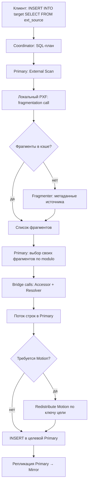

[[pxf_ingestion_visual_lab.html]]
[[Federated-Queries_Session.pdf]]
[[PXF-paper.pdf]]
https://blogs.vmware.com/tanzu/greenplum-pxf-for-federated-queries-gets-data-quickly-from-diverse-sources/

> [!summary] Суть
> **PXF (Platform Extension Framework)** позволяет Primary-сегментам Greenplum параллельно читать внешние источники (S3/MinIO, HDFS, Hive, JDBC) через Java-сервисы PXF.

## Архитектура

![[Pasted image 20261014144450.png|800]]
- **Coordinator** принимает SQL, строит план и распределяет его между сегментами.
- **Primary Segment** выполняет `External Scan`, запрашивает фрагменты, получает строки и участвует в `INSERT`.
- **PXF Extension** — нативная часть Greenplum для обмена с PXF по HTTP/REST.
- **PXF Server** — отдельный **Java/JVM-сервис**, в типовой схеме по одному на сегментный хост. Один сервис обслуживает несколько Primary; это не отдельный JVM-процесс на каждый сегмент или запрос.
- **Mirror Segment** не читает источник через PXF: он получает изменения от соответствующего Primary посредством репликации Greenplum.

| Компонент PXF | Функция |
|---|---|
| **Profile** | Выбирает сочетание реализаций Fragmenter, Accessor и Resolver под источник/формат (`s3:csv`, `hdfs:parquet`, `jdbc`). |
| **Fragmenter** | По метаданным источника формирует *логический список фрагментов*: файлы/диапазоны, HDFS splits, JDBC-партиции. Не скачивает строки. |
| **Accessor** | Читает записи назначенного фрагмента через API источника. |
| **Resolver** | Преобразует внешние записи в поля для Greenplum (и в обратную сторону при записи). |

`PROFILE=...` — **как** работать с данными; `SERVER=...` — **какую именованную конфигурацию подключения** использовать, а не имя отдельного Java-процесса.

## Dataflow: источник → обычная таблица Greenplum

1. Клиент запускает `INSERT INTO target SELECT ... FROM ext_source`. **Coordinator** строит и распределяет план.
2. Во время `External Scan` **каждый участвующий Primary** отправляет **fragmentation call** своему PXF Server.
3. PXF проверяет **локальный кэш фрагментов**. При отсутствии записи первый поток вызывает **Fragmenter**, который собирает метаданные из источника. Остальные потоки с тем же ключом используют готовый список.
4. Каждый Primary получает список фрагментов и **самостоятельно выбирает свои** с помощью детерминированного **modulo-based hashing**.
5. Для каждого назначенного фрагмента Primary делает **bridge call**. **Accessor** читает данные, **Resolver** преобразует записи; PXF передаёт строки обратно в Greenplum.
6. Данные обрабатываются **потоково**, а не загружаются целиком в RAM. Greenplum при необходимости выполняет **Redistribute Motion** по `DISTRIBUTED BY` целевой таблицы.
7. **Целевой Primary** выполняет `INSERT`; изменения реплицируются на его **Mirror**. PXF напрямую на Mirror ничего не вставляет.



> [!important] Два независимых распределения
> **PXF определяет, кто читает фрагмент.** `DISTRIBUTED BY` определяет, **где должна храниться строка**. Фрагментация не учитывает ключ целевой таблицы. `Redistribute Motion` возникает **по плану выполнения**, а не обязательно для любого `INSERT`.

## Кто реально запускает Fragmenter и когда

- Fragmentation происходит **при исполнении `External Scan`**, до чтения соответствующих фрагментов, а не при `CREATE EXTERNAL TABLE`.
- Кэш фрагментов **не общий для кластера**, он находится внутри **каждой PXF JVM**. Первый запрос с подходящим ключом вызывает Fragmenter, остальные используют кэш.
- Ключ кэша в описанной авторами PXF реализации включает конфигурационный сервер, ID транзакции GP, путь к ресурсу и предикаты запроса.
- TTL по умолчанию — **`10s`** (`pxf.fragmenter-cache.expiration`), значение настраивается. После истечения TTL фрагментация может повториться.

**Пример кластера:** 1 Coordinator + 2 физических сегментных хоста; на каждом по 2 Primary и 2 Mirror, зеркала размещены перекрёстно.

- **4 Primary** → 4 fragmentation calls при одном сканировании всеми четырьмя Primary.
- **2 PXF JVM** → **2 фактических запуска Fragmenter** при успешном использовании кэша (по одному на JVM). Без попадания в кэш запусков может быть больше.
- Mirror в чтении не участвуют.

## Как Primary выбирает фрагменты

**Подтверждённая формула одной опубликованной реализации** `FilterFragmentsForSegment()` в `pxf_fragment.c`:

$$
S = (I + (gp\_session\_id \bmod N) + gp\_command\_count) \bmod N
$$

- `I` — **позиция** фрагмента в полученном списке (с нуля), **не ключ распределения таблицы**.
- `N` — число участвующих GP-сегментов в рассматриваемом сканировании.
- `S` — GP Segment, которому достаётся фрагмент.
- Смещение по сессии и команде меняет назначение между запросами и улучшает балансировку небольших списков.

**Пример:** `N=4`, `gp_session_id=13`, `gp_command_count=2`. Смещение: `13 % 4 + 2 = 3`.

| Primary | Его фрагменты из `F0 … F7` |
|---|---|
| 0 | F1, F5 |
| 1 | F2, F6 |
| 2 | F3, F7 |
| 3 | F0, F4 |

Каждый Primary получает **одинаковый упорядоченный список** и оставляет элементы, удовлетворяющие правилу для его ID. Для корректного согласованного назначения списки должны совпадать. Фактическая политика распределения зависит от версии PXF и коннектора (в частности, у JDBC есть дополнительные настройки).

## Пример SQL: S3 CSV → таблица Greenplum

```sql
-- После установки PXF и настройки доступа к S3:
CREATE EXTENSION IF NOT EXISTS pxf;

CREATE EXTERNAL TABLE ext_orders (
    order_id BIGINT,
    customer_id BIGINT,
    amount NUMERIC(12,2)
)
LOCATION (
    'pxf://bucket/orders/?PROFILE=s3:csv&SERVER=s3_prod&SKIP_HEADER_COUNT=1'
)
FORMAT 'CSV';

CREATE TABLE orders (
    order_id BIGINT,
    customer_id BIGINT,
    amount NUMERIC(12,2)
) DISTRIBUTED BY (customer_id);

EXPLAIN (COSTS OFF)
INSERT INTO orders SELECT * FROM ext_orders;

INSERT INTO orders SELECT * FROM ext_orders;
ANALYZE orders;

SELECT gp_segment_id, COUNT(*)
FROM orders
GROUP BY gp_segment_id
ORDER BY gp_segment_id;
```

`SERVER=s3_prod` требует предварительной конфигурации в `$PXF_BASE/servers/s3_prod/`. Параметры зависят от профиля и версии PXF. `DROP EXTERNAL TABLE ext_orders` удаляет **только определение**, но не файлы в S3.

## Минимальный CLI и диагностика

```bash
pxf version               # Версия PXF
pxf status                # Статус локального PXF Server
pxf cluster status        # Статусы по кластеру
pxf cluster sync          # Синхронизация конфигураций
pxf cluster restart       # Перезапуск после изменений
# pxf cluster start / stop — запуск / остановка
```

```sql
SELECT extname, extversion
FROM pg_extension
WHERE extname = 'pxf';

EXPLAIN (COSTS OFF)
INSERT INTO orders SELECT * FROM ext_orders;
```

- **Настройки:** `$PXF_BASE/conf/pxf-application.properties`, `$PXF_BASE/conf/pxf-env.sh`; подключения — `$PXF_BASE/servers/<name>/`.
- **Ресурсы:** PXF расходует CPU, RAM и сеть сегментных хостов. `pxf.max.threads` — лимит рабочих потоков Tomcat (**200** по умолчанию в рассматриваемой документации), а **не** формула «по одному потоку на сегмент».
- **Производительность:** достаточное число фрагментов сопоставимого размера, пропускная способность источника, сеть, Memory/CPU PXF и стоимость Motion. Единого гарантированного оптимального числа фрагментов нет.

## Источники и применимость

- [PXF: Enabling Parallel Query Processing](https://blogs.vmware.com/tanzu/wp-content/uploads/sites/154/2025/04/pxf-paper.pdf) — разделы **4.1, 4.2–4.4, 5.6** (fragmentation calls, компоненты, локальный кэш).
- [Greengage: конфигурация PXF](https://greengagedb.org/en/docs-pxf/current/pxf_configuration_files.html) — TTL `10s`, `pxf.max.threads`, конфигурационные файлы.
- [Greengage: пример S3 CSV](https://greengagedb.org/ru/docs-gg/current/example_s3_text.html) — `PROFILE=s3:csv`, `SKIP_HEADER_COUNT`.

Связано: [[gpfdist_Greenplum|gpfdist — параллельный файловый сервер]].
