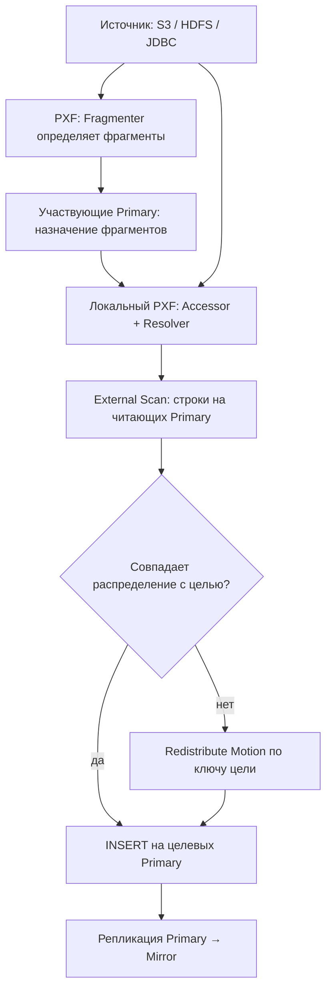

# PXF — параллельный доступ к внешним данным

> [!summary] Суть
> **PXF (Platform Extension Framework)** — расширение Greenplum для параллельного чтения и записи во внешние системы (S3/MinIO, HDFS, Hive, JDBC и др.). **Coordinator управляет SQL, но полный поток входных данных не проходит через него.**

## Архитектура

- **Greenplum**: Coordinator планирует запрос; **Primary-сегменты** исполняют план и хранят данные; **Mirror** поддерживает резервную копию своего Primary.
- **PXF Extension**: нативный обработчик протокола `pxf://` в Greenplum.
- **PXF Server**: отдельный **Java/JVM-сервис**, типично один на *физическом сегментном хосте*, даже если на нём несколько сегментов. При иной топологии размещение сервиса настраивается.
- **`PROFILE`** выбирает классы обработки; **`SERVER`** выбирает именованную конфигурацию доступа к источнику (это **не** отдельный Java-процесс).

| Компонент | Функция |
|---|---|
| **Fragmenter** | Определяет независимые части исходного набора (файлы, splits, диапазоны JDBC). |
| **Accessor** | Читает/записывает данные конкретной части через API источника. |
| **Resolver** | Преобразует внешние записи в поля Greenplum и обратно. |
| **Profile** | Связывает реализации компонентов для формата/источника. |

## Dataflow: загрузка в обычную таблицу GP



1. Клиент выполняет `INSERT INTO target SELECT ... FROM ext_source` через **Coordinator**.
2. **Fragmenter** формирует описания частей **независимо от ключа распределения целевой таблицы**.
3. Участвующие Primary вызывают PXF; **Accessor** получает данные; **Resolver** представляет их в формате полей Greenplum.
4. Строки поступают в `External Scan` сегментов **потоково**; весь источник не накапливается в RAM.
5. **Greenplum**, а не PXF, определяет целевой Primary по `DISTRIBUTED BY`; если нужно, выполняет **Redistribute Motion** (проверяется через `EXPLAIN`).
6. Primary физически вставляет строки, Mirror получает изменения посредством репликации Greenplum; **PXF не пишет напрямую в Mirror**.

> [!important] Два независимых распределения
> **Фрагмент PXF → кто читает данные.** `DISTRIBUTED BY` → **где строка будет храниться**. Это разные решения; `Redistribute Motion` не требует предварительно выгружать весь источник в память.

## Пример SQL: S3 → Greenplum

```sql
-- На выбранной БД, после установки PXF администраторами:
CREATE EXTENSION IF NOT EXISTS pxf;

CREATE EXTERNAL TABLE ext_orders (
    order_id BIGINT,
    customer_id BIGINT,
    amount NUMERIC(12,2)
)
LOCATION ('pxf://bucket/orders/?PROFILE=s3:csv&SERVER=s3_prod&SKIP_HEADER_COUNT=1')
FORMAT 'CSV';

CREATE TABLE orders (
    order_id BIGINT,
    customer_id BIGINT,
    amount NUMERIC(12,2)
) DISTRIBUTED BY (customer_id);

EXPLAIN INSERT INTO orders SELECT * FROM ext_orders;
INSERT INTO orders SELECT * FROM ext_orders;
ANALYZE orders;
```

`SERVER=s3_prod` требует предварительно настроенного каталога `$PXF_BASE/servers/s3_prod/`. Параметры URI и формат зависят от PXF-профиля.

## Минимальный CLI / диагностика

```bash
pxf version               # установленная версия
pxf status                # состояние сервиса на текущем хосте
pxf cluster status        # состояние сервисов в кластере
pxf cluster sync          # распространить конфигурацию с Coordinator
pxf cluster restart       # перезапустить после изменений конфигурации
# pxf cluster start / stop — управление сервисами кластера
```

```sql
SELECT extname, extversion FROM pg_extension WHERE extname = 'pxf';
EXPLAIN (COSTS OFF) INSERT INTO orders SELECT * FROM ext_orders;
SELECT gp_segment_id, COUNT(*) FROM orders GROUP BY 1 ORDER BY 1;
```

- **Конфигурация**: `$PXF_BASE/conf/`, `$PXF_BASE/servers/<name>/`; журналы — в каталоге логов PXF.
- **Ограничители**: сеть до источника, CPU/RAM JVM, число и размер фрагментов, мощность внешней БД, операции Motion.
- **`DROP EXTERNAL TABLE`** удаляет метаданные внешней таблицы, но **не файлы S3/HDFS**.
- **Версионность**: приведён современный CLI для PXF 6.x; у старых поставок другие переменные окружения (`PXF_CONF`) и команды первичной инициализации. Проверять `pxf help` и версию сервиса.

## Источники
- [EDB: PXF CLI](https://www.enterprisedb.com/docs/pxf/latest/reference/commands/)
- [Документация PXF: профили и архитектура](https://www.enterprisedb.com/docs/pxf/latest/)
- Связанное: [[gpfdist_Greenplum_Obsidian|gpfdist — параллельный файловый сервер]]
