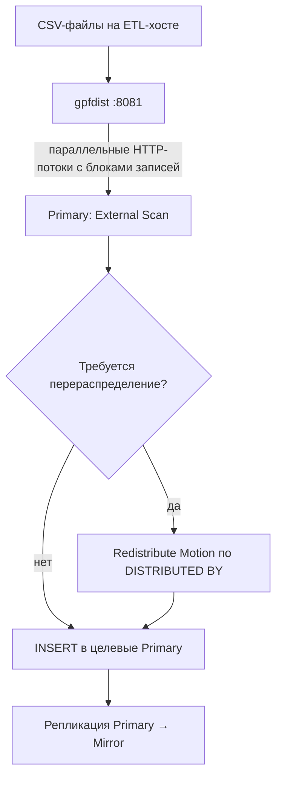

[[gpfdist_interactive_demo.html]]

# gpfdist — параллельная загрузка/выгрузка файлов

> [!summary] Суть
> **gpfdist** — отдельный файловый сервер (утилита Greenplum), который по HTTP обслуживает **несколько Primary-сегментов одновременно**. В отличие от PXF, это **не Java-фреймворк коннекторов**: никаких `Fragmenter`, `Accessor`, `Resolver`, `PROFILE`, `SERVER` здесь нет.

## Как это работает

1. Coordinator запускает распределённый план `INSERT INTO ... SELECT FROM external_table`.
    
2. Каждый участвующий Primary Segment устанавливает HTTP-соединение с `gpfdist` и отправляет `GET`.
    
3. `gpfdist` объединяет соединения одного сканирования в общую сессию по `X-GP-XID`, `X-GP-CID` и `X-GP-SN`.
    
4. `gpfdist` самостоятельно последовательно читает исходные файлы, формирует блоки из целых записей и распределяет их между подключёнными сегментами.
    
5. Каждый сегмент принимает назначенный ему поток записей и передаёт их в дальнейшие операторы SQL-плана.
    
6. При вставке Greenplum определяет целевой Primary по ключу `DISTRIBUTED BY` и при необходимости использует `Redistribute Motion`.
### Ещё два важных нюанса

- HTTP GET не отправляется на каждый блок. Сегмент устанавливает соединение и получает поток блоков. `gpfdist` продолжает выдавать данные по этому соединению, пока не закончится чтение.
    
- Назначение блоков не фиксируется по `segment_id`. Сегмент, которому достался конкретный блок при одном выполнении, при повторном запросе может получить другие данные. Сам файл при этом обрабатывается совместно всеми участниками одной сессии.


## Архитектура

- **gpfdist-процесс** запускается на машине с файлами, часто **отдельном ETL-хосте**; файлы берутся из каталога `-d`.
- **Greenplum Coordinator** принимает SQL, строит план и инициирует работу сегментов; не является транзитным узлом всех входных CSV-строк.
- **Primary-сегменты** параллельно подключаются к `gpfdist://host:port/...`, получают **блоки записей**, разбирают CSV/TEXT и передают строки в распределённый план.
- **Mirror-сегменты** не читают `gpfdist`; копия их Primary поддерживается средствами Greenplum (репликацией изменений).
- Протокол `gpfdists://` — вариант с TLS при соответствующей настройке `gpfdist --ssl`.

## Dataflow: файл → внутренняя таблица GP



1. Запустить `gpfdist` с каталогом входных файлов.
2. Создать **readable external table** с URI `gpfdist://...` (таблица — ссылка на файлы, не копия данных).
3. Выполнить **`INSERT INTO target SELECT * FROM ext_source`**.
4. gpfdist **потоково отдаёт блоки записей** читающим Primary; не нужно сначала скачать весь файл на каждый сегмент.
5. Greenplum применяет ключ целевой таблицы **`DISTRIBUTED BY`**; в плане **может** возникнуть `Redistribute Motion`. Источник не распределяет данные по ключу будущей таблицы.
6. Строки сохраняются на целевых Primary; изменения реплицируются в соответствующие Mirror.

> [!important] Параллелизм
> Один файл может обслуживать несколько потоков чтения; **не существует фиксированного правила «один файл = один сегмент»**. Число потоков зависит от участвующих Primary, конфигурации Greenplum, `gpfdist` и набора файлов. Распределение чтения и финальное распределение таблицы — **разные операции**.

## Быстрый пример: CSV → Greenplum

```bash
# На ETL-хосте. /srv/etl/sales.csv содержит заголовок + строки.
gpfdist -d /srv/etl -p 8081 -l /tmp/gpfdist.log &
gpfdist --version
ps -ef | grep '[g]pfdist'
ss -lnt | grep ':8081'
```

```sql
CREATE EXTERNAL TABLE ext_sales (
    id BIGINT,
    customer_id BIGINT,
    amount NUMERIC(12,2)
)
LOCATION ('gpfdist://etl-host:8081/sales.csv')
FORMAT 'CSV' (HEADER);

CREATE TABLE sales (
    id BIGINT,
    customer_id BIGINT,
    amount NUMERIC(12,2)
) DISTRIBUTED BY (customer_id);

EXPLAIN INSERT INTO sales SELECT * FROM ext_sales;
INSERT INTO sales SELECT * FROM ext_sales;
ANALYZE sales;

-- Посмотреть, где физически лежат строки:
SELECT gp_segment_id, COUNT(*) FROM sales GROUP BY 1 ORDER BY 1;
```

- `HEADER` означает, что первая строка файла — заголовок. Если указан шаблон файлов, **в каждом файле** должен быть заголовок.
- Внешняя таблица не копирует данные при `CREATE EXTERNAL TABLE`, только задаёт описание доступа.
- `DROP EXTERNAL TABLE ext_sales;` **не удаляет** исходный CSV.

## Выгрузка в файл (обратный поток)

```sql
CREATE WRITABLE EXTERNAL TABLE export_sales (
    id BIGINT,
    customer_id BIGINT,
    amount NUMERIC(12,2)
)
LOCATION ('gpfdist://etl-host:8081/export_sales.csv')
FORMAT 'CSV';

INSERT INTO export_sales SELECT * FROM sales;
```

В этом режиме **Primary → gpfdist → файл**. Файл формируется на хосте сервера gpfdist, а не на координаторе. Результирующий формат/число файлов зависит от конфигурации расположений и реализации.

## CLI / эксплуатация

```bash
gpfdist --help              # параметры
gpfdist --version           # версия утилиты
gpfdist -d /srv/etl -p 8081 -l /tmp/gpfdist.log &
ps -ef | grep '[g]pfdist'  # найти PID
kill <PID>                 # корректно остановить свой процесс
```

- **Порт**: `8081` в примере; нужен сетевой доступ **от всех участвующих сегментных хостов**.
- **Совместимость**: использовать `gpfdist` совместимой основной версии Greenplum.
- **Ресурсы**: важны сеть, дисковая скорость ETL-хоста, CPU, число параллельных подключений и скорость самого Greenplum.
- **Безопасность**: обычный `gpfdist://` не шифрует трафик; для TLS использовать `gpfdists://` и сертификаты.
- **План**: `EXPLAIN` позволяет проверить, есть ли `Redistribute Motion`; не следует считать его обязательным для любого INSERT.

## Сравнение с PXF

| | gpfdist | PXF |
|---|---|---|
| Источники | Файлы, отданные выделенным сервером | S3, HDFS, Hive, JDBC и другие |
| Процесс | Файловый сервер | JVM-сервис + расширение GP |
| Параллелизм | Блоки записей → сегменты | Фрагменты источника → сегменты |
| Ключ целевой таблицы | Применяется в плане GP | Применяется в плане GP |

## Источники
- [Greenplum 6: gpfdist](https://docs-cn.greenplum.org/v6/utility_guide/admin_utilities/gpfdist.html)
- [Greenplum 6: CREATE EXTERNAL TABLE](https://docs-cn.greenplum.org/v6/ref_guide/sql_commands/CREATE_EXTERNAL_TABLE.html)
- [Greengage: Use gpfdist](https://greengagedb.org/en/docs-gg/6.30.1/use_gpfdist.html)
- Связанное: [[PXF_Greenplum_Obsidian|PXF — параллельный доступ к внешним данным]]
